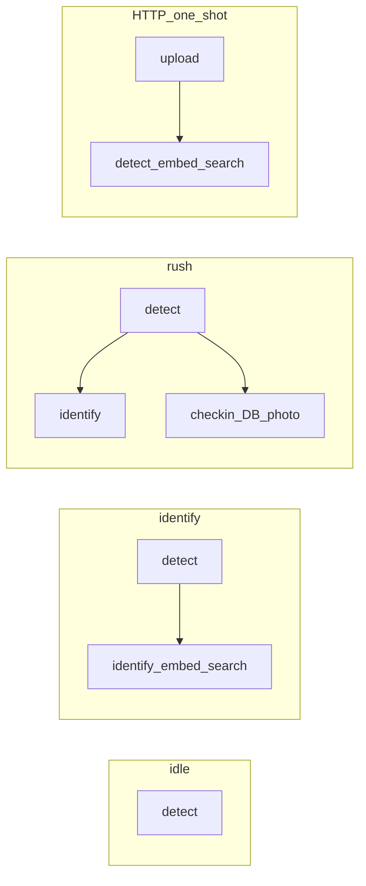
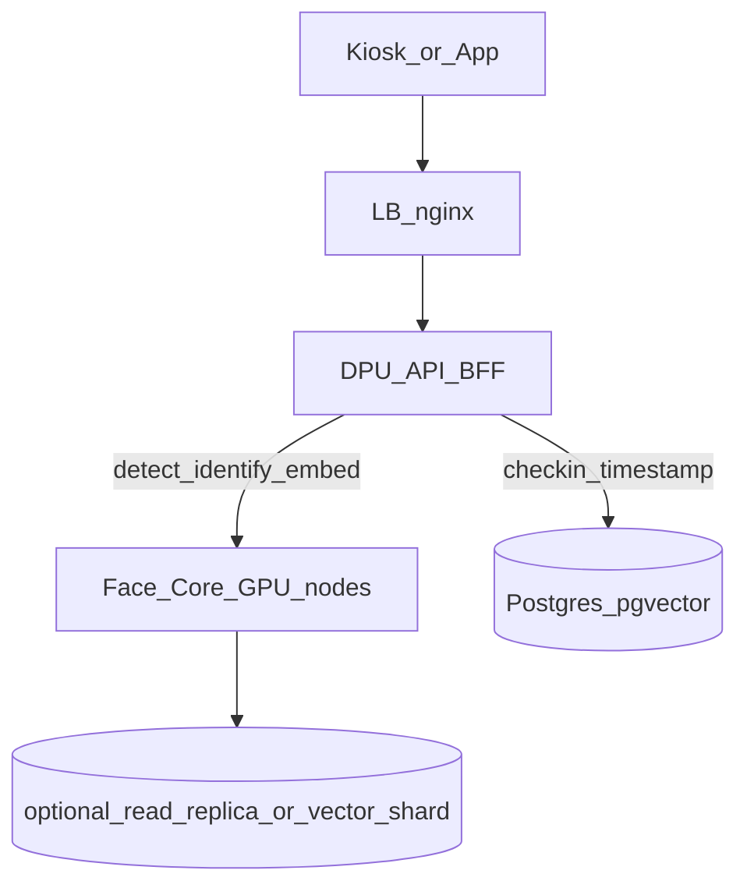

# Identify-only capacity + ความต่างสำหรับแยก Face Core

**วัด baseline:** 24 ก.ย. 2026 ~03:05–03:18 (UTC+7) · **quad** · `FACE_GPU_WORKERS=3`  
**วัดเพดานสุดท้ายหลังจูน:** 24 ก.ย. 2026 ~03:43–04:20 · A/B + push ceiling · **hexa** · `FACE_GPU_WORKERS=2`  
**วัดดัน >48 จนไม่ไหว:** 24 ก.ย. 2026 ~07:50+ · hexa w2 · ดู §3c  
**โฮสต์:** `10.50.0.117` (32c / 436GB / 2× Quadro RTX 5000)  
**เครื่องมือ:** `kiosk_load.py --profile identify` · `http_identify_load.py`  
**SLO คีออส:** detect p95 ≤ 550 ms · drop ≤ 5% · identify p95 ≤ 550 ms  
**SLO HTTP one-shot:** identify p95 ≤ 1000 ms · error ≤ 5%  
**Production attendance (คืนแล้ว):** **quad** · `FACE_GPU_WORKERS=3` — hexa ใช้เฉพาะตอนหาเพดาน identify-only

---

## 1. สรุปผู้บริหาร

| โหมดงาน | concurrent ที่ผ่าน SLO (เครื่องนี้) | หมายเหตุ |
|---------|--------------------------------------|----------|
| **Detect อย่างเดียว** (`idle`) | ≥ **48 จอ** full-rate | ไม่มี identify/check-in |
| **หาหน้าอย่างเดียว** (`identify`) — **เพดานหลังจูน (hexa w2)** | ×1 **64** full / **80** gated · ×3 **48** full / **64** gated | ดู §3b |
| **หาหน้าอย่างเดียว** — baseline quad w3 | ×1 **32–48** full / ≥**64** gated · ×3 ≥**40** full / ≥**48** gated | §3 เดิม |
| **ลงเวลาเต็ม** (`rush` = +check-in) | คนละคน **32** / หลายคน **24** full-rate | จาก PERF3 · คง quad w3 |
| **ส่งภาพ HTTP ทีละใบ** (`POST /face/members/identify`) | **~20 concurrent** OK · RPS อิ่ม **~34–35 req/s** | hexa w2 ไม่ดัน concurrent เกิน 20 |

**แผนแยก Face Core:** งานที่ควรย้ายออกจาก DPU API คือ **detect + embed/identify** (ตัวเลขด้านบน) ส่วน **check-in / timestamp / dedupe / รูป punch / สิทธิ์บริษัท** ควรอยู่ DPU — เพราะ check-in คือสิ่งที่ทำให้ rush×3 หลุดจาก 40+ จอ เหลือ 24 จอ · และ hexa ช่วย identify-only แต่ทำลาย rush

### เพดานสุดท้ายหลังจูน (หน้าเดียว)

| เมตริก | ค่าสุดท้าย |
|--------|------------|
| คีออส ×1 full / gated | **64** / **80** จอ (best) · conservative **48** / ดู §3c |
| คีออส ×3 full / gated | **48** / **64** จอ (best) · hard cliff **~52** full (§3c) |
| HTTP concurrent / RPS | **20** / **~35** (FAIL แรก conc 25 · p95 1061) |
| คอนฟิกที่ใช้ได้เพดานนี้ | **hexa** · `FACE_GPU_WORKERS=2` |
| คอนฟิก production attendance | **quad** · `FACE_GPU_WORKERS=3` (คืนแล้ว) |
| **Hard saturation (>48)** | ×1 full พังชัด ≥72 · ×3 full พังชัด ≥56–60 · gated พัง ≥96 / ≥72 |
---

## 2. นิยามโปรไฟล์ที่เทียบกัน



| โปรไฟล์ | ส่งอะไร | ไม่ทำอะไร | ใช้เมื่อ |
|---------|---------|-----------|---------|
| `idle` | detect ทุก ~90 ms | ไม่ identify / ไม่ลงเวลา | จอว่าง / กล่องหน้า |
| `identify` **(ใหม่)** | detect + identify (≤2 ค้าง, ทุก ≥1.2 s/track) | **ไม่ check-in** | แสดงชื่ออย่างเดียว |
| `rush` | detect + identify + check-in | — | ลงเวลาจริง |
| HTTP identify | 1 รูป → 1 คำตอบ | ไม่มี WS / ไม่ detect ต่อเนื่อง | แอปส่งภาพมาถามชื่อ |

---

## 3. ผลวัด identify-only (WS)

### 3.1 คนละคนต่อจอ (`faces-per-kiosk=1`) — full-rate 90 ms

| จอ | detect p95 | identify p95 | drop | verdict |
|----|------------|--------------|------|---------|
| 24 | 167 ms | 248 ms | 0% | **OK** |
| 32 | 257 ms | 340 ms | 0% | **OK** |
| 48 | 1081 ms | 1226 ms | 0% | FAIL (ขั้นผิดปกติ — ดู 64) |
| 64 | 512 ms | 587 ms | 0% | MARGIN (detect OK, identify >550) |

**เพดานวางแผน full-rate ×1: 32 จอ** (ชัวร์) · ทดลองสูงสุดราว 48–60 ถ้าทน identify ~600 ms

### 3.2 หลายคนต่อจอ (`faces-per-kiosk=3`) — full-rate 90 ms

| จอ | detect p95 | identify p95 | drop | verdict |
|----|------------|--------------|------|---------|
| 16 | 100 ms | 215 ms | 0% | **OK** |
| 24 | 131 ms | 242 ms | 0% | **OK** |
| 32 | 186 ms | 289 ms | 0.1% | **OK** |
| 40 | 240 ms | 350 ms | 0.4% | **OK** |

**เพดานวางแผน full-rate ×3: ≥ 40 จอ** (ยังไม่ชนเพดานในชุดนี้)

### 3.3 Gated detect 600 ms (ใกล้คีออสจริง)

| โปรไฟล์ | จอ | detect p95 | identify p95 | verdict |
|---------|----|------------|--------------|---------|
| ×1 | 32 | 135 ms | 175 ms | **OK** |
| ×1 | 48 | 265 ms | 218 ms | **OK** |
| ×1 | **64** | **279 ms** | **288 ms** | **OK** |
| ×3 | 24 | 103 ms | 178 ms | **OK** |
| ×3 | 32 | 110 ms | 203 ms | **OK** |
| ×3 | 40 | 356 ms | 399 ms | **OK** |
| ×3 | **48** | **161 ms** | **302 ms** | **OK** |

**เพดาน gated (baseline quad): ×1 ≥64 จอ · ×3 ≥48 จอ** (ยังไม่ FAIL ในชุดที่วัด)

### 3b. เพดานสุดท้ายหลังจูน (A/B → push)

วัดชุดสั้นเดียวกันทุกคอนฟิก: ×1 `32,48,64` · ×3 `32,40,48` · hold 30s · 1280q70 · warm 2 จอ

#### A/B ที่จุดตัดสิน (detect p95 / identify p95)

| คอนฟิก | ×1@48 | ×3@40 | ×1@64 | ×3@48 |
|--------|-------|-------|-------|-------|
| A quad w3 | **290 / 357 OK** | 259 / 348 OK | 573 / 767 **FAIL** | 294 / 406 OK |
| B hexa w3 | 326 / 370 OK | **235 / 328 OK** | 466 / 499 OK | 452 / 760 **FAIL** |
| **C hexa w2 (ชนะ)** | 313 / 362 OK | 228 / 345 OK | **454 / 506 OK** | **285 / 405 OK** |

เลือก **hexa + workers=2** — ผ่านทั้ง ×1@64 และ ×3@48 ในชุดสั้น; ค่าเฉลี่ย p95 ที่ ×1@48+×3@40 ต่ำสุดในสามคอนฟิก

#### Push ceiling บน hexa w2 (SLO: det+id p95 ≤550 · drop ≤5%)

| โปรไฟล์ | ขั้น OK สูงสุด | ขั้น FAIL แรก | รายละเอียด |
|---------|----------------|---------------|------------|
| ×1 full | **64** (450 / 481) | **72** (526 / 589) | 56=OK · 80=FAIL ทั้งคู่ |
| ×3 full | **48** (349 / 463) | **56** (600 / 782) | ×3@40 ครั้งหนึ่ง id p95=589 (noise); A/B ผ่าน 228/345 |
| ×1 gated 600 ms | **80** (511 / 452) | **96** (646 / 959) | 64=OK |
| ×3 gated 600 ms | **64** (324 / 473) | **72** (439 / 607) | 48/56=OK |

**เทียบ baseline quad:** ×1 full 32→**64** (~2×) · ×1 gated ≥64→**80** · ×3 full ≥40→**48** · ×3 gated ≥48→**64**

### 3c. ดันต่อจาก 48 จนไม่ไหว (hexa w2 · 24 ก.ย. ~07:50+)

ชุดละเอียดขึ้นไปจน saturation ชัด — hold 30s · 1280q70 · SLO เดิม

#### ×1 full `48 → 96`

| จอ | detect p95 | identify p95 | verdict |
|----|------------|--------------|---------|
| **48** | 407 | 459 | **OK** |
| 56 | 510 | 571 | FAIL (id) |
| 64 | 574 | 682 | FAIL |
| 72 | 1021 | 1113 | FAIL หนัก |
| 80 | 773 | 884 | FAIL |
| 88 | 866 | 975 | FAIL |
| 96 | 1233 | 1113 | FAIL / อิ่ม |

**Hard cliff ×1 full:** OK สูงสุดรอบนี้ **48** · FAIL แรก **56** · เกิน **72** = ไม่ใช้งานได้

> หมายเหตุ: รอบ §3b เคยผ่าน ×1@64 — รอบเช้านี้ latency สูงกว่า (โหลดค้าง/ความแปรปรวน) จึงยึด **วางแผน 48 ชัวร์ · ทดลองสูงสุด 64 เมื่อเครื่องเย็น** และถือ ≥72 เป็นเพดานพังจริง

#### ×3 full `48 → 80` (ขั้นละเอียด)

| จอ | detect p95 | identify p95 | verdict |
|----|------------|--------------|---------|
| **48** | 419 | 526 | **OK** |
| 52 | 469 | 585 | FAIL (id) |
| 56 | 576 | 677 | FAIL |
| 60 | 704 | 816 | FAIL |
| 64 | 750 | 805 | FAIL |
| 72 | 996 | 1011 | FAIL |
| 80 | 1335 | 1339 | FAIL / อิ่ม |

**Hard cliff ×3 full:** OK สูงสุด **48** · FAIL แรก **52** · ≥60 = พังชัด

#### Gated 600 ms ดันสูง

| โปรไฟล์ | จอ | detect/id p95 | หมายเหตุ |
|---------|----|---------------|----------|
| ×1 | 80 | 966 / 1164 | FAIL (รอบ §3b เคย OK — รอบนี้แย่กว่า) |
| ×1 | 96–128 | 890–1338 / 863–1588 | FAIL ตลอด · 128 อิ่มหนัก |
| ×3 | 64 | 595 / 819 | FAIL |
| ×3 | 72 | 999 / **~2.5e6** | ค้าง/timeout — **ไม่ไหวจริง** |
| ×3 | 80–112 | 829–1913 / 1061–2106 | FAIL + errors สูง |

**สรุปจนไม่ไหว:** เกิน **48 จอ** full-rate เริ่มหลุด SLO ทันทีในรอบนี้; โซน **72+** (×1) / **60+** (×3) คือ saturation แรง; gated ×3@72 ทำให้ identify ค้าง — อย่าทดสอบเกินนี้บน production โดยไม่ drain ก่อน

---

## 4. ผลวัด HTTP one-shot identify

`POST /face/members/identify` · รูปเดียว ~129 KB

### 4.1 Baseline (quad w3)

| concurrency | ok | err | RPS | p50 | p95 | verdict (p95≤1000) |
|-------------|----|-----|-----|-----|-----|---------------------|
| **20** | 200 | 0 | **35.8** | 517 ms | **848 ms** | **OK** |
| 50 | 200 | 0 | 35.7 | 1322 ms | 1685 ms | FAIL |
| 100 | 182 | 18 | 32.9 | 2440 ms | 3200 ms | FAIL |
| 150 | 238 | 62 | 33.8 | 3239 ms | 3930 ms | FAIL |

### 4.2 Refine บน hexa w2 (conc 10–40 · 250 req/ขั้น)

| concurrency | ok | err | RPS | p50 | p95 | verdict |
|-------------|----|-----|-----|-----|-----|---------|
| 10 | 250 | 0 | 30.6 | 305 | **539** | **OK** |
| 15 | 250 | 0 | 34.3 | 385 | **635** | **OK** |
| **20** | 250 | 0 | **34.7** | 566 | **768** | **OK** |
| 25 | 250 | 0 | 34.2 | 662 | 1061 | FAIL |
| 30 | 250 | 0 | 34.8 | 754 | 1310 | FAIL |
| 40 | 250 | 0 | 34.0 | 1020 | 1638 | FAIL |

**ข้อสรุป HTTP:** throughput อิ่มที่ **~34–35 identify/วินาที** ทั้งเครื่อง — hexa ลด p95 ที่ conc 20 เล็กน้อย แต่ **ไม่ดัน concurrent เกิน 20**  
**วางแผน:** ≤ **20 concurrent** one-shot หรือไม่ยิงเกิน ~30–35 req/s รวม

---

## 5. ตารางเทียบโหมด (ค่าที่ปักหมุด)

ค่า rush/idle จาก [PERF3](KIOSK-LOADTEST-PERF3-TABLE.md) / [PERF5](KIOSK-LOADTEST-PERF5-TABLE.md); identify จาก baseline + §3b

| โหมด | Full-rate เพดาน OK | Gated ~600 ms | คอนฟิก | งานหนักหลัก |
|------|-------------------|---------------|--------|-------------|
| idle (detect) | ≥48 จอ | สูงกว่านั้น | quad w3 | decode + RetinaFace |
| **identify (หลังจูน)** | **×1: 64 · ×3: 48** | **×1: 80 · ×3: 64** | **hexa w2** | + ArcFace + pgvector |
| identify (baseline) | ×1: 32 · ×3: ≥40 | ×1: ≥64 · ×3: ≥48 | quad w3 | เหมือนกัน |
| rush (ลงเวลา) | ×1: 32 · ×3: **24** | ×1: 48 · ×3: 32 | **quad w3** | + check-in DB/รูป/dedupe |
| HTTP identify | ~20 concurrent / ~35 RPS | — | hexa≈quad | เต็ม pipeline ต่อคำขอ |

**Delta สำคัญ:**  
1. ตัด check-in → ×3 full จาก rush **24 → ≥40–48 จอ**  
2. จูน hexa w2 สำหรับ identify-only → ×1 full จาก **32 → 64 จอ** — แต่ **อย่าใช้ hexa กับ attendance/rush** (PERF5)

---

## 6. แนวแยก Face Core ในอนาคต (จากตัวเลข)

### 6.1 ขอบเขตที่ควรอยู่ Face Core

| API / งาน | เหตุผลจากวัด |
|-----------|----------------|
| WS `detect` | idle ≥48 จอ = โหลดหลักของคีออส; GPU compute สั้นแต่ QPS สูง |
| WS `identify` / HTTP `members/identify` | เพดาน identify-only สูงกว่า rush; เป็น “คำตอบว่าใคร” |
| embed / quality / liveness frames | ใช้ GPU + CPU decode ร่วมคิวกับ detect |

เป้าหมาย Face Core ต่อเครื่องระดับนี้ (อิงวัดหลังจูน):  
- คีออส identify-only **64 จอ** ×1 / **48 จอ** ×3 full · gated สูงกว่านั้น (80 / 64)  
- HTTP identify **~35 RPS** หรือสเกลแนวนอนด้วยหลาย Face Core node

### 6.2 ขอบเขตที่ควรอยู่ DPU (BFF / attendance)

| งาน | เหตุผล |
|-----|--------|
| `check-in` / timestamp / approval | ทำให้ rush×3 หลุดจาก ≥40 เหลือ 24 — ผูกธุรกิจ+DB |
| dedupe 5 นาที, สิทธิ์บริษัท, รูป punch storage | ไม่ใช่ GPU; cache รอบ 5 ช่วยโหลดต่ำแล้ว |
| session/JWT, enroll metadata, dashboard | ไม่เกี่ยวกับคิว face |

### 6.3 สถาปัตยกรรมเป้าหมาย



1. **Phase A (ตอนนี้):** DPU รวมทุกอย่าง — ตัวเลขตาราง §5 คือ baseline เครื่องเดียว  
2. **Phase B:** DPU เรียก Face Core สำหรับ detect/identify; check-in ยังที่ DPU (ใช้ encoding จาก Core)  
3. **Phase C:** สเกล Face Core เป็น N node เมื่อต้องการ >40 จอ identify หรือ >36 HTTP RPS — **ไม่ต้องสเกล DPU เท่ากัน**

เกณฑ์ตัดสินย้าย Phase B→C (จากของจริงเครื่องนี้):  
- identify-only เกิน **64 จอ** ×1 / **48 จอ** ×3 full-rate (เพดานหลังจูน) หรือ HTTP p95 >1 s ที่ concurrency 20  
- หรือต้องการ isolate GPU จาก DB/IO ของ check-in

### 6.4 สิ่งที่ยังไม่ต้องทำตอนแยก Core

- บน DPU เดียว hexa w2 ดัน identify ได้ถึงเพดานด้านบนแล้ว — การแยก Core มีเหตุเมื่อต้องการ **เกินเพดานนี้** หรือแยกจาก rush/DB  
- ไม่ย้าย check-in ไป Face Core — จะพา DB ติดไปด้วยและเสียประโยชน์การแยก  
- **อย่าเปลี่ยน production attendance เป็น hexa** เพื่อดัน identify — คืน/คง **quad w3** สำหรับ rush

### 6.5 Local BFF verified (Phase B บน Docker Desktop)

**24 ก.ย. 2026** — ประกอบ sibling `../face-core` (CPU) + DPU overlay `docker-compose.face-core.yml` บนเครื่อง local:

| ตรวจ | ผล |
|------|-----|
| `GET :8081/v1/health` | `service: face-core` · `device: cpu` |
| `GET :8880/ready` | queue จาก Face Core |
| `GET /face/queue-stats` (JWT) | `source: face-core` |
| `smoke_face_core_bff.py` | ผ่าน (add-face · identify · walkby check-in · verify) |

หมายเหตุแก้ตอนประกอบ: Face Core `dispatch_gpu_task` เคยส่ง async เข้า `run_in_executor` → enroll 500; แก้ใน `face-core/src/vision/gpu_queue.py` แล้ว · smoke DPU เพิ่ม login JWT

ยังไม่ deploy BFF ขึ้น `10.50.0.117` — production attendance ยัง monolith quad w3

---

## 7. วิธีรันซ้ำ

```bash
export KIOSK_LOAD_BASE_URL=http://10.50.0.117:8880
# WS identify-only
python scripts/kiosk-load/kiosk_load.py --prepare --profile identify \
  --faces-per-kiosk 1 --kiosks 24,32,48,64 --hold 30 \
  --frame-width 1280 --jpeg-quality 70 --jsonl results-idonly-x1.jsonl

python scripts/kiosk-load/kiosk_load.py --profile identify \
  --faces-per-kiosk 3 --kiosks 16,24,32,40 --hold 30 \
  --frame-width 1280 --jpeg-quality 70 --jsonl results-idonly-x3.jsonl

# Gated
python scripts/kiosk-load/kiosk_load.py --profile identify \
  --detect-interval-ms 600 --faces-per-kiosk 1 --kiosks 32,48,64 --hold 30

# HTTP one-shot (refine)
python scripts/kiosk-load/http_identify_load.py --concurrency 10,15,20,25,30,40 --requests-per-step 250
```

## ไฟล์ดิบ

Baseline (quad w3):

- `scripts/kiosk-load/.cache/results-idonly-x1-full.jsonl`
- `scripts/kiosk-load/.cache/results-idonly-x3-full.jsonl`
- `scripts/kiosk-load/.cache/results-idonly-x1-gated.jsonl`
- `scripts/kiosk-load/.cache/results-idonly-x3-gated.jsonl`
- `scripts/kiosk-load/.cache/results-http-identify.txt`

A/B + ceiling (hexa w2 ชนะ):

- `scripts/kiosk-load/.cache/results-faceab-{quad-w3,hexa-w3,hexa-w2}-*.jsonl`
- `scripts/kiosk-load/.cache/results-faceceil-hexa-w2-*.jsonl`
- `scripts/kiosk-load/.cache/results-http-identify-hexa-w2.txt`
- `scripts/kiosk-load/.cache/results-push48-*.jsonl` (§3c ดัน >48 จนไม่ไหว)
