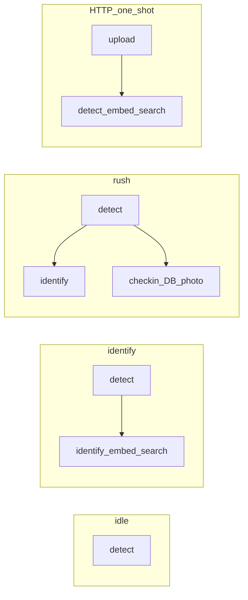
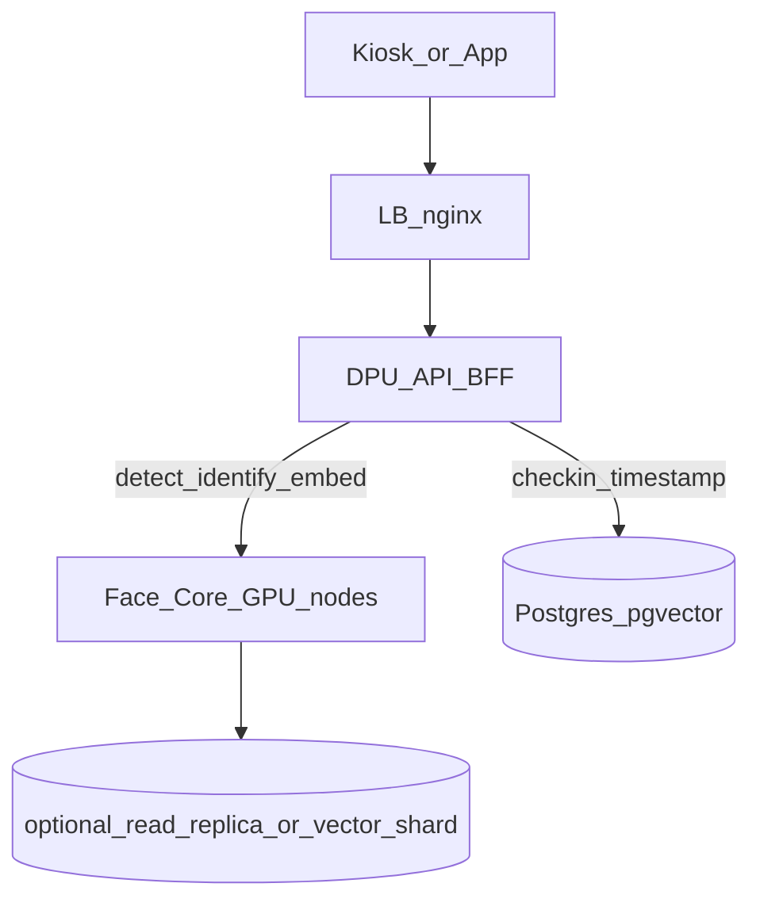

# Identify-only capacity + ความต่างสำหรับแยก Face Core

**วัด:** 24 ก.ย. 2026 ~03:05–03:18 (UTC+7)  
**โฮสต์:** `10.50.0.117` · quad API (4 process) · `FACE_GPU_WORKERS=3`  
**เครื่องมือ:** `kiosk_load.py --profile identify` · `http_identify_load.py`  
**SLO คีออส:** detect p95 ≤ 550 ms · drop ≤ 5% · identify p95 ≤ 550 ms  
**SLO HTTP one-shot:** identify p95 ≤ 1000 ms · error ≤ 5%

---

## 1. สรุปผู้บริหาร

| โหมดงาน | concurrent ที่ผ่าน SLO (เครื่องนี้) | หมายเหตุ |
|---------|--------------------------------------|----------|
| **Detect อย่างเดียว** (`idle`) | ≥ **48 จอ** full-rate | ไม่มี identify/check-in |
| **หาหน้าอย่างเดียว** (`identify` = detect+identify) | คนละคน/จอ **32 จอ** full · **≥64 จอ** gated; หลายคน/จอ **≥40 จอ** full · **≥48 จอ** gated | **ตัด check-in แล้วเบาลงชัด** |
| **ลงเวลาเต็ม** (`rush` = +check-in) | คนละคน **32** / หลายคน **24** full-rate | จาก PERF3 |
| **ส่งภาพ HTTP ทีละใบ** (`POST /face/members/identify`) | **~20 concurrent** OK · throughput อิ่มที่ **~35–36 req/s** | ไม่มี WS detect คู่ขนาน |

**แผนแยก Face Core:** งานที่ควรย้ายออกจาก DPU API คือ **detect + embed/identify** (ตัวเลขด้านบน) ส่วน **check-in / timestamp / dedupe / รูป punch / สิทธิ์บริษัท** ควรอยู่ DPU — เพราะ check-in คือสิ่งที่ทำให้ rush×3 หลุดจาก 40+ จอ เหลือ 24 จอ

---

## 2. นิยามโปรไฟล์ที่เทียบกัน



| โปรไฟล์ | ส่งอะไร | ไม่ทำอะไร | ใช้เมื่อ |
|---------|---------|-----------|---------|
| `idle` | detect ทุก ~90 ms | ไม่ identify / ไม่ลงเวลา | จอว่าง / กล่องหน้า |
| `identify` **(ใหม่)** | detect + identify (≤2 ค้าง, ทุก ≥1.2 s/track) | **ไม่ check-in** | แสดงชื่ออย่างเดียว |
| `rush` | detect + identify + check-in | — | ลงเวลาจริง |
| HTTP identify | 1 รูป → 1 คำตอบ | ไม่มี WS / ไม่ detect ต่อเนื่อง | แอปส่งภาพมาถามชื่อ |

---

## 3. ผลวัด identify-only (WS)

### 3.1 คนละคนต่อจอ (`faces-per-kiosk=1`) — full-rate 90 ms

| จอ | detect p95 | identify p95 | drop | verdict |
|----|------------|--------------|------|---------|
| 24 | 167 ms | 248 ms | 0% | **OK** |
| 32 | 257 ms | 340 ms | 0% | **OK** |
| 48 | 1081 ms | 1226 ms | 0% | FAIL (ขั้นผิดปกติ — ดู 64) |
| 64 | 512 ms | 587 ms | 0% | MARGIN (detect OK, identify >550) |

**เพดานวางแผน full-rate ×1: 32 จอ** (ชัวร์) · ทดลองสูงสุดราว 48–60 ถ้าทน identify ~600 ms

### 3.2 หลายคนต่อจอ (`faces-per-kiosk=3`) — full-rate 90 ms

| จอ | detect p95 | identify p95 | drop | verdict |
|----|------------|--------------|------|---------|
| 16 | 100 ms | 215 ms | 0% | **OK** |
| 24 | 131 ms | 242 ms | 0% | **OK** |
| 32 | 186 ms | 289 ms | 0.1% | **OK** |
| 40 | 240 ms | 350 ms | 0.4% | **OK** |

**เพดานวางแผน full-rate ×3: ≥ 40 จอ** (ยังไม่ชนเพดานในชุดนี้)

### 3.3 Gated detect 600 ms (ใกล้คีออสจริง)

| โปรไฟล์ | จอ | detect p95 | identify p95 | verdict |
|---------|----|------------|--------------|---------|
| ×1 | 32 | 135 ms | 175 ms | **OK** |
| ×1 | 48 | 265 ms | 218 ms | **OK** |
| ×1 | **64** | **279 ms** | **288 ms** | **OK** |
| ×3 | 24 | 103 ms | 178 ms | **OK** |
| ×3 | 32 | 110 ms | 203 ms | **OK** |
| ×3 | 40 | 356 ms | 399 ms | **OK** |
| ×3 | **48** | **161 ms** | **302 ms** | **OK** |

**เพดาน gated: ×1 ≥64 จอ · ×3 ≥48 จอ** (ยังไม่ FAIL ในชุดที่วัด)

---

## 4. ผลวัด HTTP one-shot identify

`POST /face/members/identify` · รูปเดียว ~129 KB · รวม 200–300 คำขอต่อขั้น

| concurrency | ok | err | RPS | p50 | p95 | verdict (p95≤1000) |
|-------------|----|-----|-----|-----|-----|---------------------|
| **20** | 200 | 0 | **35.8** | 517 ms | **848 ms** | **OK** |
| 50 | 200 | 0 | 35.7 | 1322 ms | 1685 ms | FAIL |
| 100 | 182 | 18 | 32.9 | 2440 ms | 3200 ms | FAIL |
| 150 | 238 | 62 | 33.8 | 3239 ms | 3930 ms | FAIL |

**ข้อสรุป HTTP:** throughput อิ่มที่ **~36 identify/วินาที** ทั้งเครื่อง (queue/GPU/DB) — เพิ่ม concurrency แล้วไม่ได้ RPS เพิ่ม มีแต่ latency พุ่ง  
**วางแผน:** ≤ **20 concurrent** one-shot หรือออกแบบ client ให้ไม่ยิงเกิน ~30–35 req/s รวม

---

## 5. ตารางเทียบโหมด (ค่าที่ปักหมุด)

ค่า rush/idle จาก [PERF3](KIOSK-LOADTEST-PERF3-TABLE.md) / [PERF5](KIOSK-LOADTEST-PERF5-TABLE.md); identify จากรอบนี้

| โหมด | Full-rate เพดาน OK | Gated ~600 ms | งานหนักหลัก |
|------|-------------------|---------------|-------------|
| idle (detect) | ≥48 จอ | สูงกว่านั้น | decode + RetinaFace |
| **identify (ไม่มีลงเวลา)** | **×1: 32 · ×3: ≥40** | **×1: ≥64 · ×3: ≥48** | + ArcFace + pgvector |
| rush (ลงเวลา) | ×1: 32 · ×3: **24** | ×1: 48 · ×3: 32 | + check-in DB/รูป/dedupe |
| HTTP identify | ~20 concurrent / ~36 RPS | — | เต็ม pipeline ต่อคำขอ |

**Delta สำคัญ:** ที่หลายคน/จอ full-rate การ **ตัด check-in** ดันเพดานจาก **24 → ≥40 จอ (~+67%)** — นี่คือหลักฐานว่า check-in/DB เป็นภาระแยกจาก face match

---

## 6. แนวแยก Face Core ในอนาคต (จากตัวเลข)

### 6.1 ขอบเขตที่ควรอยู่ Face Core

| API / งาน | เหตุผลจากวัด |
|-----------|----------------|
| WS `detect` | idle ≥48 จอ = โหลดหลักของคีออส; GPU compute สั้นแต่ QPS สูง |
| WS `identify` / HTTP `members/identify` | เพดาน identify-only สูงกว่า rush; เป็น “คำตอบว่าใคร” |
| embed / quality / liveness frames | ใช้ GPU + CPU decode ร่วมคิวกับ detect |

เป้าหมาย Face Core ต่อเครื่องระดับนี้ (อิงวัด):  
- คีออส identify-only **≥40 จอ** full / **≥48–64** gated  
- HTTP identify **~35 RPS** หรือสเกลแนวนอนด้วยหลาย Face Core node

### 6.2 ขอบเขตที่ควรอยู่ DPU (BFF / attendance)

| งาน | เหตุผล |
|-----|--------|
| `check-in` / timestamp / approval | ทำให้ rush×3 หลุดจาก ≥40 เหลือ 24 — ผูกธุรกิจ+DB |
| dedupe 5 นาที, สิทธิ์บริษัท, รูป punch storage | ไม่ใช่ GPU; cache รอบ 5 ช่วยโหลดต่ำแล้ว |
| session/JWT, enroll metadata, dashboard | ไม่เกี่ยวกับคิว face |

### 6.3 สถาปัตยกรรมเป้าหมาย



1. **Phase A (ตอนนี้):** DPU รวมทุกอย่าง — ตัวเลขตาราง §5 คือ baseline เครื่องเดียว  
2. **Phase B:** DPU เรียก Face Core สำหรับ detect/identify; check-in ยังที่ DPU (ใช้ encoding จาก Core)  
3. **Phase C:** สเกล Face Core เป็น N node เมื่อต้องการ >40 จอ identify หรือ >36 HTTP RPS — **ไม่ต้องสเกล DPU เท่ากัน**

เกณฑ์ตัดสินย้าย Phase B→C (จากของจริงเครื่องนี้):  
- identify-only เกิน **40 จอ** full-rate หรือ HTTP p95 >1 s ที่ concurrency 20  
- หรือต้องการ isolate GPU จาก DB/IO ของ check-in

### 6.4 สิ่งที่ยังไม่ต้องทำตอนแยก Core

- ไม่ต้องเพิ่ม process/GPU บน DPU เพื่อ identify-only (quad เพียงพอถึง 40+ จอ)  
- ไม่ย้าย check-in ไป Face Core — จะพา DB ติดไปด้วยและเสียประโยชน์การแยก

---

## 7. วิธีรันซ้ำ

```bash
export KIOSK_LOAD_BASE_URL=http://10.50.0.117:8880
# WS identify-only
python scripts/kiosk-load/kiosk_load.py --prepare --profile identify \
  --faces-per-kiosk 1 --kiosks 24,32,48,64 --hold 30 \
  --frame-width 1280 --jpeg-quality 70 --jsonl results-idonly-x1.jsonl

python scripts/kiosk-load/kiosk_load.py --profile identify \
  --faces-per-kiosk 3 --kiosks 16,24,32,40 --hold 30 \
  --frame-width 1280 --jpeg-quality 70 --jsonl results-idonly-x3.jsonl

# Gated
python scripts/kiosk-load/kiosk_load.py --profile identify \
  --detect-interval-ms 600 --faces-per-kiosk 1 --kiosks 32,48,64 --hold 30

# HTTP one-shot
python scripts/kiosk-load/http_identify_load.py --concurrency 20,50,100,150
```

## ไฟล์ดิบ

- `scripts/kiosk-load/.cache/results-idonly-x1-full.jsonl`
- `scripts/kiosk-load/.cache/results-idonly-x3-full.jsonl`
- `scripts/kiosk-load/.cache/results-idonly-x1-gated.jsonl`
- `scripts/kiosk-load/.cache/results-idonly-x3-gated.jsonl`
- `scripts/kiosk-load/.cache/results-http-identify.txt`
- `scripts/kiosk-load/.cache/results-idonly-warm.jsonl`
