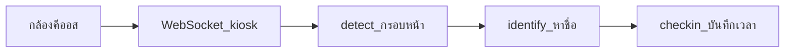

# คู่มือความจุคีออสใบหน้า — สรุปผลเทสทุกวิธี + สเป็คที่ควรใช้

**อัปเดตล่าสุด:** 24 กันยายน 2026  
**เซิร์ฟเวอร์วัด:** `10.50.0.117` (face-in)  
**ฮาร์ดแวร์:** CPU 32 core · RAM ~436 GB · **GPU 2× Quadro RTX 5000 16 GB**  
**เกณฑ์คุณภาพ (SLO) ที่ใช้ตัดสิน “ผ่าน”:**

| เมตริก | เกณฑ์ |
|--------|--------|
| detect / identify p95 | ≤ **550 ms** |
| ทิ้งเฟรม (drop) | ≤ **5%** |
| HTTP identify p95 | ≤ **1000 ms** · error ≤ 5% |

เอกสารรายละเอียดเชิงเทคนิค: [FACE-CORE-IDENTIFY-CAPACITY.md](FACE-CORE-IDENTIFY-CAPACITY.md) · [KIOSK-LOADTEST-SATURATION.md](KIOSK-LOADTEST-SATURATION.md) · ตาราง PERF2–5

---

## 1. อ่านใน 1 นาที — คำตอบที่ใช้จริง

### สเป็คที่ควรใช้บนเซิร์ฟเวอร์นี้ (production)

| รายการ | ค่าแนะนำ |
|--------|----------|
| โหมด | **DPU monolith** (InsightFace ใน API) — **ยังไม่เปิด Face Core BFF ทั้งเครื่อง** |
| จำนวน API process | **4 (quad)** = 2 process ต่อการ์ด · nginx `least_conn` |
| `FACE_GPU_WORKERS` | **3** ต่อ process |
| Compose | `docker-compose.yml` + `docker-compose.gpu.yml` + `docker-compose.gpu-x2.yml` |
| Whisper (ถ้ามีบนเครื่อง) | ปักที่ **GPU1** (`CUDA_VISIBLE_DEVICES=1`) อย่าแชร์ GPU0 กับ DPU โดยไม่จำเป็น |

### ความจุที่วางแผนติดตั้งได้ (ภายใต้ SLO)

| งานที่จอทำ | จำนวนจอที่แนะนำ | หมายเหตุ |
|------------|-----------------|----------|
| **ลงเวลาจริง** (detect + หาชื่อ + บันทึกเวลา) | **×1 คน/จอ → 24–32 จอ** · **×3 คน/จอ → ~24 จอ** | ใช้ตัวเลข **quad** (production) |
| **หาชื่ออย่างเดียว** (ไม่ลงเวลา) | วางแผนชัวร์ **~48 จอ** · สูงสุดที่เคยผ่านเทส **64–80** (ต้อง hexa ชั่วคราว) | ดู §3 |
| **ช่วงเช้า 20 นาที (identify gated)** | **~18,000 สแกน @24 จอ** · **~23,000 @32 จอ** | ดู §3.1 — เมตริก “คนต่อช่วงเร่งด่วน” |
| **Detect กรอบหน้าอย่างเดียว** | ≥ **48 จอ** | โหลดเบาที่สุด |
| **แอปยิง HTTP ทีละรูป** (`POST .../identify`) | **~20 concurrent** · ~35 รูป/วินาที | คนละแบบกับคีออส WS |

> เทสโหลดส่งเฟรมถี่กว่าคีออสจริง (คีออสมี motion gate) — **ของจริงมักดีกว่าตัวเลขเทส** เล็กน้อยถ้าคนยืนนิ่ง

---

## 2. ระบบทำงานยังไง (สั้น ๆ)



| โปรไฟล์เทส | ทำอะไร | ใกล้ของจริงเมื่อ |
|------------|--------|------------------|
| `idle` | detect อย่างเดียว | จอว่าง / โชว์กรอบ |
| `identify` | detect + หาชื่อ | แสดงชื่อ ไม่ลงเวลา |
| `rush` | detect + หาชื่อ + **ลงเวลา** | เข้างานจริง |
| HTTP identify | อัปโหลด 1 รูป → 1 คำตอบ | มือถือ/แอปยิงทีละใบ |

**×1 / ×3** = สมมติคนในเฟรม 1 คน หรือ 3 คนต่อจอ

---

## 3. สรุปผลเทสทุกวิธี (เรียงจากที่ใช้อยู่ → ทดลอง)

### วิธี A — Monolith บน DPU (เส้นทาง production)

ประมวลผลใบหน้าอยู่ใน process ของ DPU API เอง · nginx กระจายไปหลาย process

| รอบ / โครง | process | workers/process | ผลเด่น (ผ่าน SLO) | สรุปสั้น |
|------------|---------|-----------------|-------------------|----------|
| Dual-API เริ่มต้น | 2 | 2–3 | rush×1 ~12–24 · rush×3 ~6–16 | เริ่มใช้สองการ์ดจริง |
| **Quad (รอบ 3) — ใช้จริง** | **4** | **3** | **rush×1 32 · rush×3 24 · idle ≥48** | **สมดุลลงเวลา + เสถียร** |
| Hexa (รอบ 4–5 / identify) | 6 | 2 | identify×1 สูงถึง **64 full / 80 gated** | ดันหาชื่ออย่างเดียวดี · **ทำลาย rush** ถ้าเปิดถาวร |

**อธิบายผล**

- คอขวดหลักไม่ใช่ “GPU เต็ม” แต่เป็น **CPU/GIL ต่อ process** (decode JPEG, WS, Python) — เลยต้องแยกหลาย process ต่อการ์ด
- เพิ่ม process ช่วย identify แต่เกินจุดหนึ่ง (hexa) แล้ว **ลงเวลา (rush) แย่ลง** เพราะแย่งคิว/CPU กับงานเขียน DB + รูป punch
- เลยเลือก production = **quad w3** ไม่ใช่ hexa

### วิธี B — Face Core แยกบริการ (BFF)

DPU ไม่ถือ GPU · ส่งงานใบหน้าไป Face Core ผ่าน HTTP

| รอบ | วิธีวัด | ผลภายใต้ SLO | สรุปสั้น |
|-----|---------|--------------|----------|
| §6.6 Server BFF ครั้งแรก | BFF + Core บนเครื่อง · workers=1 · pending ต่ำ | ×1@16 พัง · `face_core_down` ถล่ม | คิว/rate ตึง + workers น้อย → เปิด circuit |
| §6.7 A+1 | **Local BFF → Core `:8081`** | ~**2 จอ** gated | มี hop เครือข่ายทุกเฟรม |
| §6.8 Co-locate | **BFF บนเซิร์ฟเวอร์ → Core เครื่องเดียวกัน** · Whisper ปิด · workers 2–3 | ยัง ≈ **≤ 2 จอ** gated | **ยืนยันว่าไม่ใช่แค่เน็ต** — โครง 2 process ของ Core ไล่ monolith 6 process ไม่ทัน |

**อธิบายผล**

- จูน queue=128 · pending=128 · rate สูง · pin GPU ถูกแล้ว → **session นิ่ง** ไม่ล้มแบบ §6.6
- แต่ latency ยังเกิน 550 ms ตั้งแต่จอไม่กี่จอ
- W2 กับ W3 ต่างกันน้อย → **ไม่คุ้มเพิ่ม workers=4 หรือ process ของ Core** บน GPU มีแค่ 2 ใบ

**เมื่อไหร่ค่อยใช้ Face Core**

- ต้องการแยกทีม/สเกลหลายโฮสต์ / หลายแอปยิง vision  
- **ไม่ใช่** เพื่อดัน concurrent คีออสบนเครื่องนี้ให้สูงกว่า monolith

### 3.1 ช่วงเร่งด่วน / ขนาดแกลเลอรี / หลายบริษัท (รอบ 24 ก.ย. 2026)

โฮสต์เดียวกัน · **quad w3 · Face Core ปิด** · detect gated **600 ms** · SLO p95 ≤550 ms · drop ≤5%

#### ก) หน้าต่าง 20 นาที — identify (เมตริกหลัก “สแกนได้กี่คน”)

สคริปต์: `scripts/kiosk-load/rush_hour_capacity.py`

| จอ | identify สำเร็จ / 20 นาที | ต่อนาที | p95 identify | drop | SLO 550 |
|----|---------------------------|---------|--------------|------|---------|
| **24** | **17,998** | ~900 | 211 ms | 0.06% | ผ่าน |
| **32** | **22,783** | ~1,139 | 228 ms | 0% | ผ่าน |

**แปลความ:** ถ้าสาขาเปิด **24–32 จอ** พร้อมกันในช่วงเช้า ระบบนี้รองรับประมาณ **~1.8–2.3 หมื่นครั้ง identify ใน 20 นาที** ภายใต้ SLO (สมมติคนยืนนิ่งต่อจอ · ใบหน้า matched) — **ไม่ใช่** ตัวเลข FPS ทั้งเครื่องแบบทฤษฎี

#### ข) rush 10 นาที @24 จอ (ลงเวลา) + สมาชิกหมุน

| เงื่อนไข | identify/10 นาที | check-in ใหม่ | check-in duplicate | p95 id |
|----------|------------------|---------------|--------------------|--------|
| ใบหน้าเดิม · `CHECK_IN_DEDUPE=300` (ค่าปกติ) | 10,549 | **4** | 21,074 | 209 ms |
| เตรียมสมาชิกหมุน 300 คน · **ปิด dedupe ชั่วคราว** (`=0`) | 10,539 | **21,049** | 0 | 209 ms |

**คำแนะนำ:** เมตริก “จำนวนคนลงเวลาไม่ซ้ำ” ถูก **dedupe 5 นาที** กลืนถ้าเทสด้วยใบหน้าเดิม — วางแผนความจุช่วงเช้าใช้ **identify สำเร็จ/ช่วงเวลา** (§ก) เป็นหลัก · ตัวเลข check-in ใหม่สูงได้เมื่อคนละสมาชิกจริงหรือปิด dedupe (อย่าปิดในโปรดักชันยกเว้นเทส)

#### ค) ขนาดแกลเลอรี (synthetic แล้วลบ)

สคริปต์: `scripts/kiosk-load/gallery_size_sweep.py` · identify @**16 จอ** · hold 90 s · gated 600 ms  
บริษัททดสอบมีแกลเลอรีฐาน ~**10k** อยู่แล้ว แล้วเติม synthetic

| synthetic เพิ่ม | ใบหน้าในบริษัทรวม | identify p95 | drop | SLO |
|-----------------|-------------------|--------------|------|-----|
| 0 (baseline) | ~10.3k | 207 ms | 0.5% | ผ่าน |
| +1k | ~11.3k | 205 ms | 0% | ผ่าน |
| +10k | ~20.3k | 155 ms | 0% | ผ่าน |
| +25k | ~35.3k | 174 ms | 0% | ผ่าน |

**คำแนะนำ:** ที่ขนาดถึง ~**35k ใบหน้า/บริษัท** ยังไม่ใช่คอขวดเทียบกับจำนวนจอพร้อมกัน — วางแผนพนักงาน/บริษัทหลักหมื่นคนได้โดยไม่ต้องกังวล pgvector ก่อน · ระวังที่ **peak จอพร้อมกัน** มากกว่า

#### ง) หลายบริษัท · จอรวมคงที่ (~20)

สคริปต์: `scripts/kiosk-load/multi_company_capacity.py` · identify gated · hold 180 s

| โหมด | จอ | identify ok | p95 | SLO |
|------|----|-----------|-----|-----|
| บริษัทเดียว | 20 | 4,625 | 199 ms | ผ่าน |
| **20 บริษัท × 1 จอ** | 20 | 2,723 (ทุกบริษัทมีผล) | median 84 · max 187 ms | ผ่านทั้งชุด |

**คำแนะนำ:** แยกหลายบริษัทที่ **จอรวมเท่าเดิม** ไม่ทำให้ระบบพัง — latency ยังผ่าน SLO · เพดานยังอยู่ที่ **จำนวนจอพร้อมกัน** ไม่ใช่จำนวนบริษัท

---

## 4. ตารางเปรียบเทียบด้านเดียว (เลือกสเป็ค)

| คำถาม | คำตอบที่ใช้ตัดสินใจ |
|-------|---------------------|
| ติดตั้งกี่จอลงเวลาได้ชัวร์? | **24 จอ** (หลายคนในเฟรม) หรือ **32 จอ** (คนเดียวต่อจอ) บน **quad w3** |
| ช่วงเช้า 20 นาทีสแกนได้ประมาณเท่าไร? | **~1.8 หมื่น @24 จอ** · **~2.3 หมื่น @32 จอ** (identify gated · §3.1) |
| อยากโชว์ชื่ออย่างเดียวเยอะ ๆ? | ชั่วคราวขึ้น **hexa w2** ได้สูงสุด ~48–64 จอ · **อย่าใช้เป็น production ลงเวลา** |
| แกลเลอรีบริษัทใหญ่ (หมื่นใบหน้า) กระทบไหม? | ถึง ~**35k**/บริษัทยังผ่าน SLO ที่ 16 จอ — คอขวดคือจอพร้อมกัน |
| หลายบริษัทช่วยเพิ่มความจุไหม? | **ไม่เพิ่มเพดานจอ** · แค่กระจายโหลด; วัดด้วยจอรวมคงที่แล้ว latency ใกล้เคียง |
| เปิด Face Core BFF ทั้งเครื่องดีไหม? | **ยังไม่** บนฮาร์ดแวร์นี้ — เพดาน ~2 จอ |
| เพิ่ม worker/process อีกไหม? | Monolith: **ไม่เกิน quad สำหรับลงเวลา** · Face Core: **คง 2×w3** |

---

## 5. สเป็คจริงที่ควรตั้งค่า (เช็คลิสต์)

### 5.1 Production attendance (แนะนำ)

```bash
# /opt/facescan-timeattendance/.env (หลัก ๆ)
FACE_DEVICE=cuda:0
FACE_DEVICES=cuda:0          # pin ต่อ process ผ่าน CUDA_VISIBLE_DEVICES ใน compose
FACE_GPU_WORKERS=3
FACE_CORE_ENABLED=false

docker compose -f docker-compose.yml \
  -f docker-compose.gpu.yml \
  -f docker-compose.gpu-x2.yml \
  up -d --build
```

ตรวจหลังขึ้น:

- `docker ps` มี `dpu-api` `dpu-api-gpu0b` `dpu-api-gpu1` `dpu-api-gpu1b` healthy  
- `docker exec dpu-nginx grep -c 'server api' ...` = **4**  
- `GET /ready` เห็นคิว local (ไม่ใช่ `service: face-core`)  
- `nvidia-smi` มี python ของ DPU บน **ทั้งสอง GPU**

### 5.2 Face Core (เก็บไว้ dev / อนาคต — ไม่ตัด attendance)

| พารามิเตอร์ | ค่าแนะนำหลังจูน |
|-------------|----------------|
| โปรเซส GPU | `face-core-api` (GPU0) + `face-core-gpu1` (GPU1) |
| Pin | Compose `device_ids` · ในคอนเทนเนอร์ `FACE_DEVICE=cuda:0` |
| `FACE_GPU_WORKERS` | **3** ต่อโปรเซส |
| `FACE_GPU_QUEUE_SIZE` | **128** |
| `FACE_GPU_MAX_PENDING_PER_COMPANY` | **128** |
| `RATE_LIMIT_PER_COMPANY_PER_MINUTE` | สูงพอสำหรับโหลด (เช่น **6000** ตอนเทส) |
| Publish | LAN ใช้ `docker-compose.publish-lan.yml` ถ้า BFF คนละเครื่อง |

Local ชี้ Core บนเซิร์ฟเวอร์: `docker-compose.face-core-remote.yml` + `FACE_CORE_URL=http://10.50.0.117:8081`

### 5.3 สิ่งที่จูนแล้ว “เต็มที่” บนเครื่องนี้

- Worker / queue / pending / rate ของ Face Core  
- Pin GPU ของทั้ง DPU และ Face Core  
- จำนวน process monolith (dual → quad → hexa)  

**ขั้นถัดไปถ้าต้องการความจุสูงกว่านี้** = ฮาร์ดแวร์เพิ่ม (GPU/โหนด) หรือลดโหลดฝั่งคีออส (motion gate) — ไม่ใช่จูน env ซ้ำ

---

## 6. วิธีอ่านตัวเลขเทส (กันเข้าใจผิด)

1. **Full-rate** = เทสยิง detect ถี่มาก (~ทุก 90 ms) — หนักกว่าคีออสจริง  
2. **Gated 600 ms** = ใกล้จอจริงที่หน่วงการส่งเฟรม — ตัวเลขจอมักสูงขึ้น  
3. **p95** = 95% ของคำขอเร็วกว่าค่านี้ · ใช้ตัดสิน UX  
4. **`face_core_down`** = BFF ตัดวงจรเมื่อ Core ตอบช้า/429 ซ้ำ — ไม่ใช่แค่ “GPU ช้า”  
5. ตัวเลข identify สูงบน hexa **ใช้วางแผน “หาชื่ออย่างเดียว”** ไม่ใช่แทนตัวเลข rush

---

## 7. คำแนะนำปฏิบัติการ

| สถานการณ์ | ทำอะไร |
|-----------|--------|
| เปิดสาขาใหม่ / ประเมินจำนวนจอ | ใช้ตาราง §1 (quad · rush 24–32) · ช่วงเช้าดู §3.1 |
| ช่วงเช้าคนแน่น ลงเวลาช้า | ตรวจจำนวน process = 4 · GPU ทั้งคู่มีงาน · อย่าเปิด hexa ถาวรโดยไม่วัด rush |
| กังวลแกลเลอรีใหญ่ | วัดด้วย `gallery_size_sweep.py` · โดยทั่วไป ≤35k/บริษัทยังไม่ใช่คอขวดบนเครื่องนี้ |
| หลายบริษัทในเครื่องเดียว | วางแผนจาก **จอรวม peak** ไม่ใช่จำนวนบริษัท · ดู `multi_company_capacity.py` |
| ทดลอง Face Core | ทำบน overlay / นอกเวลา · มี rollback quad พร้อม · อย่าคาดหวัง >~2 จอบนเครื่องนี้ |
| Whisper แชร์เครื่อง | ปัก GPU1 · อย่าให้กิน GPU0 ของ DPU |

---

## 8. แผนที่เอกสาร (อ่านต่อ)

| เอกสาร | เนื้อหา |
|--------|---------|
| **คู่มือนี้** | สรุปทุกวิธี + สเป็คที่ใช้จริง |
| [EXEC-SUMMARY-KIOSK-CAPACITY.html](EXEC-SUMMARY-KIOSK-CAPACITY.html) | **สรุปผู้บริหาร (HTML)** — วิธีที่ดีที่สุด · ค่าวัดจริง · สเป็คแนะนำ |
| [FACE-CORE-IDENTIFY-CAPACITY.md](FACE-CORE-IDENTIFY-CAPACITY.md) | identify-only · hexa · Face Core §6.6–§6.8 |
| [KIOSK-LOADTEST-PERF3-TABLE.md](KIOSK-LOADTEST-PERF3-TABLE.md) | ตาราง rush/idle รอบ quad |
| [KIOSK-LOADTEST.md](KIOSK-LOADTEST.md) | วิธีรัน `kiosk_load.py` |
| [DEPLOY-SERVER.md](DEPLOY-SERVER.md) | ติดตั้งเซิร์ฟเวอร์ |

---

## 9. สรุปท้ายสุด

| | |
|--|--|
| **ใช้อะไรในโปรดักชัน** | Quad API · workers=3 · Face Core ปิด |
| **รองรับลงเวลาได้กี่จอ** | ประมาณ **24–32** ภายใต้ SLO |
| **สแกนช่วงเช้า 20 นาที** | **~18k–23k** identify สำเร็จ @24–32 จอ (gated) |
| **หาชื่ออย่างเดียวสูงสุดที่เคยพิสูจน์** | **~48–64** (hexa ชั่วคราว) |
| **แกลเลอรี / บริษัท** | ~35k ใบหน้า/บริษัทยังโอเค · หลายบริษัทไม่เพิ่มเพดานจอ |
| **Face Core บนเครื่องนี้** | จูนเต็มที่แล้ว · เพดาน ~**2** จอ · ไม่ใช่ทางเพิ่ม concurrent |
| **จูน env ต่อไหม** | **ไม่จำเป็น** สำหรับเป้าหมายความจุบนฮาร์ดแวร์ชุดนี้ |
