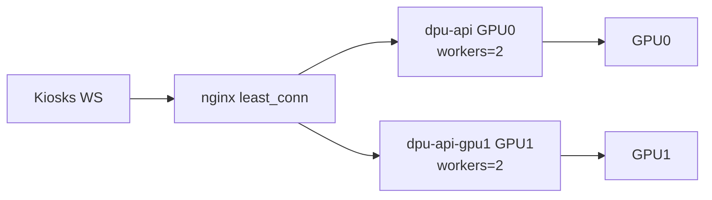

# Kiosk loadtest — GPU saturation (Phase 1–2)

**วันที่วัด:** 23 กันยายน 2026  
**โฮสต์:** `10.50.0.117` · URL `http://10.50.0.117:8880`  
**GPU:** 2× NVIDIA Quadro RTX 5000 16 GB  
**ตารางตัวเลข:** [KIOSK-LOADTEST-SATURATION-TABLE.md](KIOSK-LOADTEST-SATURATION-TABLE.md)  
**รายงาน workers=2 รอบก่อน (conservative):** [KIOSK-LOADTEST-WORKERS2-CAPACITY.md](KIOSK-LOADTEST-WORKERS2-CAPACITY.md)

---

## 1. ทำไมรอบก่อน GPU ไม่เต็ม

| สัญญาณ | ค่า (รอบ workers=2 process เดียว) |
|--------|-----------------------------------|
| GPU0 util avg | ~16% (peak ~87%) |
| GPU1 util avg | ~2% (ว่าง ~91% ของเวลา) |
| queue `active` | ชนเพดาน 2 ตลอด |
| peak throughput | ~59 jobs/s |

สรุป: worker “ยุ่ง” แต่ GPU ว่าง → คอขวดอยู่ที่ **CPU/GIL ใน uvicorn process เดียว** + เฟรมทดสอบใหญ่เกินจริง + **GPU1 ไม่ถูก pin จริง**

หลักฐาน pin ผิดก่อนแก้: `nvidia-smi --query-compute-apps` ระหว่างโหลดเห็น python ~4 GB เฉพาะบน **GPU0**; GPU1 ว่าง (4 MiB)

---

## 2. สิ่งที่ปรับในโปรเจกต์

### Phase 1 — การวัดที่เชื่อถือได้

| รายการ | รายละเอียด |
|--------|-------------|
| เฟรมสมจริง | `kiosk_load.py --frame-width 1280 --jpeg-quality 70` → เฟรม ~78 KB (เดิม mosaic ~546 KB / 3936 px) |
| Open-loop | `--profile stress --rate N` ส่ง detect ตามอัตรา ไม่รอ reply |
| Loadgen บน server | [`docker-compose.loadtest.yml`](../docker-compose.loadtest.yml) + [`scripts/kiosk-load/Dockerfile`](../scripts/kiosk-load/Dockerfile) (profile `loadtest`) |
| Host metrics | `poll_queue.py --host-metrics` → `api_cpu_pct`, `gpu0_sm`, `gpu1_sm` ใน CSV |

### Phase 2 — ปลดคอขวดฝั่ง DPU

| รายการ | รายละเอียด |
|--------|-------------|
| Device pin | `face_engine.get_face_app` ส่ง `provider_options=[{"device_id": N}, {}]` |
| Dual API | `dpu-api` → `CUDA_VISIBLE_DEVICES=0`, `dpu-api-gpu1` → `CUDA_VISIBLE_DEVICES=1`, คนละ `FACE_GPU_WORKERS=2` |
| nginx | [`docker/nginx/default.dual-gpu.conf`](../docker/nginx/default.dual-gpu.conf) · `upstream least_conn` |
| Decode CPU | `IMREAD_REDUCED` + decode pool แยกจาก GPU pool |



---

## 3. Before / After

| โปรไฟล์ | ก่อน (process เดียว + เฟรมใหญ่) | หลัง (dual API + เฟรมสมจริง) |
|---------|----------------------------------|-------------------------------|
| idle ×3 | OK ≤ **12** จอ | OK ≤ **24** จอ (p95 ~85 ms ที่ 24) |
| rush ×3 | OK ≤ **5** จอ | OK ≤ **6** จอ · MARGIN ที่ 8–12 |
| rush ×1 | OK ≤ **8** จอ | OK ≤ **12** จอ · MARGIN ที่ 16 |
| stress open-loop | ~120 detect/s (drop ~48%) | **160** detect/s offered (drop ~50%) |
| compute-apps | python เฉพาะ GPU0 | **ทั้ง 2 GPU** (~2.1 GB / process) |

### คำแนะนำใช้งาน (รอบนี้)

| สถานการณ์ | แนะนำ |
|-----------|--------|
| เร่งด่วนหนาแน่น (~3 คน/เฟรม) | **ไม่เกิน 6 จอ** |
| เร่งด่วนคนละคน/จอ | **ไม่เกิน 12 จอ** (16 ได้แบบขอบ SLO) |
| ช่วงโล่ง / detect | **ได้ถึง ~24 จอ** |

> ตัวเลขรอบ [WORKERS2-CAPACITY](KIOSK-LOADTEST-WORKERS2-CAPACITY.md) ยังใช้เป็น **เพดานแบบ conservative** ได้ถ้ายังไม่ได้ deploy dual-API

---

## 4. เกณฑ์ตัดสิน Face Core BFF (Phase 3)

| คำถาม | คำตอบจากผล Phase 2 |
|-------|---------------------|
| ต้องแยก face-core เพื่อให้ GPU เต็มไหม? | **ไม่** — dual API + pin ทำให้ทั้ง 2 ใบมี process แล้ว |
| throughput บนเครื่องเดียวจะสูงขึ้นชัดจาก Redis queue ไหม? | **ไม่น่าจะ** — ตอนนี้จำกัดที่ identify/check-in + CPU/host มากกว่า hop Redis |
| เมื่อไหร่ควรทำ face-core? | เมื่อต้องการ API replica > จำนวน GPU, สเกลข้ามเครื่อง, หรือ fairness คิวข้าม process |

**ข้อเสนอ:** เลื่อน face-core ไปเป็นงานสเกลข้ามเครื่อง / multi-tenant fairness — ไม่ต้องทำเพื่อ “ใช้ GPU ให้เต็ม” บนเซิร์ฟเวอร์ใบนี้

---

## 4b. รอบ 2 — ลดโหลดต้นทาง + ตัดดิสก์ (โค้ด)

| รายการ | รายละเอียด | ปิดกลับ |
|--------|-------------|---------|
| Motion gating (หน้าบ้าน) | thumbnail 32×24 diff; นิ่ง → keep-alive 600–2000 ms; ล็อกหน้า → 180 ms; settled → 300 ms | ตั้ง `KIOSK_STATIC_SCENE_DIFF` สูงมากใน `kiosk-tracker.service.ts` (หรือลด threshold เป็น 0) |
| Fast embed detect | WS identify/check-in: det@320 แล้ว recognition (ข้าม det@640) | `FACE_FAST_EMBED_DETECT=false` |
| In-memory WS path | ไม่เขียน `temp_images/` สำหรับ local InsightFace; รูป punch จาก bytes | — (path face-core ยังใช้ temp) |
| Workers | `FACE_GPU_WORKERS` default **3** ต่อ API process ใน `docker-compose.gpu.yml` | `FACE_GPU_WORKERS=2` |

คาด: detect/s ต่อจอจริงลดเหลือ ~2–5 เมื่อคนยืนนิ่ง; identify p95 ลดจากตัด disk + det640

---

## 5. วิธีรันซ้ำ

```bash
# บนเซิร์ฟเวอร์
docker compose -f docker-compose.yml -f docker-compose.gpu.yml up -d --build
# ตรวจ: dpu-api + dpu-api-gpu1 + nginx (mount default.dual-gpu.conf)

# จากเครื่องทดสอบ (หรือ compose profile loadtest)
export KIOSK_LOAD_BASE_URL=http://10.50.0.117:8880
python kiosk_load.py --frame-width 1280 --jpeg-quality 70 \
  --profile idle --faces-per-kiosk 3 --kiosks 4,8,12,16,24 --hold 25

python kiosk_load.py --profile stress --kiosks 8 --rate 20 --hold 40

# Host metrics (รันบนเครื่องที่มี nvidia-smi + docker)
python poll_queue.py --host-metrics --api-container dpu-api,dpu-api-gpu1 --csv queue-sat.csv
```

ไฟล์ดิบใน `scripts/kiosk-load/.cache/`:

- `results-sat-baseline-idle.jsonl` / `results-sat-baseline-stress.jsonl` (ก่อน dual-API, เฟรมสมจริง)
- `results-sat-after-{idle,rush3,rush1,stress}.jsonl`
