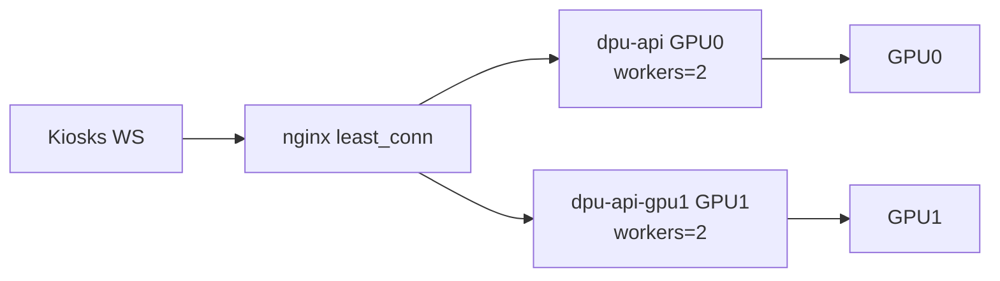

# Kiosk loadtest — GPU saturation (Phase 1–2)

**วันที่วัด:** 23 กันยายน 2026  
**โฮสต์:** `10.50.0.117` · URL `http://10.50.0.117:8880`  
**GPU:** 2× NVIDIA Quadro RTX 5000 16 GB  
**ตารางตัวเลข:** [KIOSK-LOADTEST-SATURATION-TABLE.md](KIOSK-LOADTEST-SATURATION-TABLE.md)  
**รายงาน workers=2 รอบก่อน (conservative):** [KIOSK-LOADTEST-WORKERS2-CAPACITY.md](KIOSK-LOADTEST-WORKERS2-CAPACITY.md)

---

## 1. ทำไมรอบก่อน GPU ไม่เต็ม

| สัญญาณ | ค่า (รอบ workers=2 process เดียว) |
|--------|-----------------------------------|
| GPU0 util avg | ~16% (peak ~87%) |
| GPU1 util avg | ~2% (ว่าง ~91% ของเวลา) |
| queue `active` | ชนเพดาน 2 ตลอด |
| peak throughput | ~59 jobs/s |

สรุป: worker “ยุ่ง” แต่ GPU ว่าง → คอขวดอยู่ที่ **CPU/GIL ใน uvicorn process เดียว** + เฟรมทดสอบใหญ่เกินจริง + **GPU1 ไม่ถูก pin จริง**

หลักฐาน pin ผิดก่อนแก้: `nvidia-smi --query-compute-apps` ระหว่างโหลดเห็น python ~4 GB เฉพาะบน **GPU0**; GPU1 ว่าง (4 MiB)

---

## 2. สิ่งที่ปรับในโปรเจกต์

### Phase 1 — การวัดที่เชื่อถือได้

| รายการ | รายละเอียด |
|--------|-------------|
| เฟรมสมจริง | `kiosk_load.py --frame-width 1280 --jpeg-quality 70` → เฟรม ~78 KB (เดิม mosaic ~546 KB / 3936 px) |
| Open-loop | `--profile stress --rate N` ส่ง detect ตามอัตรา ไม่รอ reply |
| Loadgen บน server | [`docker-compose.loadtest.yml`](../docker-compose.loadtest.yml) + [`scripts/kiosk-load/Dockerfile`](../scripts/kiosk-load/Dockerfile) (profile `loadtest`) |
| Host metrics | `poll_queue.py --host-metrics` → `api_cpu_pct`, `gpu0_sm`, `gpu1_sm` ใน CSV |

### Phase 2 — ปลดคอขวดฝั่ง DPU

| รายการ | รายละเอียด |
|--------|-------------|
| Device pin | `face_engine.get_face_app` ส่ง `provider_options=[{"device_id": N}, {}]` |
| Dual API | `dpu-api` → `CUDA_VISIBLE_DEVICES=0`, `dpu-api-gpu1` → `CUDA_VISIBLE_DEVICES=1`, คนละ `FACE_GPU_WORKERS=2` |
| nginx | [`docker/nginx/default.dual-gpu.conf`](../docker/nginx/default.dual-gpu.conf) · `upstream least_conn` |
| Decode CPU | `IMREAD_REDUCED` + decode pool แยกจาก GPU pool |



---

## 3. Before / After

| โปรไฟล์ | ก่อน (process เดียว + เฟรมใหญ่) | หลัง (dual API + เฟรมสมจริง) |
|---------|----------------------------------|-------------------------------|
| idle ×3 | OK ≤ **12** จอ | OK ≤ **24** จอ (p95 ~85 ms ที่ 24) |
| rush ×3 | OK ≤ **5** จอ | OK ≤ **6** จอ · MARGIN ที่ 8–12 |
| rush ×1 | OK ≤ **8** จอ | OK ≤ **12** จอ · MARGIN ที่ 16 |
| stress open-loop | ~120 detect/s (drop ~48%) | **160** detect/s offered (drop ~50%) |
| compute-apps | python เฉพาะ GPU0 | **ทั้ง 2 GPU** (~2.1 GB / process) |

### คำแนะนำใช้งาน (รอบนี้)

| สถานการณ์ | แนะนำ |
|-----------|--------|
| เร่งด่วนหนาแน่น (~3 คน/เฟรม) | **ไม่เกิน 6 จอ** |
| เร่งด่วนคนละคน/จอ | **ไม่เกิน 12 จอ** (16 ได้แบบขอบ SLO) |
| ช่วงโล่ง / detect | **ได้ถึง ~24 จอ** |

> ตัวเลขรอบ [WORKERS2-CAPACITY](KIOSK-LOADTEST-WORKERS2-CAPACITY.md) ยังใช้เป็น **เพดานแบบ conservative** ได้ถ้ายังไม่ได้ deploy dual-API

---

## 4. เกณฑ์ตัดสิน Face Core BFF (Phase 3)

| คำถาม | คำตอบจากผล Phase 2 |
|-------|---------------------|
| ต้องแยก face-core เพื่อให้ GPU เต็มไหม? | **ไม่** — dual API + pin ทำให้ทั้ง 2 ใบมี process แล้ว |
| throughput บนเครื่องเดียวจะสูงขึ้นชัดจาก Redis queue ไหม? | **ไม่น่าจะ** — ตอนนี้จำกัดที่ identify/check-in + CPU/host มากกว่า hop Redis |
| เมื่อไหร่ควรทำ face-core? | เมื่อต้องการ API replica > จำนวน GPU, สเกลข้ามเครื่อง, หรือ fairness คิวข้าม process |

**ข้อเสนอ:** เลื่อน face-core ไปเป็นงานสเกลข้ามเครื่อง / multi-tenant fairness — ไม่ต้องทำเพื่อ “ใช้ GPU ให้เต็ม” บนเซิร์ฟเวอร์ใบนี้

---

## 4b. รอบ 2 — ลดโหลดต้นทาง + ตัดดิสก์ (โค้ด)

| รายการ | รายละเอียด | ปิดกลับ |
|--------|-------------|---------|
| Motion gating (หน้าบ้าน) | thumbnail 32×24 diff; นิ่ง → keep-alive 600–2000 ms; ล็อกหน้า → 180 ms; settled → 300 ms | ตั้ง `KIOSK_STATIC_SCENE_DIFF` สูงมากใน `kiosk-tracker.service.ts` (หรือลด threshold เป็น 0) |
| Fast embed detect | WS identify/check-in: det@320 แล้ว recognition (ข้าม det@640) | `FACE_FAST_EMBED_DETECT=false` |
| In-memory WS path | ไม่เขียน `temp_images/` สำหรับ local InsightFace; รูป punch จาก bytes | — (path face-core ยังใช้ temp) |
| Workers | `FACE_GPU_WORKERS` default **3** ต่อ API process ใน `docker-compose.gpu.yml` | `FACE_GPU_WORKERS=2` |

คาด: detect/s ต่อจอจริงลดเหลือ ~2–5 เมื่อคนยืนนิ่ง; identify p95 ลดจากตัด disk + det640

### ผลวัดรอบ 2 บน `10.50.0.117` (deploy 9d407e2d, workers=3) — ตาราง [KIOSK-LOADTEST-PERF2-TABLE.md](KIOSK-LOADTEST-PERF2-TABLE.md)

> loadgen ยังส่ง detect เต็มอัตรา 90 ms (ไม่ได้ใช้ motion gating ของหน้าบ้าน) — ตัวเลขนี้จึงเป็น **เพดานฝั่ง server ล้วน**; ของจริงคีออสจะส่งน้อยกว่านี้อีก

| โปรไฟล์ | ก่อน (workers=2, code 7b5b140d) | หลัง (workers=3, code 9d407e2d) |
|---------|------------------|------------------|
| idle × 3 คน/จอ | 24 จอ OK (p95 85 ms) | **32 จอ OK** (p95 113 ms) — ยังไม่ชนเพดาน |
| rush × 3 คน/จอ | 6 จอ OK · 8 MARGIN · 16 FAIL (drop 57%) | **16 จอ OK** (detect p95 299 ms, drop 0%) |
| rush × 1 คน/จอ | 12 จอ OK · 16 MARGIN | **24 จอ OK** (detect p95 381 ms) |
| identify p95 @ rush×3 4 จอ | 326 ms | **187 ms** |
| check-in p95 @ rush×3 4 จอ | 110 ms | 135 ms (เท่าเดิมโดยประมาณ — จำกัดที่ DB/dedupe) |

Host metrics ระหว่างโหลด: GPU SM avg ~11% ต่อใบ (peak 31–35%), API CPU ~150% ต่อ process (p95 ~250%) → คอขวดยังเป็น **CPU ต่อ process** ไม่ใช่ GPU; ขั้นถัดไปถ้าต้องการเพดานสูงกว่านี้คือเพิ่ม API process (เช่น 2 process ต่อการ์ด) หรือย้าย whisper ออกจาก GPU0

---

## 4c. รอบ 3 — 2 process ต่อการ์ด (quad API) + ย้าย whisper ออกจาก GPU0

| รายการ | รายละเอียด | ถอยกลับ |
|--------|-------------|---------|
| Quad API | [`docker-compose.gpu-x2.yml`](../docker-compose.gpu-x2.yml) เพิ่ม `dpu-api-gpu0b` (GPU0) + `dpu-api-gpu1b` (GPU1) ผ่าน `extends` จาก `api-gpu1`; nginx mount [`default.quad-gpu.conf`](../docker/nginx/default.quad-gpu.conf) (4 upstreams, `least_conn`) | ตัด `-f docker-compose.gpu-x2.yml` แล้ว `up -d --remove-orphans` |
| whisper_server | process ของ `myhr` (พอร์ต 8091, th-large-v3 float32 ~4 GB) รันใหม่ด้วย `CUDA_VISIBLE_DEVICES=1` — GPU0 เหลือเฉพาะ DPU | รันตาม `/home/whisper_server/run.txt` โดยไม่ตั้ง env |
| workers | คง `FACE_GPU_WORKERS=3` ต่อ process (A/B กับ 2 ไม่ต่างในระดับ noise) | — |

ผลวัด (loadgen เต็มอัตรา 90 ms เหมือนเดิม) — ตาราง [KIOSK-LOADTEST-PERF3-TABLE.md](KIOSK-LOADTEST-PERF3-TABLE.md):

| โปรไฟล์ | รอบ 2 (2 process) | รอบ 3 (4 process) |
|---------|------------------|------------------|
| idle × 3 คน/จอ | 32 จอ OK (p95 113 ms) | **48 จอ OK** (p95 173 ms) — ยังไม่ชนเพดาน |
| rush × 3 คน/จอ | 16 จอ OK (299 ms) | **24 จอ OK** (514 ms) · 32 จอ FAIL (740 ms) |
| rush × 1 คน/จอ | 24 จอ OK (381 ms) | **32 จอ OK** (429 ms) · 48 จอ FAIL (817 ms) |
| identify p95 @ rush×3 16 จอ | 484 ms | 452 ms |

Host metrics: GPU SM avg ~16%/ใบ (peak 39%), API CPU ~120% × 4 process (รวม ~480% จาก 32 core) → GPU ยังเหลือมาก; เพดานถัดไปน่าจะเป็น **DB/pgvector + dedupe query ต่อ check-in** (check-in p95 ไล่ตาม detect p95 ในทุก step) และ latency ของ WS I/O ใน process เดียว — ถ้าต้องการ > 24 จอ rush ให้พิจารณา 3 process ต่อการ์ด หรือย้ายไป Face Core ข้ามเครื่อง

> ข้อสังเกต: ที่ 16 จอ rush×3 รอบ 3 ได้ 383 ms (รอบ 2 = 299 ms) — อยู่ในช่วง noise ระหว่างรัน (รอบ 2 ที่ 12 จอ = 263, 16 จอ = 299) และ 4 process ช่วยชัดเมื่อโหลด ≥ 24 จอเท่านั้น

---

## 4d. รอบ 4 — 3 process ต่อการ์ด (hexa API) · หา saturation โดยไม่สน UX

| รายการ | รายละเอียด | ถอยกลับ |
|--------|-------------|---------|
| Hexa API | [`docker-compose.gpu-x3.yml`](../docker-compose.gpu-x3.yml) เพิ่ม `dpu-api-gpu0c` + `dpu-api-gpu1c`; nginx [`default.hexa-gpu.conf`](../docker/nginx/default.hexa-gpu.conf) (6 upstreams) | ตัด `-f docker-compose.gpu-x3.yml` แล้ว `up -d --remove-orphans` (กลับเป็น quad) |
| เป้าหมายวัด | หาเพดานฮาร์ดแวร์เมื่อยอมรับ latency 1–2 s / ไม่ยึด SLO 550 ms | — |

ผลวัด — ตาราง [KIOSK-LOADTEST-PERF4-TABLE.md](KIOSK-LOADTEST-PERF4-TABLE.md):

| โปรไฟล์ | Quad (รอบ 3) SLO | Hexa SLO | Hexa saturation (ยังรับงาน, drop≈0) |
|---------|------------------|----------|-------------------------------------|
| idle ×3 | 48 จอ | **≥ 96 จอ** (112+ มี session error) | ~160 จอ (detect ยัง ~506 ms แต่ handshake พังบางส่วน) |
| rush ×3 | **24 จอ** | **16 จอ** (24 = 674 ms แย่กว่า quad) | ~56 จอ @ 1.6–1.8 s |
| rush ×1 | **32 จอ** | ~24–32 จอ (ขอบ) | ~80 จอ @ ~1.8 s |

Host metrics: GPU SM avg ~21%/ใบ (peak ~48%), VRAM ~5.5 GB/การ์ด (6× ~1.9 GB), CPU ต่อ process ~75–90% avg → **GPU ยังไม่เต็ม**; rush แย่ลงเพราะแย่ง GPU queue + DB ระหว่าง process มากขึ้น

**ข้อสรุป:** 3 process/GPU เหมาะกับ idle concurrent สูง ไม่เหมาะชั่วโมงเร่งด่วน — production ที่สน UX ควรอยู่ที่ **quad (2/GPU)**

---

## 4e. รอบ 5 — check-in dedupe cache (quad) + แผน A/B hexa workers=2

| รายการ | รายละเอียด |
|--------|-------------|
| Rollback | ถอย hexa → quad บนเซิร์ฟเวอร์ก่อนวัด |
| โค้ด | [`checkin_dedupe_cache.py`](../API-Fast/src/utils/checkin_dedupe_cache.py) — TTL = `CHECK_IN_DEDUPE_SECONDS`; hit ข้าม query `EmployeeTimestamp` |
| Loadgen | เพิ่ม `--detect-interval-ms` ใน [`kiosk_load.py`](../scripts/kiosk-load/kiosk_load.py) สำหรับจำลอง motion gating (600–2000 ms) |

ผลวัด — [KIOSK-LOADTEST-PERF5-TABLE.md](KIOSK-LOADTEST-PERF5-TABLE.md):

| โปรไฟล์ | PERF3 (full-rate) | PERF5A cache | PERF5B hexa w2 | PERF5C gated 600 ms |
|---------|-------------------|--------------|----------------|---------------------|
| rush×3 24 | **514 OK** | 790 FAIL | 663 FAIL | 766* |
| rush×3 32 | 740 FAIL | 856 FAIL | 793 FAIL | **425 OK** |
| rush×1 32 | 429 OK | 501 OK | 1742 FAIL | **189 OK** |
| rush×1 48 | 817 FAIL | — | — | **399 OK** |

**สรุป:** cache ช่วย check-in โหลดต่ำ; hexa+w2 ไม่ชนะ quad; **motion gating ~600 ms ดัน rush×3 เป็น 32 จอ และ rush×1 เป็น 48 จอ** บน quad — production คง quad w3 + ค่า `KIOSK_STATIC_WITH_FACES_MS=800`

> หลัง loadtest 5A โฮสต์เคยไม่ตอบชั่วคราวแล้วกลับมา; ท้ายรอบถอย hexa แล้วเหลือ quad

---

## 5. วิธีรันซ้ำ

```bash
# บนเซิร์ฟเวอร์
docker compose -f docker-compose.yml -f docker-compose.gpu.yml up -d --build
# ตรวจ: dpu-api + dpu-api-gpu1 + nginx (mount default.dual-gpu.conf)

# จากเครื่องทดสอบ (หรือ compose profile loadtest)
export KIOSK_LOAD_BASE_URL=http://10.50.0.117:8880
python kiosk_load.py --frame-width 1280 --jpeg-quality 70 \
  --profile idle --faces-per-kiosk 3 --kiosks 4,8,12,16,24 --hold 25

python kiosk_load.py --profile stress --kiosks 8 --rate 20 --hold 40

# Host metrics (รันบนเครื่องที่มี nvidia-smi + docker)
python poll_queue.py --host-metrics --api-container dpu-api,dpu-api-gpu1 --csv queue-sat.csv
```

ไฟล์ดิบใน `scripts/kiosk-load/.cache/`:

- `results-sat-baseline-idle.jsonl` / `results-sat-baseline-stress.jsonl` (ก่อน dual-API, เฟรมสมจริง)
- `results-sat-after-{idle,rush3,rush1,stress}.jsonl`
