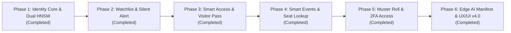

# SentinelVision — Unified Biometric Identity, Security & Vision Analytics Platform

**Repository:** `https://github.com/chanachaipmgeng/SentinelVision.git`  
**Release:** `v6.3.0` (Phase 1 – Phase 8 + UX/UI Audit Remediation Implemented)  
**Core Engine:** FastAPI (`API-Fast`) + InsightFace `buffalo_l` (512-d ArcFace) + PostgreSQL `pgvector` (Dual HNSW Indexes, Alembic `0001..0037`) + Angular 19 (`Web-Manage`)

---

## 1. Vision & Platform Modules (All 6 Modules Active)

**SentinelVision** unifies workforce attendance and physical security into a 6-module **Biometric Identity & Security Platform**:

1. **Time & Workforce Attendance (`/company/timestamp-face`, `/company/hr-schedule`):** Multi-person real-time WebSocket Kiosk (`/face/ws/kiosk`), Passive Anti-Spoofing, Multi-shift HR workflows (including cross-midnight shifts), and Geo-fenced check-in.
2. **Watchlist, Blacklist & VIP Alerting (`/company/sentinel-center?tab=watchlist`):** Real-time 1:N identification against tiered watchlists (`BLACKLIST`, `POI`, `VIP`) with silent alarms and instant multi-channel dispatch (`notification_outbox` -> Webhook / LINE / Security Console).
3. **Smart Access Control & Visitor Pass (`/company/sentinel-center?tab=access` & `tab=visitors`):** Zone/door permission matrix (`SentinelAccessZone`), time schedules, 2FA high-security mode, IoT/Relay controller integration (`relay_webhook_url`), and Visitor passes with auto-expiring biometric profiles (`expire_sentinel_identities_tick`).
4. **Smart Events & Seminar Check-in (`/company/sentinel-center?tab=events`):** High-throughput walk-through event check-in (`SentinelEvent`), custom welcome messages, seat/table lookup (`seat_number`), and real-time attendance analytics.
5. **AI Vision Analytics, Multi-Modal Security & Muster Roll (`/company/sentinel-center?tab=command` & `tab=muster`):** 2FA High-Security Access (Face + PIN/TOTP), Real-time Building Occupancy & Emergency Muster Roll, and unified 1:N scan simulator.
6. **Edge AI Fleet Synchronization (`/sentinel/company/{companyId}/edge-sync`):** Offline-first Edge Kiosk embedding manifest synchronization and active zone configuration export.

---

## 2. Master Roadmap Status (Phase 1 – Phase 6 Complete)

| Phase | Module / Capability | Key Files | Status |
| :--- | :--- | :--- | :--- |
| **Phase 1** | Unified Identity Schema (`sentinel_identity` + HNSW index) & Alembic `0006` | `src/models/sentinel.py`, `src/utils/schema_migrate.py`, `alembic/versions/0006_sentinel_vision_core.py` | ✅ Completed |
| **Phase 2** | Dual 1:N Vector Search + Watchlist/Blacklist Silent Alarm & Incident Feed | `src/services/face_match_service.py`, `src/routes/sentinel_routes.py`, `src/controllers/face_controller.py` | ✅ Completed |
| **Phase 3** | Smart Access Control Zones, IoT Door Relay Webhook & Visitor Pass + PDPA Auto-Expiry | `src/routes/sentinel_routes.py`, `src/main.py` (`expire_sentinel_identities_tick`) | ✅ Completed |
| **Phase 4** | Smart Events & Seminar Check-in with Seat/Table Lookup | `src/models/sentinel.py` (`SentinelEvent`), `src/routes/sentinel_routes.py` | ✅ Completed |
| **Phase 5** | Live Building Occupancy / Emergency Muster Roll & 2FA Zone Enforcement | `GET /sentinel/company/{companyId}/overview`, `POST /sentinel/company/{companyId}/scan` | ✅ Completed |
| **Phase 6** | Offline-First Edge Sync Manifest, Single-Origin Nginx Routing & Modern UX/UI Console | `Web-Manage/src/app/DPU/company-management/sentinel-center/`, `docker/nginx/default*.conf` | ✅ Completed |

---

## 3. Phase 7: Enterprise Scale & Performance Hardening (Completed)

| Track | Capability | Key Files | Status |
| :--- | :--- | :--- | :--- |
| **Vector Recall** | `hnsw.iterative_scan` (`relaxed_order`) with `SAVEPOINT` fallback + centralized `_apply_hnsw_session_params` | `API-Fast/src/services/face_match_service.py`, `API-Fast/src/config/settings.py` | ✅ Completed |
| **Hot-Path Cache** | Redis JSON cache (`sv:modcfg:*`, `sv:zones:*`) + multi-replica Kiosk scan debounce (`kiosk_scan_debounce_check`) | `API-Fast/src/services/cache_service.py`, `company_module_service.py`, `sentinel_controller.py` | ✅ Completed |
| **Governance** | Tamper-evident SHA-256 hash-chained `audit_log` + `GET /sentinel/company/{companyId}/audit-verify` | `API-Fast/src/services/audit_service.py`, `API-Fast/src/routes/sentinel_routes.py` | ✅ Completed |
| **SCIM 2.0 Sync** | RFC 7643/7644 `/scim/v2/company/{companyId}/Users` provisioning + PDPA deprovision erasure + `scim.write` API key scope | `API-Fast/src/services/scim_service.py`, `API-Fast/src/routes/scim_routes.py`, `docker/nginx/snippets/gateway.conf` | ✅ Completed |
| **Realtime Alerts** | Watchlist/Security Incident WebSocket push (`/sentinel/ws/incidents/{companyId}`) + Redis Pub/Sub + Command Center live toast | `API-Fast/src/services/incident_ws_hub.py`, `Web-Manage/.../sentinel-center.component.ts` | ✅ Completed |
| **Frontend Speed** | `ChangeDetectionStrategy.OnPush` on Attendance Logs, Live Wall, Audit Log & `DataTableComponent` + `@angular/cdk/scrolling` Virtual Scroll + Adaptive Sub-Stream | `Web-Manage/src/app/shared/components/data-table/`, `Web-Manage/src/app/DPU/company-management/{timestamp-log,live-wall,audit-log}/` | ✅ Completed |
| **Branch RBAC** | `allowed_location_ids` branch/location row-level scope resolution for multi-branch managers | `API-Fast/src/services/rbac_service.py` | ✅ Completed |
| **ONVIF & PTZ** | Pure-Python WS-Discovery (`239.255.255.250:3702`) + ONVIF PTZ `ContinuousMove`/`Stop` endpoints | `API-Fast/src/services/onvif_service.py`, `API-Fast/src/routes/camera_routes.py` | ✅ Completed |
| **Door Telemetry** | Bidirectional door-sensor telemetry (`POST /sentinel/company/{companyId}/zones/{zoneId}/door-telemetry`) with `DOOR_FORCED_OPEN` & `DOOR_HELD_OPEN` alerting | `API-Fast/src/controllers/sentinel_controller.py`, `API-Fast/src/routes/sentinel_routes.py` | ✅ Completed |
| **Visitor Self-Reg** | HMAC-signed Guest Self-Service Pre-Registration (`POST /visitors/invite`, `GET/POST /public/visitor-invite/{token}`) with PDPA consent & face enrollment | `API-Fast/src/services/visitor_invite_service.py`, `API-Fast/src/routes/sentinel_routes.py` | ✅ Completed |
| **Mantrap Interlock** | Hardware Mantrap / Airlock interlock (`check_mantrap_interlock`) blocking unlock/entry (`409 MANTRAP_INTERLOCK_ACTIVE`) & logging `MANTRAP_INTERLOCK_BLOCKED` when paired door is open | `API-Fast/src/controllers/sentinel_controller.py` | ✅ Completed |
| **HRIS Connectors** | Native HRIS/Payroll connector exports (`SAP_CSV`, `WORKDAY_JSON`, `PEAK_CSV`, `FLOWACCOUNT_CSV`) via `GET /hr/company/{companyId}/payroll-connectors/{connector}` | `API-Fast/src/services/hris_connector_service.py`, `API-Fast/src/routes/hr_routes.py` | ✅ Completed |
| **Thai ID / Passport OCR** | Thai National ID (Mod-11 checksum) & ICAO 9303 TD3 Passport MRZ (7-3-1 check digits) OCR/parser with PDPA masking for Visitor Self-Service & Reception | `API-Fast/src/services/id_ocr_service.py`, `API-Fast/src/routes/sentinel_routes.py` | ✅ Completed |
| **Multi-Region DR** | Active-Active Multi-Region DR topology (`GET /sentinel/company/{companyId}/dr/topology`) & HMAC-signed replication receiver (`POST /sentinel/dr/replicate`) with idempotent Redis cache invalidation | `API-Fast/src/services/dr_replication_service.py`, `API-Fast/src/config/settings.py`, `API-Fast/src/routes/sentinel_routes.py` | ✅ Completed |
| **Enterprise UI** | Console UI integration for Audit Hash-Chain Verify, HRIS Connectors (`SAP`/`Workday`/`PEAK`/`FlowAccount`), ONVIF Discovery & PTZ, Visitor Invite/OCR, and Multi-Region DR Topology | `Web-Manage/src/app/DPU/company-management/{audit-log,reports,cameras,sentinel-center}/` | ✅ Completed |
| **Guest Portal & NVR Scrubber** | Public Guest Self-Service Pre-Registration Portal (`/#/visitor-invite/:token` with PDPA & OCR) + Unified NVR AI-Marker Timeline Scrubber | `Web-Manage/src/app/authentication/visitor-invite/`, `Web-Manage/src/app/DPU/company-management/playback/` | ✅ Completed |
| **P2 Enterprise Polish** | TensorRT FP16 EP (`FACE_TENSORRT_ENABLED`), Event Breakout Room Capacity (`POST .../sessions/check-in`), Dynamic PDPA Privacy Masking (`PUT .../privacy-masks`), and `audit-verify` legacy-row compatibility | `API-Fast/src/utils/face_engine.py`, `event_session_service.py`, `privacy_mask_service.py`, `audit_service.py` | ✅ Completed |

---

## 4. Phase 8 (v6.3.0): IVAP v2.0 Benchmark Priorities 1–3 & Full-App UX/UI Hardening (Completed)

| Track | Capability | Key Files | Status |
| :--- | :--- | :--- | :--- |
| **Priority 1: Edge Fleet Health & Telemetry** | Real-time Edge Kiosk & CCTV health telemetry (`GET /sentinel/company/{companyId}/fleet-health`), dynamic health score thresholds & `/company/fleet-health` console | `API-Fast/src/routes/sentinel_routes.py`, `Web-Manage/.../fleet-health/fleet-health.component.ts` | ✅ Completed |
| **Priority 2: Visitor Self-Reg & Event QR** | Public Visitor Invitation flow, Event Public Registration Portal with lazy-loaded QR generation (`qrcode`), and Alembic `0036_event_public_registration` | `API-Fast/src/services/event_registration_service.py`, `API-Fast/alembic/versions/0036_event_public_registration.py` | ✅ Completed |
| **Priority 3: Smart Parking LPR & RFID Cards** | `sentinel_vehicle`, `sentinel_parking_spot`, `sentinel_parking_transaction`, `sentinel_rfid_card` (Alembic `0037_vehicle_parking_rfid`), automated LPR barrier & dwell engine, RFID swipe verification, `/company/parking` & `/company/rfid-cards` | `API-Fast/src/services/{parking_service,rfid_service}.py`, `Web-Manage/.../{parking,rfid-cards}/` | ✅ Completed |
| **48-Screen UX/UI & CI Hardening** | Landing Hero contrast/LCP fix, Dashboard `totalEmployees` reconciliation, Self-Service System-Admin 404 guard, Chrome 135+ `<select>::picker-icon` double-arrow fix, Cameras `<app-page-header>` & offline PTZ guard, RBAC 2x2 grid & active rail fix, Trivy `dpu/backup:ci` clean, scoped `Web-Manage/GEMINI.md` | `API-Fast/src/controllers/dashboard_controller.py`, `Web-Manage/src/assets/css/{dpu-theme,dpu-landing}.css`, `Web-Manage/GEMINI.md` | ✅ Completed |
