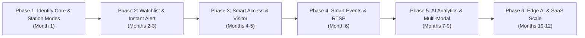

# SentinelVision — Unified Biometric Identity, Security & Vision Analytics Platform

**Repository:** `https://github.com/chanachaipmgeng/SentinelVision`  
**Core Engine:** FastAPI (`API-Fast`) + InsightFace `buffalo_l` (512-d ArcFace) + PostgreSQL `pgvector` (HNSW) + Angular 17 (`Web-Manage`)

---

## 1. Vision & Platform Modules

**SentinelVision** expands the enterprise Face Attendance foundation into a 6-module **Unified Biometric Identity & Security Platform**:

1. **Time & Workforce Attendance:** Multi-person real-time WebSocket Kiosk (`/face/ws/kiosk`), Liveness verification, Multi-shift HR workflows, and Geo-fenced mobile check-in.
2. **Watchlist, Blacklist & VIP Alerting:** Real-time 1:N identification against tiered watchlists (`BLACKLIST`, `POI`, `VIP`) with silent alarms and instant multi-channel dispatch (`notification_outbox` -> LINE / Webhook / Security Console).
3. **Smart Access Control & Visitor Pass:** Zone/door permission matrix (`AccessZone`, `AccessRule`), time schedules, IoT/Relay controller integration (HTTP Webhook / MQTT / Wiegand bridge), and self-service Visitor pre-registration with auto-expiring biometric profiles.
4. **Smart Events & Seminar Check-in:** High-throughput walk-through event check-in, live welcome screens, seat/table lookup, and real-time booth/session attendance analytics.
5. **AI Vision Analytics & Multi-Modal Security:** 2FA High-Security Access (Face + PIN/QR/TOTP), Real-time Zone Occupancy & Emergency Muster Roll, Dwell-time/Loitering detection, and Cross-camera Person Journey Reconstruction.
6. **Edge AI Fleet & Enterprise SaaS:** Offline-first Edge Kiosk embedding cache & synchronization, remote device health monitoring, natural-language security search, and multi-tenant subscription quotas.

---

## 2. Master Roadmap (Phase 1 – Phase 6)

---

## 3. Detailed Implementation Plan (Starting Now — Phase 1 & Phase 2)

### Sprint 1 (Phase 1A): Unified Identity & Biometric Lifecycle Schema
- **Database Evolution (`API-Fast/src/utils/schema_migrate.py` + Alembic):**
  - Introduce `identity_profile` (or extend `member` / `face_encoding` with `identity_type`: `EMPLOYEE`, `VISITOR`, `VIP`, `BLACKLIST`, `EVENT_ATTENDEE`) scoped strictly by `company_id`.
  - Add biometric lifecycle columns: `valid_from`, `expires_at`, `consent_version`, and `retention_policy`.
  - Add `kiosk_station` metadata (`station_id`, `company_id`, `location_id`, `station_mode`: `ATTENDANCE`, `ACCESS_CONTROL`, `EVENT_CHECKIN`, `WATCHLIST_MONITOR`, `relay_webhook_url`).

### Sprint 2 (Phase 1B): Multi-Mode Kiosk & Unified 1:N Vector Search
- **Backend (`API-Fast/src/controllers/face_ws.py` & `face_encoding.py`):**
  - Upgrade `search_face_pgvector` to support unified 1:N matching across active employees, active visitors, event attendees, and company watchlists in a single HNSW query while preserving strict tenant isolation (`company_id`) and active status filtering.
  - Return structured match actions based on `station_mode` (e.g., record attendance, trigger silent watchlist alert, evaluate door access rule, or display event seat).

### Sprint 3 (Phase 2): Watchlist, Blacklist & Real-Time Security Center
- **Backend (`API-Fast`):**
  - CRUD endpoints for `watchlist_entry` (`BLACKLIST`, `POI`, `VIP`, severity level, alert channels, face embeddings).
  - Real-time alert event creation in `notification_outbox` with snapshot attachment and instant WebSocket push to Security Dashboard.
- **Frontend (`Web-Manage`):**
  - **Watchlist Management Console:** Register and manage Blacklist/VIP profiles with multi-angle face enrollment.
  - **Live Security Alert Feed:** Real-time popups and incident log when a Watchlist face is detected at any Kiosk/Camera.

### Sprint 4 (Phase 3): Smart Access Control & Visitor Management
- **Backend (`API-Fast`):**
  - `access_zone`, `access_rule` (Department/Position/IdentityType + Time Window), and `access_log` models.
  - Non-blocking hardware relay trigger service (HTTP/MQTT) dispatched via async worker.
  - Visitor Pre-Registration API & temporary token link for self-enrollment + PDPA consent.
- **Frontend (`Web-Manage`):**
  - Access Control Matrix UI (Zones, Doors, Schedules, Live Door Status & Manual Unlock).
  - Visitor Pass Portal & Approval workflow.

### Sprint 5 (Phase 4): Smart Events & RTSP Stream Worker
- **Backend & Stream Worker:**
  - `event_campaign`, `event_registration`, and `event_checkin_log` models.
  - Optional RTSP IP Camera frame ingestion worker feeding `Face Core` / `API-Fast`.
- **Frontend (`Web-Manage`):**
  - Event Manager & Kiosk Event Welcome Mode (Custom branding, VIP badge, Table/Seat display).

### Sprint 6 (Phase 5 & 6): Spatial Intelligence, Muster Roll & Edge Sync
- Real-time Building Occupancy & Emergency Muster Roll dashboard.
- 2FA High-Security Kiosk challenge (Face + TOTP/PIN).
- Edge Kiosk offline delta-sync API (`/api/v1/edge/sync-embeddings`) and Fleet Health telemetry.
