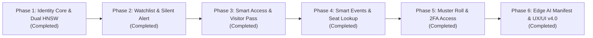

# SentinelVision — Unified Biometric Identity, Security & Vision Analytics Platform

**Repository:** `https://github.com/chanachaipmgeng/SentinelVision.git`  
**Release:** `v4.0.0` (Phase 1 – Phase 6 Implemented)  
**Core Engine:** FastAPI (`API-Fast`) + InsightFace `buffalo_l` (512-d ArcFace) + PostgreSQL `pgvector` (Dual HNSW Indexes) + Angular 19 (`Web-Manage`)

---

## 1. Vision & Platform Modules (All 6 Modules Active)

**SentinelVision** unifies workforce attendance and physical security into a 6-module **Biometric Identity & Security Platform**:

1. **Time & Workforce Attendance (`/company/timestamp-face`, `/company/hr-schedule`):** Multi-person real-time WebSocket Kiosk (`/face/ws/kiosk`), Passive Anti-Spoofing, Multi-shift HR workflows (including cross-midnight shifts), and Geo-fenced check-in.
2. **Watchlist, Blacklist & VIP Alerting (`/company/sentinel-center?tab=watchlist`):** Real-time 1:N identification against tiered watchlists (`BLACKLIST`, `POI`, `VIP`) with silent alarms and instant multi-channel dispatch (`notification_outbox` -> Webhook / LINE / Security Console).
3. **Smart Access Control & Visitor Pass (`/company/sentinel-center?tab=access` & `tab=visitors`):** Zone/door permission matrix (`SentinelAccessZone`), time schedules, 2FA high-security mode, IoT/Relay controller integration (`relay_webhook_url`), and Visitor passes with auto-expiring biometric profiles (`expire_sentinel_identities_tick`).
4. **Smart Events & Seminar Check-in (`/company/sentinel-center?tab=events`):** High-throughput walk-through event check-in (`SentinelEvent`), custom welcome messages, seat/table lookup (`seat_number`), and real-time attendance analytics.
5. **AI Vision Analytics, Multi-Modal Security & Muster Roll (`/company/sentinel-center?tab=command` & `tab=muster`):** 2FA High-Security Access (Face + PIN/TOTP), Real-time Building Occupancy & Emergency Muster Roll, and unified 1:N scan simulator.
6. **Edge AI Fleet Synchronization (`/sentinel/company/{companyId}/edge-sync`):** Offline-first Edge Kiosk embedding manifest synchronization and active zone configuration export.

---

## 2. Master Roadmap Status (Phase 1 – Phase 6 Complete)

| Phase | Module / Capability | Key Files | Status |
| :--- | :--- | :--- | :--- |
| **Phase 1** | Unified Identity Schema (`sentinel_identity` + HNSW index) & Alembic `0006` | `src/models/sentinel.py`, `src/utils/schema_migrate.py`, `alembic/versions/0006_sentinel_vision_core.py` | ✅ Completed |
| **Phase 2** | Dual 1:N Vector Search + Watchlist/Blacklist Silent Alarm & Incident Feed | `src/services/face_match_service.py`, `src/routes/sentinel_routes.py`, `src/controllers/face_controller.py` | ✅ Completed |
| **Phase 3** | Smart Access Control Zones, IoT Door Relay Webhook & Visitor Pass + PDPA Auto-Expiry | `src/routes/sentinel_routes.py`, `src/main.py` (`expire_sentinel_identities_tick`) | ✅ Completed |
| **Phase 4** | Smart Events & Seminar Check-in with Seat/Table Lookup | `src/models/sentinel.py` (`SentinelEvent`), `src/routes/sentinel_routes.py` | ✅ Completed |
| **Phase 5** | Live Building Occupancy / Emergency Muster Roll & 2FA Zone Enforcement | `GET /sentinel/company/{companyId}/overview`, `POST /sentinel/company/{companyId}/scan` | ✅ Completed |
| **Phase 6** | Offline-First Edge Sync Manifest, Single-Origin Nginx Routing & Modern UX/UI Console | `Web-Manage/src/app/DPU/company-management/sentinel-center/`, `docker/nginx/default*.conf` | ✅ Completed |
