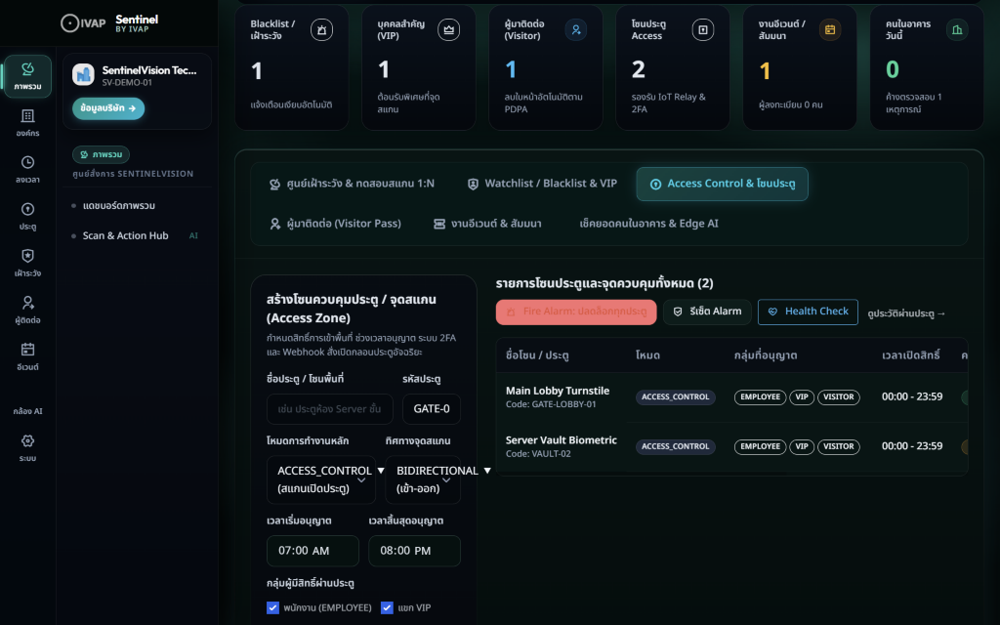

# คู่มือการใช้งานระบบ SentinelVision v6.0.1 (Unified Biometric Identity, Attendance & Smart Security Platform)

> **เวอร์ชันเอกสาร:** 6.0.1 (Enterprise Phases 1–10, GPU-First `api-gpu`, Edge AI & Copilot)  
> **Repository:** `https://github.com/chanachaipmgeng/SentinelVision.git`  
> **เทคโนโลยีหลัก:** FastAPI v4.0 (Python 3.11, CUDA 12.8 GPU-First) + InsightFace `buffalo_l` (512-d) + PostgreSQL `pgvector` (HNSW) + Angular Console & Multi-Face WebSocket Kiosk

---

## สารบัญ (Table of Contents)
1. [ภาพรวมสถาปัตยกรรมและบทบาทผู้ใช้งาน](#1-ภาพรวมสถาปัตยกรรมและบทบาทผู้ใช้งาน)
2. [การเข้าสู่ระบบ Enterprise SSO (OIDC / SAML 2.0) และ Multi-Company](#2-การเข้าสู่ระบบ-enterprise-sso-oidc--saml-20-และ-multi-company)
3. [แดชบอร์ดภาพรวมองค์กรและการลงเวลา (Executive Attendance Dashboard)](#3-แดชบอร์ดภาพรวมองค์กรและการลงเวลา-executive-attendance-dashboard)
4. [ศูนย์บัญชาการ SentinelVision (Command Center, Incident SLA & 1:N Scan)](#4-ศูนย์บัญชาการ-sentinelvision-command-center-incident-sla--1n-scan)
5. [การจัดการบัญชีเฝ้าระวัง Watchlist / Blacklist / VIP](#5-การจัดการบัญชีเฝ้าระวัง-watchlist--blacklist--vip)
6. [การควบคุมประตูอัจฉริยะ, Tailgating AI, Anti-Passback, Health Check & Wiegand/OSDP](#6-การควบคุมประตูอัจฉริยะ-tailgating-ai-anti-passback-health-check--wiegandosdp)
7. [ระบบบัตรผู้มาติดต่อด้วยใบหน้า & QR Self-Service (Visitor Face Pass)](#7-ระบบบัตรผู้มาติดต่อด้วยใบหน้า--qr-self-service-visitor-face-pass)
8. [การจัดการงานอีเวนต์ สัมมนา และค้นหาที่นั่งด้วยใบหน้า (Smart Events & Seat Lookup)](#8-การจัดการงานอีเวนต์-สัมมนา-และค้นหาที่นั่งด้วยใบหน้า-smart-events--seat-lookup)
9. [บัญชีรวมพลฉุกเฉิน Fire Alarm Fail-Safe, Batch Vector Re-Index & Edge Sync](#9-บัญชีรวมพลฉุกเฉิน-fire-alarm-fail-safe-batch-vector-re-index--edge-sync)
10. [การจัดการกะเวลาทำงาน โควตาลา OT Engine, Roster Swap, Anti-Mock GPS & PDPA](#10-การจัดการกะเวลาทำงาน-โควตาลา-ot-engine-roster-swap-anti-mock-gps--pdpa)
11. [จุดลงเวลาและตรวจสอบใบหน้าแบบกลุ่มเรียลไทม์ & Offline HMAC Sync Kiosk](#11-จุดลงเวลาและตรวจสอบใบหน้าแบบกลุ่มเรียลไทม์--offline-hmac-sync-kiosk)
12. [ฟีเจอร์ระดับ Enterprise (Phases 1–10)](#12-ฟีเจอร์ระดับ-enterprise-phases-110)
13. [การจัดการองค์กร แผนก ตำแหน่ง พนักงาน และสถานที่ตั้ง (`/company/company-*`)](#13-การจัดการองค์กร-แผนก-ตำแหน่ง-พนักงาน-และสถานที่ตั้ง-companycompany-)
14. [การลงเวลา การอนุมัติ รายงาน และ Employee Self-Service (ESS)](#14-การลงเวลา-การอนุมัติ-รายงาน-และ-employee-self-service-ess)
15. [หน้าจอเฉพาะทาง Access / Watchlist / Visitors / Events & Scan Hub](#15-หน้าจอเฉพาะทาง-access--watchlist--visitors--events--scan-hub)
16. [ระบบกล้องวงจรปิด Live Wall, NVR Playback, E-Map, Face Monitor & Presence](#16-ระบบกล้องวงจรปิด-live-wall-nvr-playback-e-map-face-monitor--presence)
17. [ความปลอดภัย Audit Log, อุปกรณ์ Kiosk, การแจ้งเตือน, AI Copilot & System Admin](#17-ความปลอดภัย-audit-log-อุปกรณ์-kiosk-การแจ้งเตือน-ai-copilot--system-admin)

---

## 1. ภาพรวมสถาปัตยกรรมและบทบาทผู้ใช้งาน

**SentinelVision v4.6.0** เป็นแพลตฟอร์มระบุตัวตนด้วยชีวมิติ (Biometric Identity), บริหารเวลาทำงาน (Enterprise HR & Time Attendance) และรักษาความปลอดภัยอัจฉริยะ (Physical Access & SOC) ที่ใช้ฐานข้อมูลเวกเตอร์ใบหน้า **512 มิติ (InsightFace `buffalo_l` + PostgreSQL `pgvector` HNSW Index)** ร่วมกันในทุกโมดูล:

| โมดูล (Module) | ความสามารถหลัก (Core Capabilities) |
| :--- | :--- |
| **Smart Time & Attendance** | ลงเวลาเข้า-ออกงานแบบกลุ่ม (Multi-face WebSocket), Walk-by & Mask/Anti-Spoof, Offline HMAC Sync (`X-DPU-Signature-256`), Anti-Mock GPS / Wi-Fi BSSID Integrity, คำนวณสาย/OT Rate Engine (`1.0x`/`1.5x`/`2.0x`/`3.0x`) และ Leave Policy |
| **SOC & Incident Lifecycle** | วงจรจัดการเหตุการณ์ (`OPEN` -> `ACKNOWLEDGED` -> `ASSIGNED` -> `CLOSED`), SLA Due Tracking, Evidence Video Clips, Bulk Ack/Close และ Alert Outbox |
| **Watchlist / Blacklist / VIP** | แจ้งเตือนบุคคลเฝ้าระวัง/บุคคลต้องห้ามทันทีที่ปรากฏหน้ากล้อง พร้อมบันทึก Incident ระดับ `CRITICAL` และต้อนรับแขก `VIP` อัตโนมัติ |
| **Smart Access Control & Edge** | โซนประตู (Entry/Exit/Bidirectional), **Tailgating AI** (`peopleCount > 1`), **Anti-Passback**, **Door Held-Open & Camera RTSP Health Check**, **Fire Alarm Fail-Safe** และ **Wiegand-26 / OSDP RS-485 Edge Bridge** |
| **Visitor Face Pass & Events** | ลงทะเบียนผู้มาติดต่อ (Walk-in, ลิงก์ Self-Service, QR Check-in/Check-out), หมดอายุอัตโนมัติ, ระบบงานอีเวนต์และการค้นหาหมายเลขที่นั่งด้วยใบหน้า |
| **Muster Roll & Vector Ops** | บัญชีรวมพลฉุกเฉิน (Live Building Occupancy + Entry/Exit + Export CSV), **Batch Vector Re-Index (512-d)** และ Edge AI Offline Manifest Sync |

---

## 2. การเข้าสู่ระบบ Enterprise SSO (OIDC / SAML 2.0) และ Multi-Company

### ขั้นตอนการเข้าใช้งาน
1. เปิดเว็บเบราว์เซอร์ไปที่ URL ของระบบ (เช่น `http://localhost/auth/login` หรือ `http://127.0.0.1:4200/#/auth/login`)
2. กรอก **ชื่อผู้ใช้งาน (Username)** และ **รหัสผ่าน (Password)** หรือเลือกเข้าสู่ระบบผ่าน **Enterprise SSO (OIDC / SAML 2.0)**:
   - รองรับ **OIDC Authorization Code** (`/auth/sso/oidc/start`, `/auth/sso/oidc/callback`) และ **SAML 2.0 ACS** (`/auth/sso/saml/acs`) พร้อม **JIT Provisioning** สร้างบัญชีพนักงานให้อัตโนมัติตามนโยบายบริษัท (`/auth/sso/policy/{companyId}`)
   - รองรับ **RBAC Multi-Tenancy & Location Scoping** ระดับบทบาท `ADMIN_SYSTEM`, `ADMIN_COMPANY`, `SECURITY_GUARD`, และ `EMPLOYEE`
3. ระบบจะออก JWT Token (พร้อม HttpOnly Cookie และ CSRF Protection) และนำเข้าสู่หน้าแดชบอร์ดขององค์กรโดยอัตโนมัติ

---

## 3. แดชบอร์ดภาพรวมองค์กรและการลงเวลา (Executive Attendance Dashboard)

### ฟีเจอร์หลักบนหน้าแดชบอร์ด (`/company/dashboard`)
- **แบนเนอร์ทางลัด SentinelVision Center:** เข้าถึงศูนย์ควบคุมความปลอดภัย Watchlist, Access Control, Visitor Pass และ Smart Events ได้ในคลิกเดียว
- **ตัวชี้วัดสำคัญรายวัน (Daily KPIs):** จำนวนพนักงานทั้งหมด, สถิติเข้างานวันนี้ (ตรงเวลา, มาสาย, ขาดงาน, ลางาน), รายการรออนุมัติ (Pending Approvals) และสถานะความพร้อมของระบบ
- **กราฟแนวโน้มการเข้างาน 7 วันย้อนหลัง:** แสดงสัดส่วนการเข้างานตรงเวลาและมาสายรายวันแบบโต้ตอบได้

---

## 4. ศูนย์บัญชาการ SentinelVision (Command Center, Incident SLA & 1:N Scan)

### การใช้งานหน้า Command & 1:N Scan (`/company/sentinel-center`)
1. **แถบ KPI ด้านบน (6 ตัวชี้วัด):** แสดงจำนวนรายการใน Blacklist/Watchlist, VIP, ผู้มาติดต่อ (Active Visitors), โซนประตู (Access Zones), งานอีเวนต์ และจำนวนคนในอาคารขณะนี้ (In-Building Muster)
2. **Unified 1:N Biometric Verification & Gate Simulator (ฝั่งซ้าย):**
   - เลือก **โซนประตู/กล้อง (Access Zone)** หรือ **งานอีเวนต์ (Event)** ที่ต้องการจำลองการสแกน
   - อัปโหลดภาพใบหน้าเพื่อทดสอบการค้นหาแบบ **Unified 1:N** (ค้นหาพร้อมกันทั้งฐานข้อมูลพนักงานและฐานข้อมูล Sentinel Identities)
   - แสดงผลการตัดสินใจทันที (`GRANT`, `DENY`, `ALERT_WATCHLIST`, `VIP_WELCOME`) พร้อมค่าความเหมือน (Cosine Similarity %) และหมายเลขที่นั่ง
3. **Real-Time Security & Incident Lifecycle Feed (ฝั่งขวา):**
   - ติดตามวงจรเหตุการณ์ `OPEN` -> `ACKNOWLEDGED` -> `ASSIGNED` -> `CLOSED` พร้อมตัวนับเวลา **SLA Due**
   - รองรับปุ่ม **`Ack`**, **`Assign`**, **`Close`**, การจัดการแบบกลุ่ม (**Bulk Ack / Bulk Close**), และการเปิดดู **Evidence Video Clip** จากกล้องที่เชื่อมโยง

---

## 5. การจัดการบัญชีเฝ้าระวัง Watchlist / Blacklist / VIP

### การเพิ่มและจัดการรายชื่อ (แท็บ `Watchlist / Blacklist & VIP`)
1. ในฟอร์ม **ลงทะเบียน Watchlist / Blacklist / VIP** ด้านซ้าย เลือกประเภทบัญชี:
   - `BLACKLIST`: บุคคลต้องห้าม/อดีตพนักงานที่ถูกเพิกถอนสิทธิ์ (แจ้งเตือนระดับ `CRITICAL` + ปฏิเสธการเข้าพื้นที่)
   - `WATCHLIST`: บุคคลเฝ้าระวังพิเศษ (แจ้งเตือนเจ้าหน้าที่รักษาความปลอดภัยทันทีที่พบหน้ากล้อง)
   - `VIP`: แขกผู้บริหาร/ลูกค้าคนสำคัญ (แจ้งเตือนทีมต้อนรับพร้อมข้อความต้อนรับบนจอ Kiosk)
2. กรอกชื่อ-นามสกุล, รหัสอ้างอิง, องค์กร และหมายเหตุการแจ้งเตือน (Alert Reason) แล้วแนบภาพถ่ายใบหน้าเพื่อสกัดเวกเตอร์ 512-d ลง `pgvector`
3. ในตารางด้านขวา สามารถกรองดูตามหมวดหมู่ อัปเดตใบหน้าใหม่ หรือลบรายการได้ทันที

---

## 6. การควบคุมประตูอัจฉริยะ, Tailgating AI, Anti-Passback, Health Check & Wiegand/OSDP

### การตั้งค่าโซนประตูและการตรวจสอบสถานะ (แท็บ `Access Control & โซนประตู`)
1. **การสร้างโซนควบคุมประตู (Create Access Zone):**
   - กำหนด **ชื่อโซน/ประตู**, **รหัสโซน**, **ทิศทาง (`ENTRY` / `EXIT` / `BIDIRECTIONAL`)**, ช่วงเวลาเปิด-ปิด (Schedule) และสิทธิ์กลุ่มบุคคล (`EMPLOYEE`, `VIP`, `VISITOR`)
   - เปิดใช้ **2FA (Face + PIN/TOTP)** สำหรับโซนความมั่นคงสูง
   - เปิดใช้ **Anti-Passback** (`antiPassbackEnabled`, `antiPassbackMinutes`) เพื่อป้องกันการใช้สิทธิ์เข้าซ้ำโดยไม่ผ่านประตูออกก่อน และตรวจจับ **Tailgating AI** (`peopleCount > 1` -> `TAILGATING_DETECTED`) ผ่าน `POST /sentinel/company/{companyId}/zones/{zoneId}/evaluate-access`
   - เลือก **Edge Hardware Protocol** (`WEBHOOK`, `WIEGAND`, `OSDP` RS-485 พร้อม `osdpAddress` 0–126 และ `edgeBridgeUrl`) สำหรับสั่งปลดล็อกผ่าน `POST /sentinel/company/{companyId}/zones/{zoneId}/edge-unlock`
2. **Health Check & Fail-Safe Controls (ด้านขวาบน):**
   - กดปุ่ม **`Health Check`** (`POST /sentinel/company/{companyId}/health-check`) เพื่อตรวจสอบ **Camera RTSP Offline** (ไม่มี heartbeat เกิน 3 นาที) และ **Door Held-Open** (`doorOpenSince` เกิน `doorHeldMaxSeconds`) พร้อมบันทึก Incident และส่ง Notification Outbox อัตโนมัติ
   - กดปุ่ม **`Fire Alarm: ปลดล็อกทุกประตู`** (`POST /fire-alarm`) เพื่อสั่งปลดล็อกประตูฉุกเฉินพร้อมกันทุกโซน และ **`รีเซ็ต Alarm`** (`POST /fire-alarm/reset`) เมื่อเหตุการณ์คลี่คลาย

---

## 7. ระบบบัตรผู้มาติดต่อด้วยใบหน้า & QR Self-Service (Visitor Face Pass)

### การออกบัตรผู้มาติดต่อ (แท็บ `ผู้มาติดต่อ (Visitor Pass)`)
1. **ลิงก์ลงทะเบียนล่วงหน้าด้วยตนเอง (Self-Service Pre-Registration Link):** คัดลอก URL ส่งให้ผู้มาติดต่อลงทะเบียนชื่อและอัปโหลดใบหน้าผ่านสมาร์ทโฟนล่วงหน้า พร้อมรับรหัส/QR Check-in
2. **การลงทะเบียนหน้าเคาน์เตอร์ (Walk-in Visitor Registration):** กรอกชื่อ-นามสกุล, บริษัท, พนักงานผู้รับรอง และระยะเวลาอนุญาต (เช่น `8 ชั่วโมง`) พร้อมภาพถ่ายใบหน้า
3. **Check-out & PDPA Auto-Expiry:** รองรับการกด **Check-out** เมื่อผู้มาติดต่อออกจากอาคาร และเมื่อครบกำหนดเวลา (`expiresAt`) ระบบจะเปลี่ยนสถานะเป็น `EXPIRED` โดยอัตโนมัติ

---

## 8. การจัดการงานอีเวนต์ สัมมนา และค้นหาที่นั่งด้วยใบหน้า (Smart Events & Seat Lookup)

### ขั้นตอนการจัดงานและลงทะเบียนผู้ร่วมงาน (แท็บ `งานอีเวนต์ & สัมมนา`)
1. **สร้างงานอีเวนต์ใหม่:** ระบุชื่องาน, สถานที่, โซนประตูที่เชื่อมโยง, จำนวนที่นั่งสูงสุด และช่วงวันเวลาจัดงาน
2. **ลงทะเบียนผู้เข้าร่วมงาน + กำหนดที่นั่ง:** เลือกงานอีเวนต์ กรอกชื่อ-องค์กร และหมายเลขที่นั่ง/โซน (เช่น `VIP-A01`) พร้อมรูปใบหน้า
3. **การสแกนหน้างาน:** เมื่อผู้ร่วมงานสแกนใบหน้าที่จุด Kiosk ระบบจะแสดงข้อความต้อนรับพร้อมหมายเลขที่นั่งทันที และอัปเดตยอด **Checked-In / Registered** แบบเรียลไทม์

---

## 9. บัญชีรวมพลฉุกเฉิน Fire Alarm Fail-Safe, Batch Vector Re-Index & Edge Sync

### เครื่องมือจัดการภาวะฉุกเฉินและเวกเตอร์ AI (แท็บ `เช็คยอดคนในอาคาร & Edge AI`)
1. **Edge AI Offline Sync & Batch Vector Re-Index (ฝั่งซ้าย):**
   - ดูรุ่น Manifest, จำนวน Employee Vectors และ Sentinel Vectors ที่พร้อมซิงค์ไปยัง Edge Box
   - กด **`อัปเดต Edge Manifest ล่าสุด`** เพื่อดึง Manifest ล่าสุด
   - กด **`Batch Vector Re-Index (512-d)`** (`POST /reindex-vectors`) เพื่อ L2-normalize และอัปเดต `modelVersion` ของเวกเตอร์ใบหน้าทั้งหมดแบบ batch พร้อมแสดงจำนวนที่ประมวลผลและสถานะ
2. **Live Building Occupancy & Emergency Muster Roll (ฝั่งขวา):**
   - แสดงรายชื่อบุคคลที่อยู่ในอาคารวันนี้ (รวม `PRESENT` จาก `attendance_daily`, ผู้เช็คอินค้าง และผู้มาติดต่อ)
   - กด **`ปลอดภัยแล้ว`** เพื่อเช็คชื่อผู้มาถึงจุดรวมพล, กด **`Fire Alarm`** เพื่อเปิดโหมดอพยพฉุกเฉิน, และกด **`Export CSV`** เพื่อนำส่งรายงานรวมพล

---

## 10. การจัดการกะเวลาทำงาน โควตาลา OT Engine, Roster Swap, Anti-Mock GPS & PDPA

### การบริหารจัดการงานบุคคล (`/company/hr-schedule`)
- **กะเวลาทำงาน (Work Shifts & Roster Swap):** กำหนดเวลาเข้า-ออก, นาทีผ่อนผันสาย (Grace Minutes), ตารางกะรายวัน (**Shift Roster**) และระบบขอสลับกะระหว่างพนักงาน (**Shift Swap Approval**)
- **Leave Policy & OT Rate Engine:** คำนวณสิทธิ์วันลาตามอายุงาน, ยอดยกมา (Carry-over), การลาแบบครึ่งวัน/รายชั่วโมง, แนบใบรับรองแพทย์ และคำนวณ OT อัตโนมัติตามอัตรา `1.0x` / `1.5x` / `2.0x` / `3.0x`
- **Multi-Level Approval & Delegation:** อนุมัติใบลา/OT/Regularization หลายลำดับขั้นพร้อมตั้งค่าผู้รับมอบอำนาจแทนชั่วคราว
- **Anti-Mock GPS & Wi-Fi BSSID Integrity:** ตรวจสอบความถูกต้องของพิกัด GPS และ Wi-Fi BSSID สำหรับการลงเวลานอกสถานที่
- **PDPA Biometric Purge (`/company/enroll-face`):** ตรวจสอบจำนวนเวกเตอร์ใบหน้าและลบข้อมูลชีวมิติทันทีเมื่อพนักงานลาออกหรือถอนความยินยอม

---

## 11. จุดลงเวลาและตรวจสอบใบหน้าแบบกลุ่มเรียลไทม์ & Offline HMAC Sync Kiosk

### การใช้งานหน้าจอ Kiosk (`/company/scan/:stationMode` และ `/company/timestamp-face`)
1. รองรับโหมดการทำงานเฉพาะทาง 6 รูปแบบ (`ATTENDANCE`, `ACCESS_CONTROL`, `WATCHLIST_MONITOR`, `VISITOR_CHECKIN`, `EVENT_CHECKIN`, `UNIFIED_HYBRID`)
2. เชื่อมต่อผ่าน **WebSocket (`/face/ws/kiosk`)** ความหน่วงต่ำ พร้อมวาดกรอบใบหน้าแบบกลุ่ม (Multi-Person HUD Overlay), Walk-by Detection, และ Anti-Spoof / Mask Check
3. **Offline-First Kiosk HMAC Sync (`BL-12`):** เมื่อเครือข่ายขาดหาย เครื่อง Kiosk จะแคชเวกเตอร์จาก Edge Sync Manifest และบันทึกการสแกนลง Local Queue เมื่อกลับมาออนไลน์จะส่งซิงค์ผ่าน `POST /timestamp/company/{companyId}/offline-sync` พร้อมลายเซ็น **`X-DPU-Signature-256`** (HMAC-SHA256) และ `X-DPU-Timestamp` ป้องกันการปลอมแปลงและ Replay Attack

## 12. ฟีเจอร์ระดับ Enterprise (Phases 1–10)

ส่วนเสริมระดับองค์กรที่เพิ่มเข้ามาใน SentinelVision v4.0 ครอบคลุมการตรวจสอบความปลอดภัย การเชื่อมต่อระบบบุคคล การจัดการกล้องและวิดีโอ และความต่อเนื่องทางธุรกิจ:

1. **Audit Log Integrity Verification (`/company/audit-log`)**
   - กดปุ่ม **Verify Integrity** เพื่อตรวจสอบความถูกต้องของ Hash-chain (`audit_log`) แบบเรียลไทม์ ระบบรองรับทั้งเรกคอร์ดใหม่และเรกคอร์ดย้อนหลัง (Legacy fallback) โดยแสดงสถานะ `VERIFIED` พร้อมจำนวนรายการที่ตรวจสอบแล้ว
2. **HRIS / Identity Connectors & SCIM 2.0**
   - เชื่อมต่อระบบ HRIS ภายนอก (Workday, SAP SuccessFactors, BambooHR) และรองรับโปรโตคอล SCIM 2.0 สำหรับซิงค์ข้อมูลพนักงานเข้าสู่ `CompanyEmployee` / `Member` อัตโนมัติ พร้อมปิดบังข้อมูลส่วนบุคคล (PDPA masking) สำหรับเลขบัตรประชาชนและพาสปอร์ต
3. **ONVIF Camera Discovery, PTZ & PDPA Privacy Mask (`/company/cameras`)**
   - ใช้ปุ่ม **Discover ONVIF** เพื่อค้นหากล้อง IP ในเครือข่ายอัตโนมัติ ควบคุมทิศทางกล้อง (PTZ) และกำหนดกรอบ **PDPA Privacy Mask** (Blur/Blackout) บนพื้นที่อ่อนไหวของภาพกล้อง
4. **NVR AI-Marker Timeline Scrubber**
   - ในหน้าดูวิดีโอบันทึกย้อนหลัง (NVR Playback) แถบไทม์ไลน์จะแสดงเครื่องหมายเหตุการณ์ AI (Incident Markers) ตามเวลาที่เกิดเหตุ เพื่อให้ผู้ดูแลระบบกดข้ามไปยังช่วงเวลาสำคัญได้ทันที
5. **Visitor Invite, ID OCR & Guest Self-Check-in Portal**
   - สร้างลิงก์/QR เชิญผู้มาติดต่อล่วงหน้า รองรับการสแกนบัตรประชาชนหรือพาสปอร์ตด้วย OCR (บันทึกเฉพาะข้อมูลที่ปิดบังตาม PDPA) และเปิดให้ผู้มาติดต่อลงทะเบียนด้วยตนเองผ่าน Guest Portal
6. **Breakout Room Capacity Check-in (`/company/sentinel-center` — แท็บ Events)**
   - กำหนดห้องย่อย (Breakout Rooms) ภายใต้ Event พร้อมเพดานความจุสูงสุด (Capacity) และติดตามยอดผู้เข้าร่วมแบบเรียลไทม์เมื่อสแกนเช็กอินเข้าห้องย่อย
7. **Multi-Region Disaster Recovery (DR) Replication**
   - ติดตามสถานะการจำลองข้อมูลข้ามภูมิภาคผ่าน Multi-Region DR Strip โดยทุกคำขอ Replication (`/sentinel/dr/replicate`) ผ่านการยืนยันตัวตนด้วยลายเซ็น HMAC-SHA256 (`X-Sentinel-DR-Sig`) และป้องกันข้อมูลซ้ำด้วย Redis Idempotency Keys

## 13. การจัดการองค์กร แผนก ตำแหน่ง พนักงาน และสถานที่ตั้ง (`/company/company-*`)

- **ข้อมูลบริษัท (`/company/company-info`)**: แก้ไขชื่อองค์กร, เลขทะเบียน, ที่อยู่, โซนเวลาเริ่มต้น (`Asia/Bangkok`) และโมดูลที่เปิดใช้งาน
- **จัดการแผนก (`/company/company-department`)**: สร้าง/แก้ไข/ลบแผนก, ค้นหา และส่งออกข้อมูลแผนกเป็น CSV
- **จัดการตำแหน่ง (`/company/company-position`)**: สร้าง/แก้ไข/ลบตำแหน่งงาน และส่งออกข้อมูลเป็น CSV
- **ทะเบียนพนักงาน & ใบหน้า (`/company/company-emp`)**:
  - เพิ่ม/แก้ไขข้อมูลพนักงาน, นำเข้าพนักงานจำนวนมาก (Batch Excel/CSV Import), และกรองตามแผนก/ตำแหน่ง/สถานะ
  - **5-Angle Face Quality Gate Enrollment**: ลงทะเบียนใบหน้าพนักงาน 5 มุม พร้อมตรวจสอบความคมชัด ความสว่าง และมุมเอียงของใบหน้าก่อนบันทึกเวกเตอร์ 512 มิติ
- **สถานที่ตั้ง / สาขา (`/company/company-location`)**: กำหนดพิกัด GPS Geofencing, รัศมีที่อนุญาต และ Wi-Fi BSSID สำหรับการลงเวลาผ่านมือถือ

---

## 14. การลงเวลา การอนุมัติ รายงาน และ Employee Self-Service (ESS)

- **ศูนย์รวมจุดสแกน (`/company/scan-hub`)**: รวมลิงก์เปิด Kiosk ทุกโหมด (`ATTENDANCE`, `ACCESS_CONTROL`, `WATCHLIST_MONITOR`, `VISITOR_CHECKIN`, `EVENT_CHECKIN`) พร้อมปุ่มคัดลอก Direct URL สำหรับติดตั้งบนเครื่อง Kiosk แยกจุด
- **ประวัติการลงเวลา (`/company/timestamp-log`) & รายการแจ้งเตือน/ผิดปกติ (`/company/warning-timestamp-log`)**: ตรวจสอบบันทึกเวลาเข้า-ออกงาน ภาพถ่ายขณะสแกน คะแนนความมั่นใจ (Confidence) รายการมาสาย/ออกก่อน/นอกพื้นที่ และส่งออก CSV/Excel
- **กล่องอนุมัติ (`/company/approval-inbox`)**: อนุมัติหรือปฏิเสธคำขอลา, คำขอ OT, การสลับกะ (Roster Swap) และการแก้ไขเวลาทำงานแบบ Multi-level Approval Chain พร้อมตัวกรองตามสถานที่ตั้ง
- **รายงาน (`/company/reports`)**: สรุปรายงานเวลาทำงานรายวัน/รายเดือน ชั่วโมง OT และสถิติการเข้างาน
- **พอร์ทัลพนักงาน (`/company/self-service`)**: ให้พนักงานดูประวัติการลงเวลาของตนเอง ยื่นคำขอลา/OT/สลับกะ และติดตามสถานะการอนุมัติ

---

## 15. หน้าจอเฉพาะทาง Access / Watchlist / Visitors / Events & Scan Hub

นอกเหนือจากหน้า Command Center รวม (`/company/sentinel-center`) ระบบแยกหน้าจอจัดการเฉพาะทางตามเมนู Dual-Rail Sidebar เพื่อให้ทีมปฏิบัติการเข้าถึงได้รวดเร็ว:

- **Access Control (`/company/scan/access-control`, `/company/access-control/zones`, `/logs`, `/settings`)**:
  - จัดการโซนประตู ตารางเวลาเปิด-ปิดประตู อัปเดตสถานะ Relay Latency (ms) ส่งออก Access Logs เป็น CSV และตั้งค่านโยบาย Tailgating / Anti-Passback
- **Watchlist & Blacklist (`/company/scan/watchlist`, `/company/watchlist/identities`, `/incidents`, `/settings`)**:
  - จัดการรายชื่อเฝ้าระวัง พร้อมวันหมดอายุ (Expiration), บันทึกปิดเคส Incident Resolution Note และตั้งค่าระดับความไวในการแจ้งเตือน
- **Visitors (`/company/scan/visitor`, `/company/visitors/passes`, `/muster-roll`, `/settings` และ `/visitor-invite/:token`)**:
  - ออกบัตร Visitor Pass, พิมพ์บัตร, ส่งลิงก์เชิญล่วงหน้า (`/visitor-invite/:token`) ให้ผู้มาติดต่อสแกนบัตรประชาชน/พาสปอร์ต (OCR + PDPA masking) และลงทะเบียนด้วยตนเอง รวมถึงหน้า **Muster Roll (`/company/visitors/muster-roll`)** สำหรับเช็กชื่อรวมพลฉุกเฉินและส่งออก CSV
- **Events (`/company/scan/event`, `/company/events/campaigns`, `/checkins`, `/settings`)**:
  - สร้างแคมเปญอีเวนต์ จัดการผู้ลงทะเบียน ค้นหาที่นั่งด้วยใบหน้า คุมความจุห้องประชุมย่อย (**Breakout Room Capacity Check-in**) และส่งออก Event Dwell CSV

---

## 16. ระบบกล้องวงจรปิด Live Wall, NVR Playback, E-Map, Face Monitor & Presence

- **จัดการกล้อง (`/company/cameras`)**: เพิ่ม/แก้ไขกล้อง RTSP, กด **Discover ONVIF** เพื่อค้นหากล้องในวง LAN อัตโนมัติ, ควบคุมทิศทาง **PTZ**, และตั้งค่า **PDPA Privacy Mask** (เบลอโซนอ่อนไหวบนภาพกล้อง)
- **Live Wall (`/company/live-wall`)**: แสดงภาพสดหลายช่องพร้อมกัน (WebRTC/HLS ผ่าน MediaMTX) รองรับการสลับ Layout Preset และถ่ายภาพ Snapshot
- **NVR Playback (`/company/playback`)**: ดูวิดีโอบันทึกย้อนหลังพร้อมแถบ **AI-Marker Timeline Scrubber** เพื่อกระโดดไปยังช่วงเวลาที่เกิดเหตุการณ์ AI ได้ทันที
- **E-Map (`/company/e-map`)**: แผนผังตำแหน่งกล้องและประตูแบบโต้ตอบ พร้อมปุ่มเปิดดูภาพสด (Quick Live) และสั่งปลดล็อกประตู (Quick Door Link)
- **Face Monitor (`/company/face-monitor`) & Presence (`/company/presence`)**: ติดตามการตรวจจับใบหน้าแบบเรียลไทม์จากกล้อง CCTV และสรุปยอดคนในอาคารแยกตามโซน

---

## 17. ความปลอดภัย Audit Log, อุปกรณ์ Kiosk, การแจ้งเตือน, AI Copilot & System Admin

- **Audit Log (`/company/audit-log`)**: บันทึกการเปลี่ยนแปลงสำคัญทั้งหมดแบบ Append-only พร้อมปุ่ม **Verify Hash-Chain** (`VERIFIED`) เพื่อพิสูจน์ว่าไม่มีการแก้ไขข้อมูลย้อนหลัง
- **จัดการอุปกรณ์ (`/company/devices` และ `/kiosk/pair`)**: ลงทะเบียนและจับคู่เครื่อง Kiosk ด้วย Pairing Code (`/kiosk/pair`), หมุนเวียน Key และเพิกถอนอุปกรณ์ที่ไม่ได้ใช้งาน
- **ศูนย์แจ้งเตือน (`/company/notification-center`)**: ตรวจสอบประวัติการส่งแจ้งเตือน (Delivery History) ผ่าน LINE Messaging API, SMTP Email และ Webhook Outbox
- **โปรไฟล์ & ความปลอดภัย (`/company/profile-security`)**: เปลี่ยนรหัสผ่าน และเปิดใช้งาน Two-Factor Authentication (2FA/TOTP)
- **ตั้งค่าบริษัท (`/company/settings`)**: ค้นหาการตั้งค่า (Settings Search Filter), รีเซ็ตค่าเริ่มต้น, เตือนเมื่อมีการเปลี่ยนแปลงที่ยังไม่บันทึก (Unsaved Changes Guard), ตั้งค่าภูมิภาค, SCIM 2.0 / HRIS Connectors และ Multi-Region DR Status
- **Investigation Graph & AI Copilot**: แท็บกราฟความสัมพันธ์ใน Sentinel Center และปุ่ม **Ask AI** สำหรับถาม-ตอบสรุปเหตุการณ์และข้อมูลองค์กรแบบเรียลไทม์
- **System Admin Console (`/admin/*`)** (สำหรับผู้ดูแลระบบระดับ Platform):
  - `/admin/member-manage`: จัดการผู้ใช้งานทั้งหมดข้ามองค์กร
  - `/admin/manage-companys`: สร้าง/ระงับ/จัดการโควตาของแต่ละบริษัท (Multi-tenant)
  - `/admin/admin-manage`: จัดการสิทธิ์ผู้ดูแลระบบแพลตฟอร์ม
  - `/admin/system-setting`: ตั้งค่าระบบส่วนกลาง
  - `/admin/error-logs`: ตรวจสอบบันทึกข้อผิดพลาดของระบบ (Error Logs)
