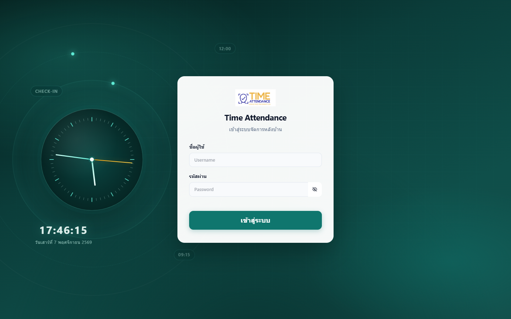
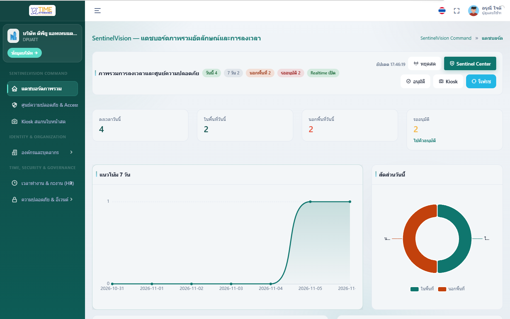
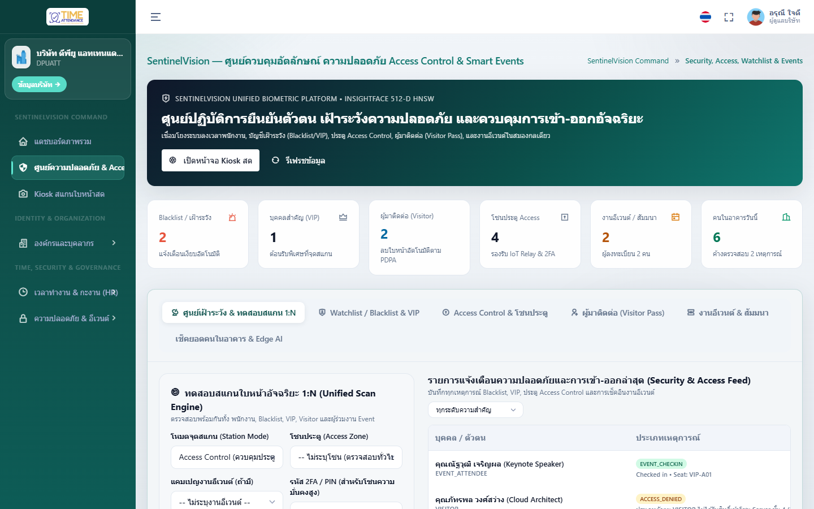
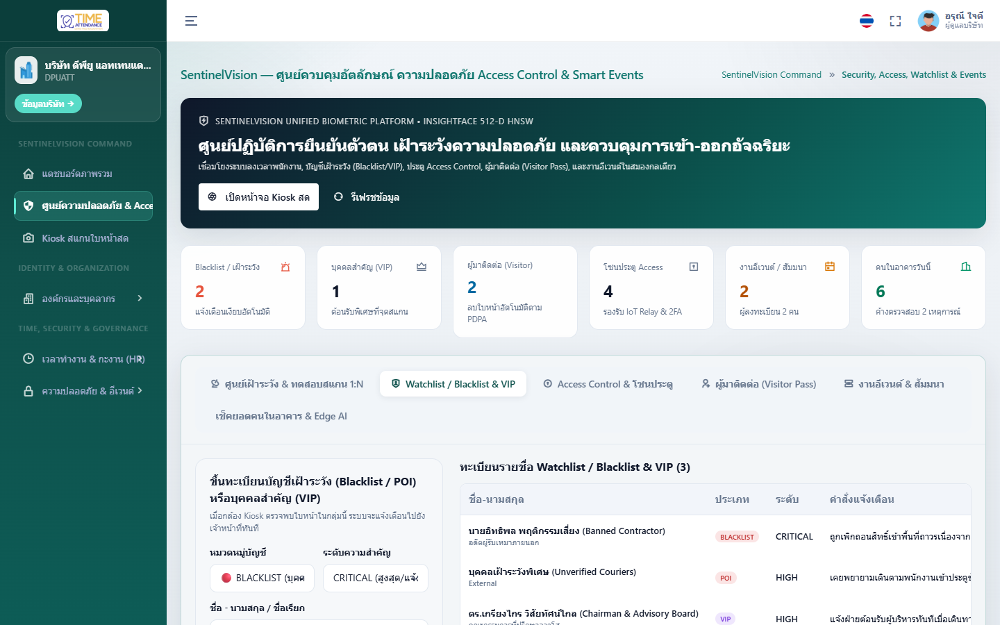
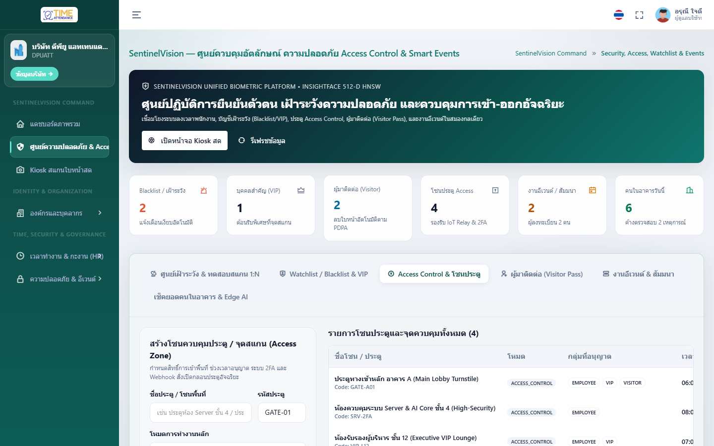
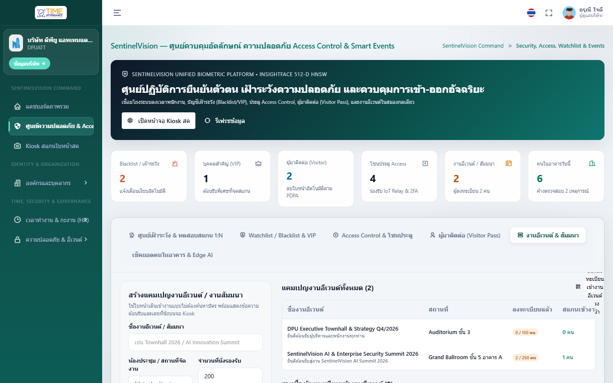
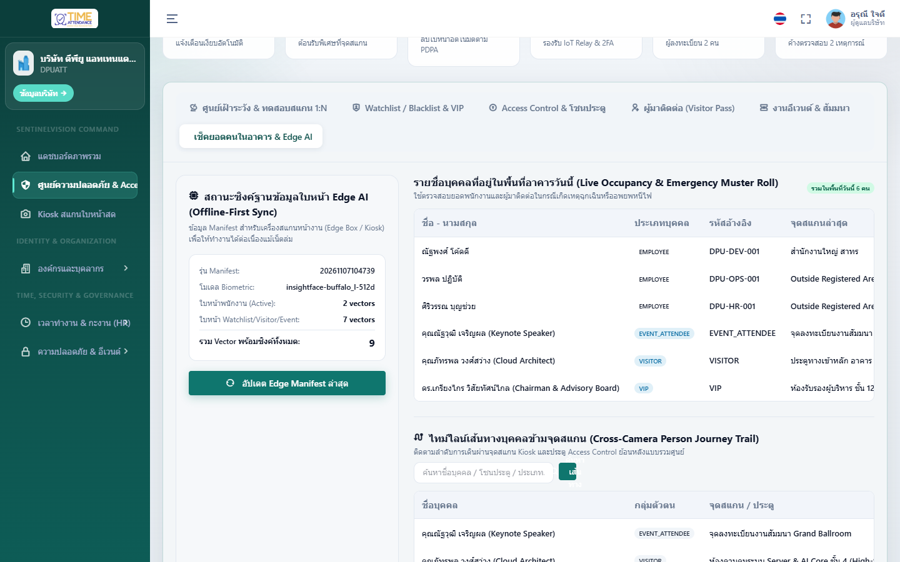
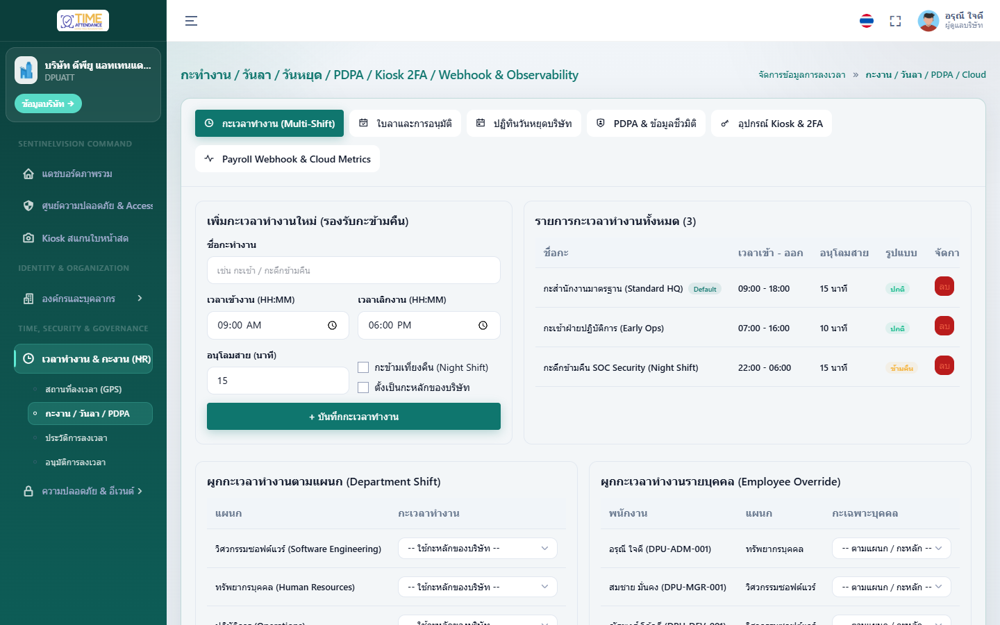
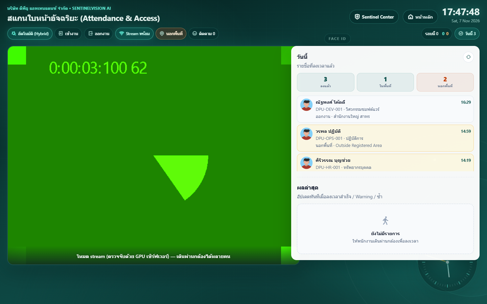

# คู่มือการใช้งานระบบ SentinelVision v4.0 (Unified Biometric Identity, Attendance & Smart Security Platform)

> **เวอร์ชันเอกสาร:** 4.0.0  
> **Repository:** `https://github.com/chanachaipmgeng/SentinelVision.git`  
> **เทคโนโลยีหลัก:** FastAPI v4.0 (Python 3.11) + InsightFace `buffalo_l` (512-d) + PostgreSQL `pgvector` (HNSW) + Angular 17 Console & Multi-Face WebSocket Kiosk

---

## สารบัญ (Table of Contents)
1. [ภาพรวมสถาปัตยกรรมและบทบาทผู้ใช้งาน](#1-ภาพรวมสถาปัตยกรรมและบทบาทผู้ใช้งาน)
2. [การเข้าสู่ระบบและเลือกองค์กร (Authentication & Multi-Company)](#2-การเข้าสู่ระบบและเลือกองค์กร-authentication--multi-company)
3. [แดชบอร์ดภาพรวมองค์กรและการลงเวลา (Executive Attendance Dashboard)](#3-แดชบอร์ดภาพรวมองค์กรและการลงเวลา-executive-attendance-dashboard)
4. [ศูนย์บัญชาการ SentinelVision (Command Center & 1:N Biometric Scan)](#4-ศูนย์บัญชาการ-sentinelvision-command-center--1n-biometric-scan)
5. [การจัดการบัญชีเฝ้าระวัง Watchlist / Blacklist / VIP](#5-การจัดการบัญชีเฝ้าระวัง-watchlist--blacklist--vip)
6. [การควบคุมประตูและโซนพื้นที่อัจฉริยะ (Smart Access Control Zones)](#6-การควบคุมประตูและโซนพื้นที่อัจฉริยะ-smart-access-control-zones)
7. [ระบบบัตรผู้มาติดต่อด้วยใบหน้า & ลิงก์ลงทะเบียนล่วงหน้า (Visitor Face Pass)](#7-ระบบบัตรผู้มาติดต่อด้วยใบหน้า--ลิงก์ลงทะเบียนล่วงหน้า-visitor-face-pass)
8. [การจัดการงานอีเวนต์ สัมมนา และค้นหาที่นั่งด้วยใบหน้า (Smart Events & Seat Lookup)](#8-การจัดการงานอีเวนต์-สัมมนา-และค้นหาที่นั่งด้วยใบหน้า-smart-events--seat-lookup)
9. [บัญชีรวมพลฉุกเฉิน เส้นทางข้ามกล้อง และซิงก์ Edge AI (Emergency Muster Roll, Journey Trail & Edge Sync)](#9-บัญชีรวมพลฉุกเฉิน-เส้นทางข้ามกล้อง-และซิงก์-edge-ai-emergency-muster-roll-journey-trail--edge-sync)
10. [การจัดการกะเวลาทำงาน วันหยุด การลา และข้อมูลชีวมิติ PDPA (HR Schedule & PDPA)](#10-การจัดการกะเวลาทำงาน-วันหยุด-การลา-และข้อมูลชีวมิติ-pdpa-hr-schedule--pdpa)
11. [จุดลงเวลาและตรวจสอบใบหน้าแบบกลุ่มเรียลไทม์ (Multi-Face WebSocket Kiosk)](#11-จุดลงเวลาและตรวจสอบใบหน้าแบบกลุ่มเรียลไทม์-multi-face-websocket-kiosk)

---

## 1. ภาพรวมสถาปัตยกรรมและบทบาทผู้ใช้งาน

**SentinelVision v4.0** ยกระดับจากระบบลงเวลาเข้า-ออกงานด้วยใบหน้า (Face Attendance) สู่แพลตฟอร์มระบุตัวตนด้วยชีวมิติและรักษาความปลอดภัยอัจฉริยะแบบครบวงจร โดยใช้ฐานข้อมูลเวกเตอร์ใบหน้า **512 มิติ (InsightFace `buffalo_l` + PostgreSQL `pgvector` HNSW Index)** ร่วมกันในทุกโมดูล:

| โมดูล (Module) | หน้าที่หลัก (Core Capabilities) |
| :--- | :--- |
| **Smart Time & Attendance** | ลงเวลาเข้า-ออกงานแบบกลุ่ม (Multi-face WebSocket), คำนวณสาย/OT อัตโนมัติตามกะงาน (Work Shift), อนุมัติใบลาและรายการลงเวลานอกสถานที่ |
| **Watchlist / Blacklist / VIP** | แจ้งเตือนบุคคลเฝ้าระวัง/บุคคลต้องห้ามทันทีที่ปรากฏหน้ากล้อง พร้อมบันทึก Incident ระดับ `CRITICAL` และต้อนรับแขก `VIP` อัตโนมัติ |
| **Smart Access Control** | กำหนดโซนประตู (Door/Turnstile), ระดับความเข้มงวด, ผูก Door Relay Webhook และสั่งปลดล็อกประตูจากระยะไกล (Remote Unlock) |
| **Visitor Face Pass** | ลงทะเบียนผู้มาติดต่อ (Walk-in หรือลิงก์ Self-Service ล่วงหน้า) ใช้ใบหน้าผ่านประตูตามช่วงเวลาที่กำหนด และหมดอายุอัตโนมัติ |
| **Smart Events** | ลงทะเบียนผู้เข้าร่วมงานสัมมนา/คอนเฟอเรนซ์ สแกนใบหน้าหน้างานเพื่อแสดงหมายเลขโต๊ะ/ที่นั่ง (`Seat / Zone`) และนับยอดผู้เข้าร่วมแบบเรียลไทม์ |
| **Muster Roll & Journey Trail** | ตรวจสอบรายชื่อผู้ที่ยังอยู่ในอาคารยามฉุกเฉิน (Emergency Muster Roll), ค้นหาเส้นทางปรากฏตัวข้ามกล้อง (Cross-Camera Journey Trail) และดึง Manifest ไปยังกล่อง Edge AI |

---

## 2. การเข้าสู่ระบบและเลือกองค์กร (Authentication & Multi-Company)

### ขั้นตอนการเข้าใช้งาน
1. เปิดเว็บเบราว์เซอร์ไปที่ URL ของระบบ (เช่น `http://localhost:8880/auth/login`)
2. กรอก **ชื่อผู้ใช้งาน (Username)** และ **รหัสผ่าน (Password)**
   - **ผู้ดูแลระบบส่วนกลาง (System Admin):** `sysadmin` / `Password123!`
   - **ผู้ดูแลระบบองค์กร (HR / Security Admin):** `admin` / `Password123!`
3. ระบบจะตรวจสอบสิทธิ์ JWT และนำเข้าสู่หน้าจัดการขององค์กรโดยอัตโนมัติ (รองรับ Multi-Tenancy แยกข้อมูลระหว่างบริษัทอย่างสมบูรณ์)

---

## 3. แดชบอร์ดภาพรวมองค์กรและการลงเวลา (Executive Attendance Dashboard)

### ฟีเจอร์หลักบนหน้าแดชบอร์ด (`/company/dashboard`)
- **แบนเนอร์ทางลัด SentinelVision Center:** เข้าถึงศูนย์ควบคุมความปลอดภัย Watchlist, Access Control, Visitor Pass และ Smart Events ได้ในคลิกเดียว
- **ตัวชี้วัดสำคัญรายวัน (Daily KPIs):**
  - จำนวนพนักงานทั้งหมดและพนักงานที่ลงทะเบียนใบหน้าแล้ว
  - สถิติการเข้างานวันนี้ (ตรงเวลา, มาสาย, ขาดงาน/ยังไม่สแกน, ลางาน)
  - รายการรออนุมัติ (Pending Approvals) สำหรับการลงเวลานอกสถานที่หรือความมั่นใจต่ำ
- **กราฟแนวโน้มการเข้างาน 7 วันย้อนหลัง:** แสดงสัดส่วนการเข้างานตรงเวลาและมาสายรายวัน

---

## 4. ศูนย์บัญชาการ SentinelVision (Command Center & 1:N Biometric Scan)

### การใช้งานหน้า Command & 1:N Scan (`/company/sentinel-center?tab=command`)
1. **แถบ KPI ด้านบน (6 ตัวชี้วัด):** แสดงจำนวนรายการใน Watchlist/Blacklist, VIP, ผู้มาติดต่อ (Active Visitors), โซนประตู (Access Zones), งานอีเวนต์ และจำนวนคนในอาคารขณะนี้ (In-Building Muster)
2. **Unified 1:N Biometric Verification & Gate Simulator (ฝั่งซ้าย):**
   - เลือก **โซนประตู/กล้อง (Access Zone)** หรือ **งานอีเวนต์ (Event)** ที่ต้องการจำลองการสแกน
   - อัปโหลดภาพใบหน้าเพื่อทดสอบการค้นหาแบบ **Unified 1:N** (ค้นหาพร้อมกันทั้งฐานข้อมูลพนักงานและฐานข้อมูล Sentinel Identities)
   - ระบบจะแสดงผลการตัดสินใจทันที (`GRANT`, `DENY`, `ALERT_WATCHLIST`, `VIP_WELCOME`) พร้อมค่าความเหมือน (Cosine Similarity %) และหมายเลขที่นั่ง (กรณีสแกนเข้างานอีเวนต์)
3. **Real-Time Security & Access Incident Feed (ฝั่งขวา):**
   - แสดงรายการเหตุการณ์ล่าสุดพร้อมระดับความรุนแรง (`CRITICAL`, `WARN`, `INFO`)
   - กดปุ่ม **`Ack`** เพื่อรับทราบเหตุการณ์และบันทึกชื่อผู้ตรวจสอบพร้อมเวลาลงฐานข้อมูล

---

## 5. การจัดการบัญชีเฝ้าระวัง Watchlist / Blacklist / VIP

### การเพิ่มและจัดการรายชื่อ (`/company/sentinel-center?tab=watchlist`)
1. ในฟอร์ม **ลงทะเบียน Watchlist / Blacklist / VIP** ด้านซ้าย:
   - เลือกประเภทบัญชี:
     - `BLACKLIST`: บุคคลต้องห้าม/อดีตพนักงานที่ถูกเพิกถอนสิทธิ์ (แจ้งเตือนระดับ `CRITICAL` + ปฏิเสธการเข้าพื้นที่)
     - `WATCHLIST`: บุคคลเฝ้าระวังพิเศษ (แจ้งเตือนเจ้าหน้าที่รักษาความปลอดภัยทันทีที่พบหน้ากล้อง)
     - `VIP`: แขกผู้บริหาร/ลูกค้าคนสำคัญ (แจ้งเตือนทีมต้อนรับพร้อมข้อความต้อนรับบนจอ Kiosk)
   - กรอกชื่อ-นามสกุล, รหัสอ้างอิง/บัตรประชาชน, องค์กร และหมายเหตุการแจ้งเตือน (Alert Reason)
   - เลือกไฟล์รูปถ่ายใบหน้าหน้าตรงชัดเจน แล้วกด **บันทึกและสกัดเวกเตอร์ใบหน้า (512-d)**
2. ในตารางด้านขวา สามารถกรองดูเฉพาะหมวดหมู่, อัปโหลดใบหน้าใหม่ (`อัปเดตใบหน้า`), หรือกดลบรายการออกจากฐานข้อมูลเฝ้าระวังได้ทันที

---

## 6. การควบคุมประตูและโซนพื้นที่อัจฉริยะ (Smart Access Control Zones)

### การตั้งค่าโซนประตูและสั่งเปิดประตูระยะไกล (`/company/sentinel-center?tab=access`)
1. **การสร้างโซนควบคุมประตู (Create Access Zone):**
   - กำหนด **ชื่อโซน/ประตู** (เช่น `Main Lobby Turnstile`, `Server Room Biometric Lock`) และ **รหัสโซน** (`ZONE-LOBBY-01`)
   - เลือก **ระดับความปลอดภัย (`LOW`, `MEDIUM`, `HIGH`, `CRITICAL`)**
   - เลือก **กลุ่มที่อนุญาตให้เข้าพื้นที่** (เช่น `EMPLOYEE`, `VIP`, `VISITOR`)
   - ระบุ **Door Relay Webhook URL** เพื่อเชื่อมต่อไปยังกล่องควบคุมประตูไฟฟ้า (ESP32 / Wiegand / Modbus Relay Controller)
2. **การสั่งปลดล็อกประตูจากระยะไกล (Remote Unlock Trigger):**
   - ในการ์ดของแต่ละโซน กดปุ่ม **`สั่งปลดล็อกประตู (Remote Unlock)`**
   - ระบบจะส่งคำสั่งไปยัง Door Relay Webhook ทันที พร้อมบันทึกเหตุการณ์ `REMOTE_UNLOCK` ลงใน Audit & Incident Log

---

## 7. ระบบบัตรผู้มาติดต่อด้วยใบหน้า & ลิงก์ลงทะเบียนล่วงหน้า (Visitor Face Pass)

### การออกบัตรผู้มาติดต่อ 2 รูปแบบ (`/company/sentinel-center?tab=visitors`)
1. **ลิงก์ลงทะเบียนล่วงหน้าด้วยตนเอง (Self-Service Pre-Registration Link):**
   - คัดลอก URL จากกล่อง **ลิงก์ลงทะเบียนล่วงหน้า** ด้านบนของตารางเพื่อส่งให้ผู้มาติดต่อหรือผู้ร่วมงานลงทะเบียนชื่อและอัปโหลดใบหน้าล่วงหน้าผ่านสมาร์ทโฟน (`POST /sentinel/public/register/{companyId}`)
2. **การลงทะเบียนหน้าเคาน์เตอร์ (Walk-in Visitor Registration):**
   - กรอกชื่อ-นามสกุล, บริษัทผู้มาติดต่อ, ชื่อพนักงานผู้รับรอง (Host Employee) และระยะเวลาอนุญาต (เช่น `8 ชั่วโมง`)
   - แนบภาพถ่ายใบหน้าแล้วกด **ออกบัตร Visitor Pass ด้วยใบหน้า**
   - เมื่อครบกำหนดเวลา (`expiresAt`) Background Job ของระบบจะเปลี่ยนสถานะบัตรเป็น `EXPIRED` โดยอัตโนมัติ

---

## 8. การจัดการงานอีเวนต์ สัมมนา และค้นหาที่นั่งด้วยใบหน้า (Smart Events & Seat Lookup)

### ขั้นตอนการจัดงานและลงทะเบียนผู้ร่วมงาน (`/company/sentinel-center?tab=events`)
1. **สร้างงานอีเวนต์ใหม่ (ฝั่งซ้ายบน):**
   - ระบุชื่องานอีเวนต์ (เช่น `DPU AI & Cyber Security Summit 2026`), สถานที่จัดงาน, โซนประตูที่เชื่อมโยง, จำนวนที่นั่งสูงสุด และวันเวลาเริ่ม-สิ้นสุดงาน
2. **ลงทะเบียนผู้เข้าร่วมงาน + กำหนดที่นั่ง (ฝั่งซ้ายล่าง):**
   - เลือกงานอีเวนต์ที่ต้องการ, กรอกชื่อผู้เข้าร่วม, องค์กร และ **หมายเลขที่นั่ง/โซน** (เช่น `VIP-A01`, `ROW-B12`) พร้อมอัปโหลดรูปใบหน้า
3. **การสแกนหน้างานและการติดตามผล (ฝั่งขวา):**
   - เมื่อผู้เข้าร่วมงานสแกนใบหน้าที่จุดลงทะเบียน ระบบจะแสดงข้อความต้อนรับพร้อมหมายเลขที่นั่งทันที และอัปเดตตัวเลข **Checked-In / Registered** แบบเรียลไทม์

---

## 9. บัญชีรวมพลฉุกเฉิน เส้นทางข้ามกล้อง และซิงก์ Edge AI (Emergency Muster Roll, Journey Trail & Edge Sync)

### 3 เครื่องมือสำคัญสำหรับทีมรักษาความปลอดภัยและวิศวกรระบบ (`/company/sentinel-center?tab=muster`)
1. **Emergency Muster Roll (ฝั่งซ้าย):**
   - แสดงจำนวนและรายชื่อพนักงานรวมถึงผู้มาติดต่อที่สแกนเข้าอาคารในวันนี้ เพื่อใช้ตรวจสอบยอดผู้อยู่ในอาคารทันทีเมื่อเกิดเหตุฉุกเฉินหรือซ้อมหนีไฟ
2. **Cross-Camera Person Journey Trail (ฝั่งขวาบน):**
   - พิมพ์ชื่อบุคคลหรือรหัสอ้างอิงแล้วกด **`ค้นหาเส้นทาง`**
   - ระบบจะรวบรวมไทม์ไลน์การปรากฏตัวของบุคคลนั้นจากทุกกล้อง/ทุกโซนประตู เรียงตามเวลาพร้อมระดับความเชื่อมั่นและการตัดสินใจของระบบ
3. **Edge AI Offline Manifest Sync (ฝั่งขวาล่าง):**
   - กดปุ่ม **`ดึงข้อมูล Edge Sync Manifest`** เพื่อทดสอบการดึงเวกเตอร์ใบหน้า 512 มิติ (ทั้งพนักงานที่ Active และบัญชี Sentinel ที่ยังไม่หมดอายุ) สำหรับนำไปแคชลงอุปกรณ์ Edge AI Box (Jetson / RK3588) ให้ทำงานแบบ Offline ได้แม้เน็ตเวิร์กหลักขัดข้อง

---

## 10. การจัดการกะเวลาทำงาน วันหยุด การลา และข้อมูลชีวมิติ PDPA (HR Schedule & PDPA)

### การบริหารจัดการงานบุคคล (`/company/hr-schedule`)
- **กะเวลาทำงาน (Work Shifts):** กำหนดเวลาเข้า-ออกงาน, นาทีผ่อนผันสาย (Grace Minutes) และเกณฑ์คำนวณ OT อัตโนมัติเมื่อพนักงานสแกนใบหน้า
- **ปฏิทินวันหยุดประจำปี (Company Holidays):** บันทึกวันหยุดนักขัตฤกษ์และวันหยุดพิเศษขององค์กร
- **คำขอลาหยุด (Leave Requests):** สร้างคำขอลาป่วย/ลาพักร้อน/ลากิจ และกด **อนุมัติ (Approve)** หรือ **ปฏิเสธ (Reject)** ได้ในหน้าเดียว
- **การจัดการข้อมูลชีวมิติตามมาตรฐาน PDPA (`/company/enroll-face`):** รองรับการดูจำนวนเวกเตอร์ใบหน้าที่จัดเก็บและปุ่ม **ลบข้อมูลชีวมิติ (PDPA Biometric Purge)** เมื่อพนักงานลาออกหรือถอนความยินยอม

---

## 11. จุดลงเวลาและตรวจสอบใบหน้าแบบกลุ่มเรียลไทม์ (Multi-Face WebSocket Kiosk)

### การใช้งานหน้าจอ Kiosk (`/company/timestamp-face`)
1. เปิดหน้า `/company/timestamp-face` บนเครื่องแท็บเล็ตหรือจอ Kiosk ที่เชื่อมต่อกล้องเว็บแคม/กล้อง IP
2. ระบบจะเชื่อมต่อผ่าน **WebSocket (`/face/ws/kiosk`)** ความหน่วงต่ำ พร้อมวาดกรอบใบหน้าแบบกลุ่ม (Multi-Person HUD Overlay)
3. เมื่อสแกนพบใบหน้า:
   - **กรณีพนักงานปกติ:** บันทึกเวลาเข้า-ออกงานอัตโนมัติ แสดงชื่อ แผนก และสถานะ `ตรงเวลา` / `มาสาย`
   - **กรณีตรงกับบัญชี Watchlist / Blacklist / VIP / Visitor / Event:** ระบบจะประเมินผลร่วมกับ `evaluate_kiosk_sentinel_match` ทันที เพื่อแจ้งเตือนความปลอดภัยหรือแสดงข้อความต้อนรับ VIP บนหน้าจอ Kiosk พร้อมบันทึกลงศูนย์บัญชาการ SentinelVision แบบเรียลไทม์
