# SentinelVision (Sentinel by IVAP) — คู่มือการใช้งานและ Walkthrough ครบทุกโฟลว์ (v7.3.0)

> เอกสารคู่มือการใช้งานฉบับสมบูรณ์ ครอบคลุมทุกหน้าจอและทุกขั้นตอนการทำงานของแพลตฟอร์ม **SentinelVision Enterprise v7.3.0** ตั้งแต่หน้า Public, การเข้าสู่ระบบ, ศูนย์ผู้ดูแลแพลตฟอร์ม (System Admin), ศูนย์บัญชาการความปลอดภัยบริษัท (Company Console), การลงเวลาและ HR, ตู้สแกนชีวมิติ 6 โหมด, ระบบควบคุมประตู/ลานจอดรถ/RFID, เฝ้าระวังภัย/ผู้มาติดต่อ/อีเวนต์, กล้อง CCTV/E-Map, จนถึงการกำกับดูแลและตั้งค่าระบบ พร้อมภาพหน้าจอจริงครบทั้ง **10 โฟลว์ (52 หน้าจอ)**

---

## สารบัญโฟลว์การทำงาน (End-to-End Flow Map)

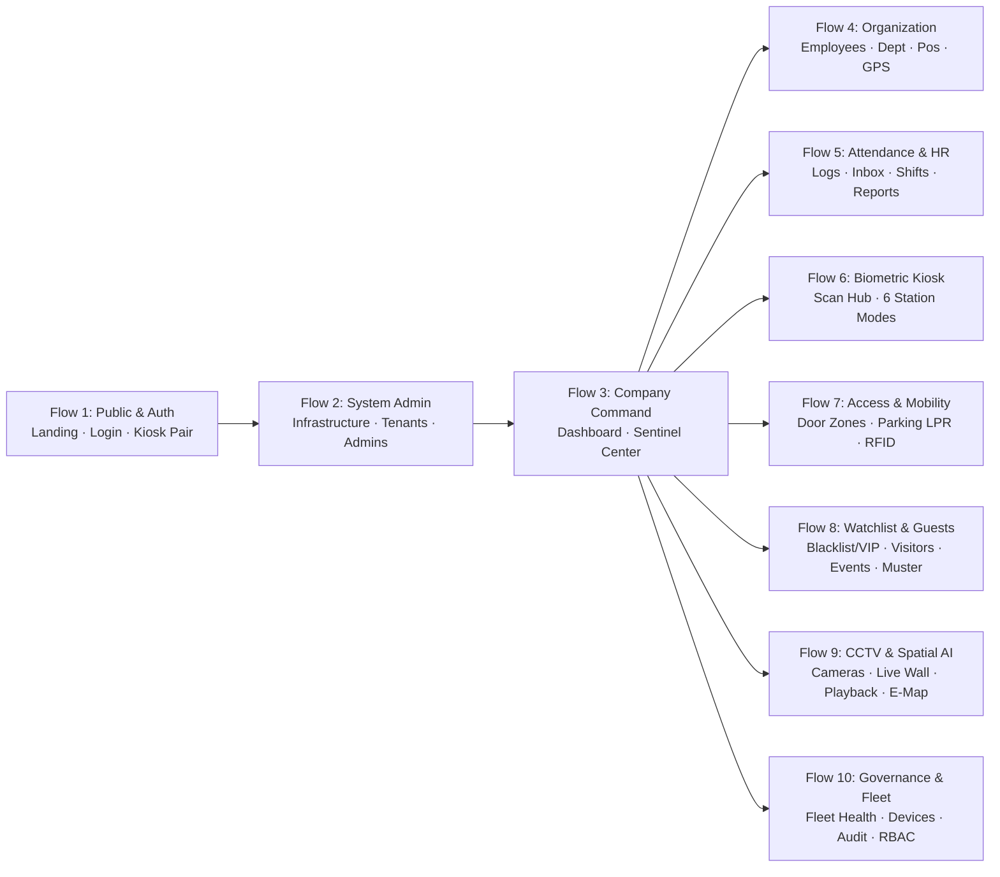

---

## สถานะ Docker Full-Stack (v7.3.0)

| Service | Container | สถานะ & บทบาทหลัก |
|---|---|---|
| API + Biometric GPU Engine | `sentinel-api-gpu` | FastAPI + High-Precision 512-d Biometric Engine (`cuda:0`, 3 queue workers) |
| Background Worker | `sentinel-worker` | ประมวลผลคิวแจ้งเตือน, CCTV analysis, รายงาน และงานพื้นหลัง |
| Admin Web Console | `sentinel-admin` | Angular Enterprise Console (Obsidian Dark & Porcelain Light Theme) |
| Gateway Proxy | `sentinel-nginx` | Reverse Proxy พอร์ต `http://localhost:8880` (`/health`, `/ready`, WebSocket) |
| Database | `sentinel-db` | PostgreSQL 16 + `pgvector` (Schema `0038_enterprise_ha_indexes`) |
| Cache & Queue | `sentinel-redis` | Redis 7 (Session, Debounce, Rate-limit, Real-time Pub/Sub) |
| Media Streaming | `sentinel-mediamtx` | MediaMTX RTSP/WebRTC (WHEP) สำหรับกล้องวงจรปิด |

---

## Flow 1 — หน้าแรก การเข้าสู่ระบบ และการจับคู่ตู้สแกน (Public & Authentication)

### 1.1 หน้าหลักแพลตฟอร์ม (`/#/`)
- **หน้าที่:** แนะนำภาพรวมสถาปัตยกรรม ความสามารถหลัก 6 โหมดตู้สแกน (Attendance, Access Control, Watchlist, Visitor, Event, Unified Hybrid) พร้อมตัวอย่าง Console Telemetry แบบโต้ตอบและปุ่มสลับภาษา `TH / EN`
- **การใช้งาน:** กด **เปิดคอนโซลผู้ดูแล** หรือ **เข้าสู่ระบบ** เพื่อไปยังหน้าล็อกอิน หรือกด **ดูฟีเจอร์ทั้งหมด** เพื่อเลื่อนดูรายละเอียด

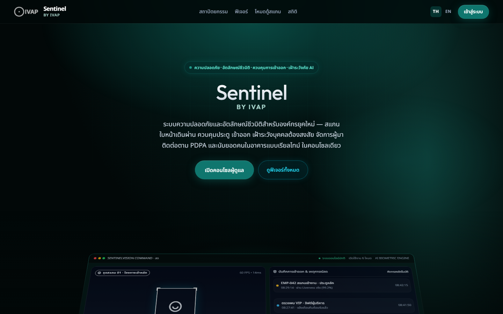

### 1.2 หน้าเข้าสู่ระบบ (`/#/auth/login`)
- **หน้าที่:** ยืนยันตัวตนเข้าสู่ระบบด้วยชื่อผู้ใช้และรหัสผ่าน รองรับ **2FA TOTP**, **Enterprise SSO** และลิงก์เชื่อมต่อไปยังหน้าจับคู่ตู้สแกน (`/kiosk/pair`)
- **การใช้งาน:** กรอก Username / Password → กดปุ่มแสดง/ซ่อนรหัสผ่านหากต้องการตรวจสอบ → กด **เข้าสู่ระบบคอนโซล** (ระบบจะพาสู่ `/admin/home` สำหรับ System Admin หรือ `/company/dashboard` สำหรับผู้ดูแลบริษัท)

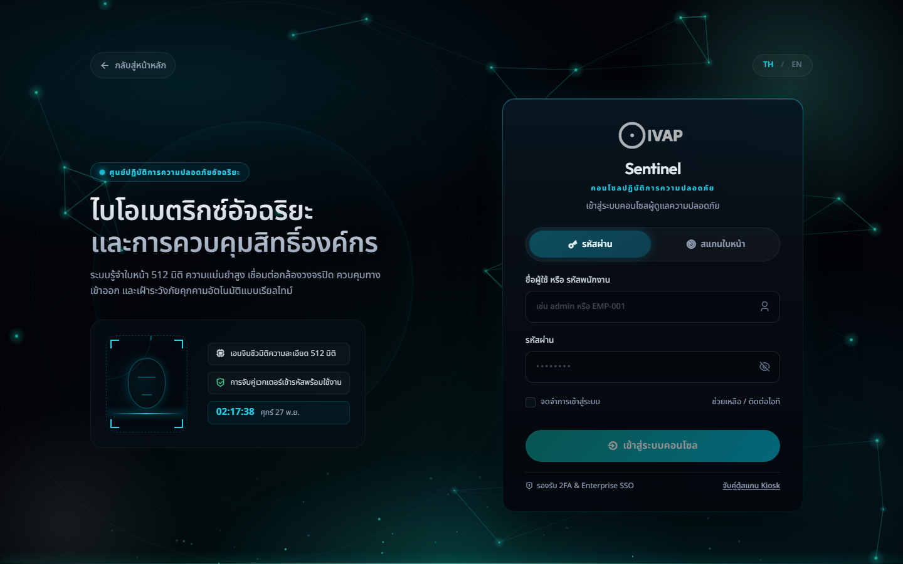

### 1.3 หน้าจับคู่เครื่องสแกน Kiosk (`/#/kiosk/pair`)
- **หน้าที่:** เชื่อมต่อแท็บเล็ตหรือเครื่อง Kiosk หน้างานด้วยรหัสจับคู่แบบใช้ครั้งเดียว 6 หลัก (One-Time Pairing Code) ที่แยกสิทธิ์เฉพาะจุดสแกนออกจากสิทธิ์ผู้ดูแลระบบอย่างปลอดภัย
- **การใช้งาน:** สร้างรหัสจากเมนู **อุปกรณ์ Kiosk** ในคอนโซลผู้ดูแล → นำรหัสมากรอกที่หน้านี้ → กด **จับคู่เครื่องสแกน**

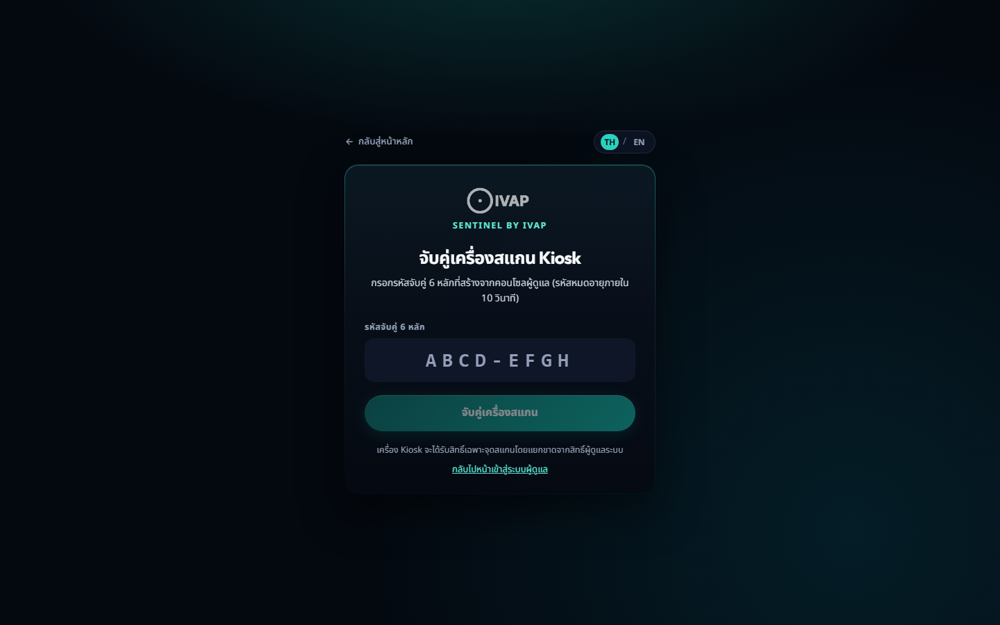

---

## Flow 2 — ศูนย์ผู้ดูแลแพลตฟอร์มระดับระบบ (System Admin Console `/admin/*`)

> เฉพาะบัญชี **System Admin** เท่านั้น มีขอบเขตดูแลโครงสร้างพื้นฐาน, การจัดการบริษัทผู้เช่า (Multi-Tenant), โควตา และบันทึกข้อผิดพลาดระดับแพลตฟอร์ม

### 2.1 แดชบอร์ดผู้ดูแลระบบ (`/#/admin/home`)
- **หน้าที่:** ภาพรวมสถานะแพลตฟอร์มและทางลัดเข้าสู่โมดูลการจัดการบริษัท สมาชิก และโครงสร้างพื้นฐาน

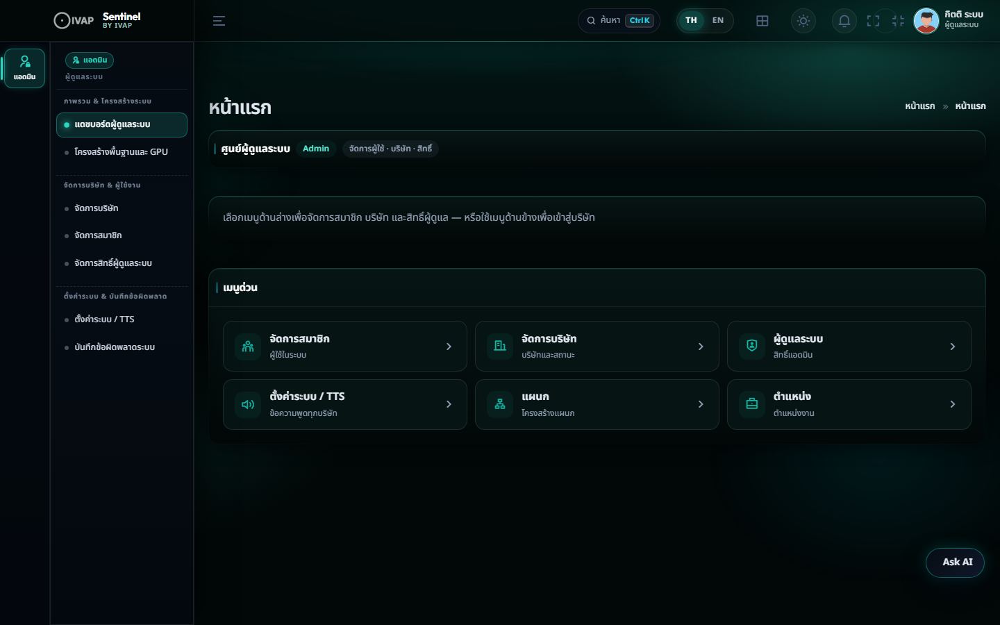

### 2.2 โครงสร้างพื้นฐานและ GPU (`/#/admin/infrastructure`)
- **หน้าที่:** ตรวจสอบสถานะ API Cluster (`HEALTHY`), GPU Devices (`cuda:0`), AI Workers (`3`), Global AI Queue, เวอร์ชันฐานข้อมูล Alembic (`0038_enterprise_ha_indexes`), Multi-Region DR (HMAC-SHA256) และการกระจายงานคิวรายประเภท (`CHECKIN`, `IDENTIFY`, `DETECT`, `CCTV`)

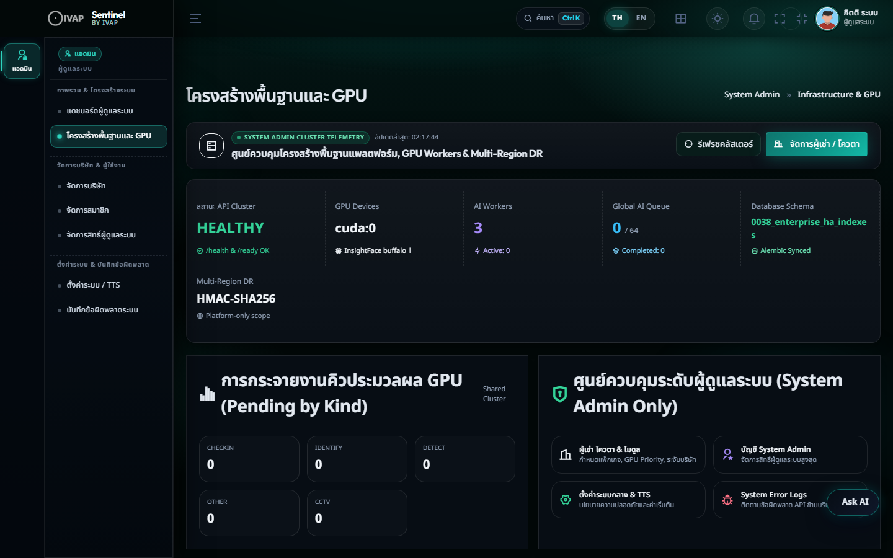

### 2.3 จัดการบริษัทผู้เช่าและโควตา (`/#/admin/manage-companys`)
- **หน้าที่:** สร้าง/แก้ไขข้อมูลบริษัท กำหนดสถานะ (`PUBLIC`/`PENDING`), วงจรชีวิตผู้เช่า (`ACTIVE` / `SUSPENDED` / `OFFBOARDED`), แพ็กเกจและโควตา (จำนวนอุปกรณ์, จำนวนพนักงาน, GPU Priority)
- **การใช้งาน:** คลิกที่ **ชื่อบริษัท** เพื่อสลับเข้าสู่ Company Console ของบริษัทนั้นทันที หรือกดปุ่ม **เพิ่มบริษัท / แก้ไข** เพื่อเปิดฟอร์ม Modal

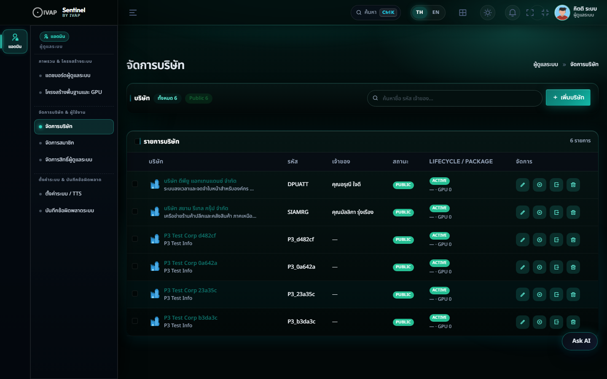

### 2.4 จัดการสิทธิ์ผู้ดูแลระบบ (`/#/admin/admin-manage`)
- **หน้าที่:** บริหารบัญชี System Admin, ตรวจสอบสถานะความยินยอมข้อมูลชีวมิติ (PDPA Consent), ลงทะเบียนใบหน้าเพื่อใช้ล็อกอิน, จัดการภาพใบหน้าที่ลงทะเบียนแล้ว หรือเพิกถอนความยินยอม

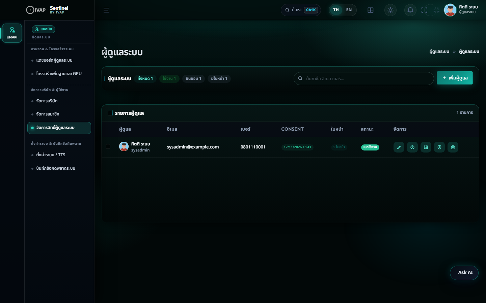

### 2.5 จัดการสมาชิกทั้งแพลตฟอร์ม (`/#/admin/member-manage`)
- **หน้าที่:** ค้นหา สร้าง แก้ไข เปิด/ปิดการใช้งาน หรือลบสมาชิกและผู้ดูแลระดับบริษัทข้ามผู้เช่า

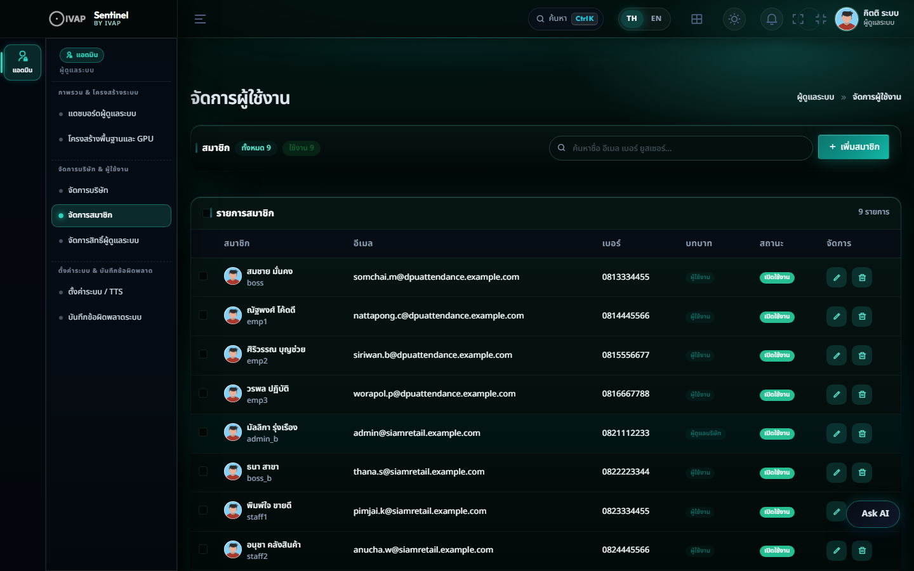

### 2.6 ตั้งค่าระบบกลางและเสียงพูด TTS (`/#/admin/system-setting`)
- **หน้าที่:** ตั้งค่าข้อความเสียงพูดแจ้งเตือนอัตโนมัติ (TTS Templates) สำหรับเหตุการณ์สแกนเข้างาน ออกงาน เตือนนอกพื้นที่ และค่าเริ่มต้นระดับแพลตฟอร์ม

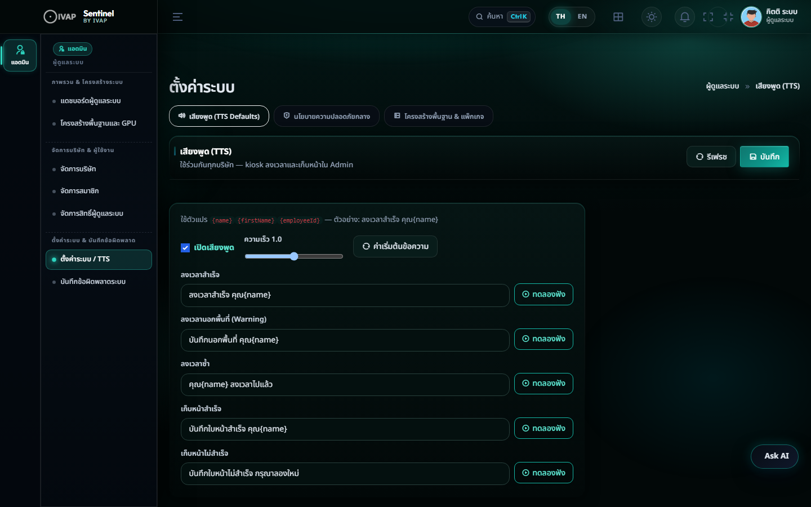

### 2.7 บันทึกข้อผิดพลาดระบบ (`/#/admin/error-logs`)
- **หน้าที่:** ตรวจสอบข้อผิดพลาดของ API และระบบพื้นหลังข้ามบริษัทเพื่อวิเคราะห์และแก้ไขปัญหาได้อย่างรวดเร็ว

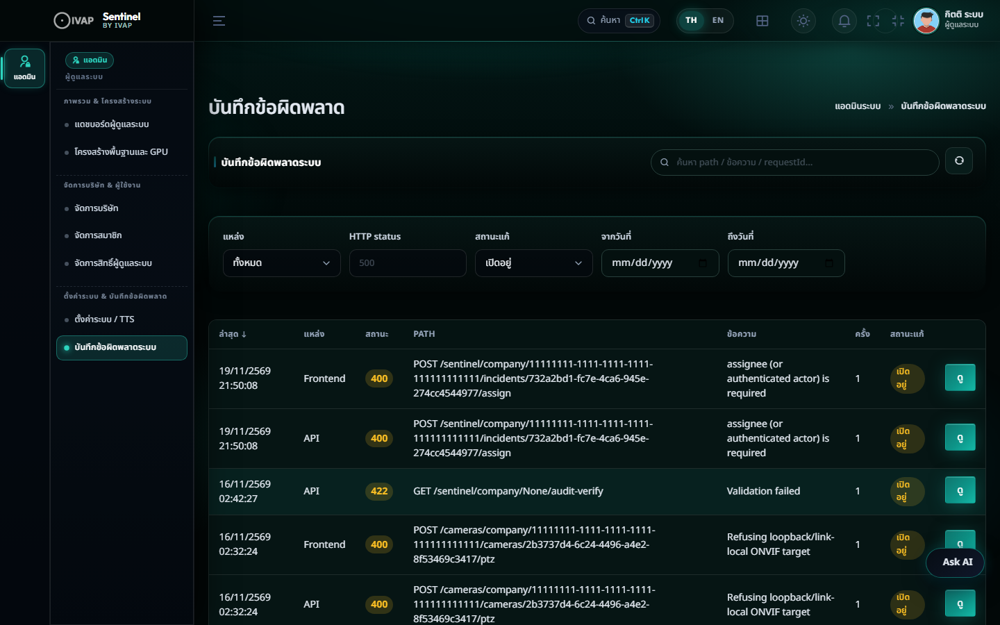

---

## Flow 3 — แดชบอร์ดบริษัท ศูนย์บัญชาการ และการสลับธีม/ค้นหาด่วน

> เมื่อ System Admin คลิกเข้าบริษัท ระบบจะแสดง **System Admin Context Banner** สีอำพันด้านบนเพื่อระบุบริษัทที่กำลังทำงานอยู่ พร้อมปุ่ม **กลับภาพรวมแพลตฟอร์ม** ได้ทุกเมื่อ

### 3.1 แดชบอร์ดภาพรวม — โหมดมืด (Obsidian Dark) (`/#/company/dashboard`)
- **หน้าที่:** แสดง Setup Checklist 5 ขั้นตอน, แถบสถิติ KPI แบบรวมศูนย์ 5 ช่อง (พนักงานทั้งหมด, การลงเวลา, ตรงเวลาในพื้นที่, นอกพื้นที่, Pending Approval), กราฟแท่งวิเคราะห์สถานะการลงเวลา, แผนที่พิกัดลงเวลา และกิจกรรมสแกนสด

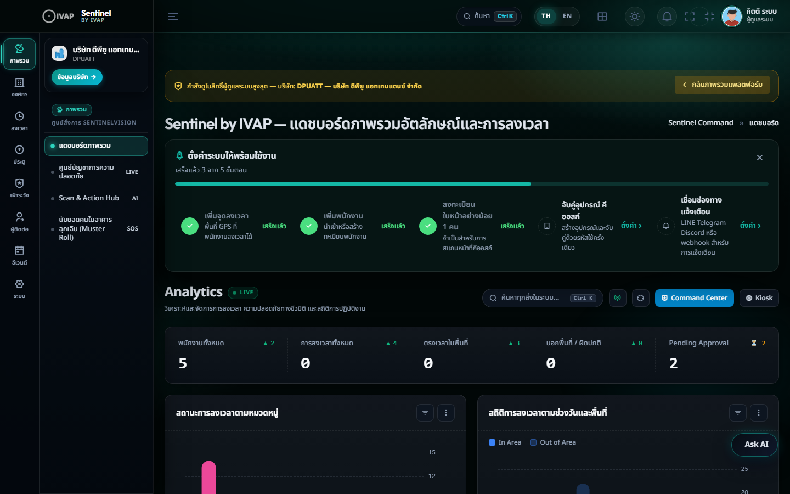

### 3.2 แดชบอร์ดภาพรวม — โหมดสว่าง (Porcelain Light Mode) (`/#/company/dashboard`)
- **หน้าที่:** สลับธีมได้ทันทีผ่านปุ่มพระอาทิตย์/พระจันทร์บน Header รองรับความคมชัดสูงครบทั้งการ์ด ตาราง ฟอร์ม และ Modal ทุกหน้าจอจัดการ

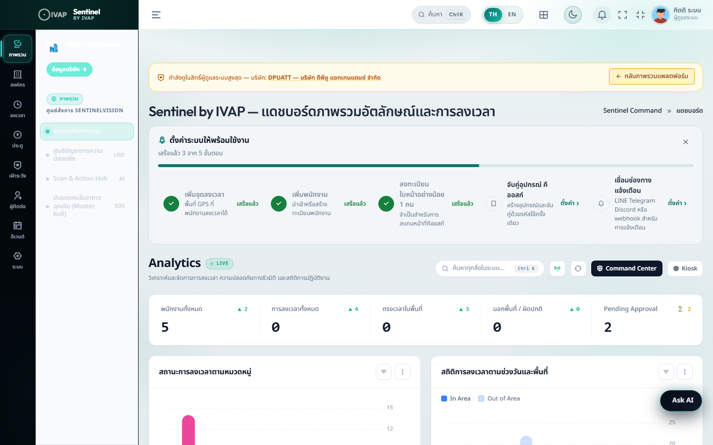

### 3.3 ค้นหาและนำทางด่วนทั้งระบบ (`Ctrl+K` Command Palette)
- **หน้าที่:** กด `Ctrl+K` (หรือคลิกช่องค้นหาบน Header) เพื่อพิมพ์ค้นหาและกระโดดไปยังหน้าจอหรือคำสั่งใดก็ได้ด้วยคีย์บอร์ดทันที

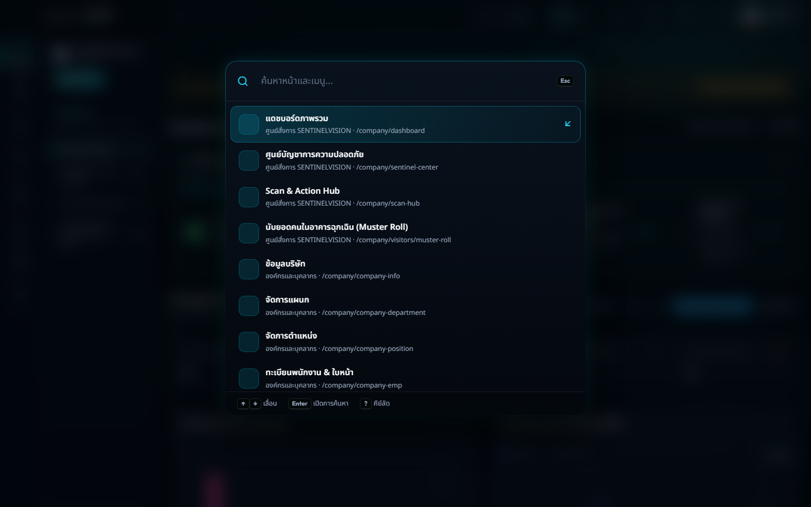

### 3.4 ศูนย์บัญชาการความปลอดภัย (`/#/company/sentinel-center`)
- **หน้าที่:** คอนโซลบัญชาการกลางรวมทุกโมดูลความปลอดภัย (Live Monitor, Watchlist/VIP, Access Control, Visitor Pass, Events, Muster Roll และ Investigation Graph) พร้อมเชื่อมต่อ WebSocket Real-time และปุ่มเปิด Live Kiosk

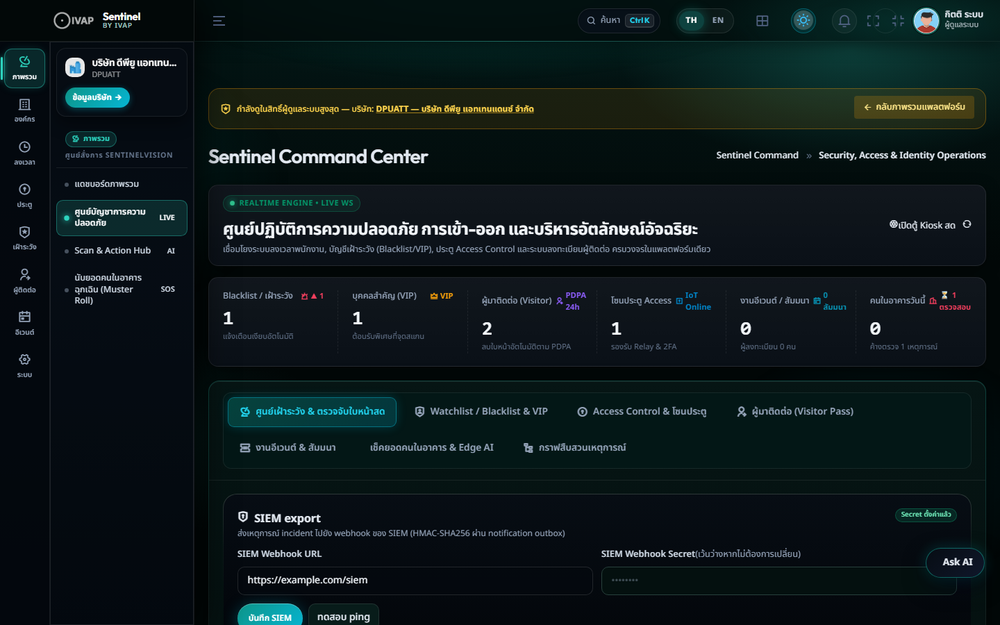

### 3.5 ข้อมูลบริษัท (`/#/company/company-info`)
- **หน้าที่:** ดูและแก้ไขข้อมูลพื้นฐานของบริษัท โลโก้ ที่อยู่ และข้อมูลติดต่อหลัก

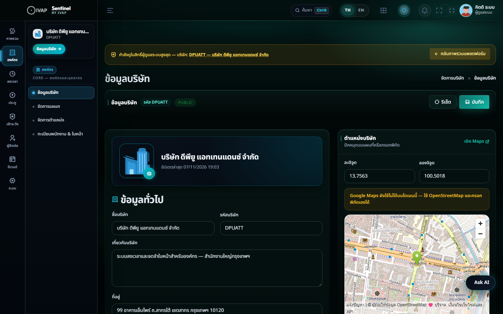

---

## Flow 4 — โครงสร้างองค์กรและทะเบียนพนักงาน (Organization & Workforce)

### 4.1 ทะเบียนพนักงานและใบหน้า (`/#/company/company-emp`)
- **หน้าที่:** บริหารรายชื่อพนักงานทั้งหมด รองรับมุมมองตารางและการ์ด, ตัวกรองด่วน (ยังไม่ระบุแผนก/ตำแหน่ง/ไม่มีรูป), นำเข้า Excel + ZIP รูปใบหน้า, ส่งออก CSV, ลงทะเบียนใบหน้า 5 มุมพร้อมตรวจคุณภาพภาพถ่าย (Quality Gate), จัดการใบหน้า และ Offboard ล้างข้อมูลชีวมิติตาม PDPA

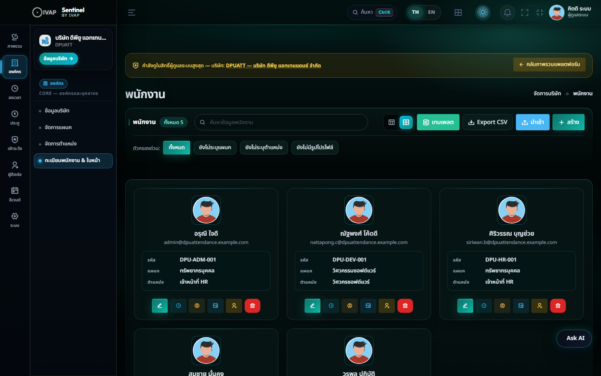

### 4.2 ฟอร์มเพิ่ม/แก้ไขข้อมูลพนักงาน (`SurfaceModalComponent`)
- **หน้าที่:** Modal มาตรฐานพร้อม Focus Trap, ปิดด้วย `Esc`, และรองรับ Dark/Light Mode สำหรับกรอกข้อมูลส่วนตัว อีเมล วันเริ่มงาน แผนก ตำแหน่ง หัวหน้างาน รูปโปรไฟล์ และสิทธิ์บริษัท

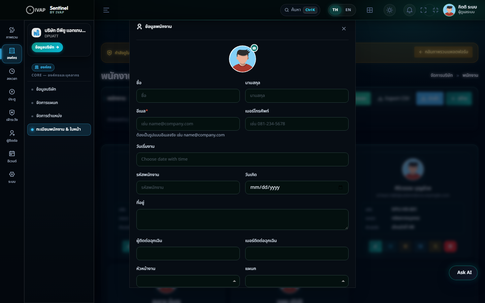

### 4.3 จัดการแผนก (`/#/company/company-department`)
- **หน้าที่:** สร้าง แก้ไข ค้นหา ลบ และส่งออก CSV รายชื่อแผนก พร้อมป้องกันการลบแผนกที่ยังมีพนักงานสังกัดอยู่

### 4.4 จัดการตำแหน่ง (`/#/company/company-position`)
- **หน้าที่:** สร้าง แก้ไข ค้นหา ลบ และส่งออก CSV ตำแหน่งงานในองค์กร

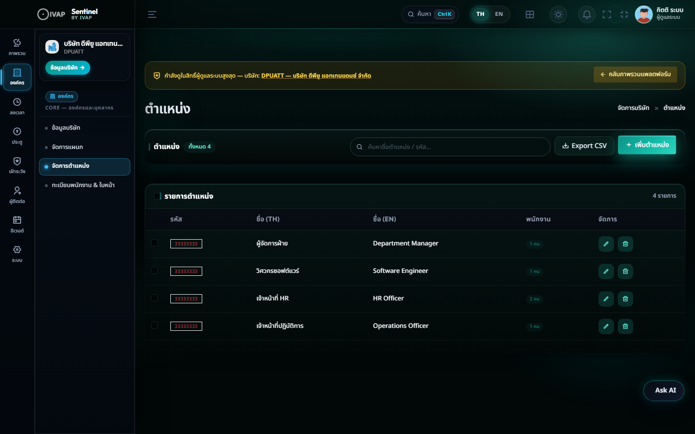

### 4.5 สถานที่ลงเวลาและขอบเขต GPS (`/#/company/company-location`)
- **หน้าที่:** กำหนดพิกัดสถานที่ลงเวลาทั้งแบบถาวร (Permanent) และชั่วคราว (Temporary) พร้อมแผนที่ปักหมุดและรัศมี Geofence (กิโลเมตร)

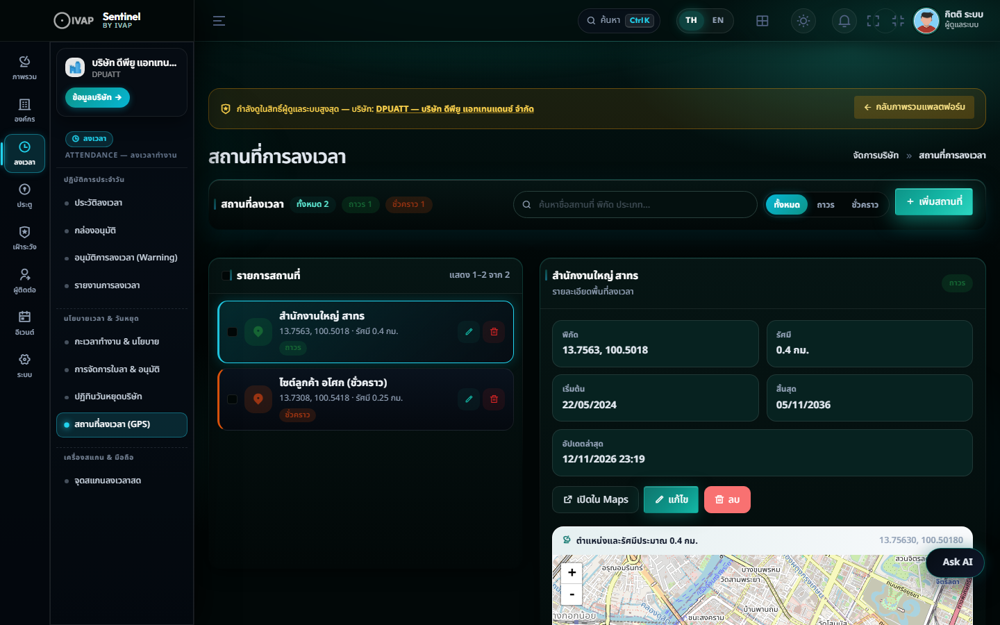

---

## Flow 5 — การลงเวลา ตารางกะ นโยบาย HR รายงาน และบริการตนเอง

### 5.1 ประวัติลงเวลา (`/#/company/timestamp-log`)
- **หน้าที่:** ตรวจสอบรายการสแกนเข้า-ออกงานทั้งหมด พร้อมภาพถ่ายหลักฐาน เวลา พิกัด สถานะตรงเวลา/สาย และตัวกรองตามวันที่หรือพนักงาน

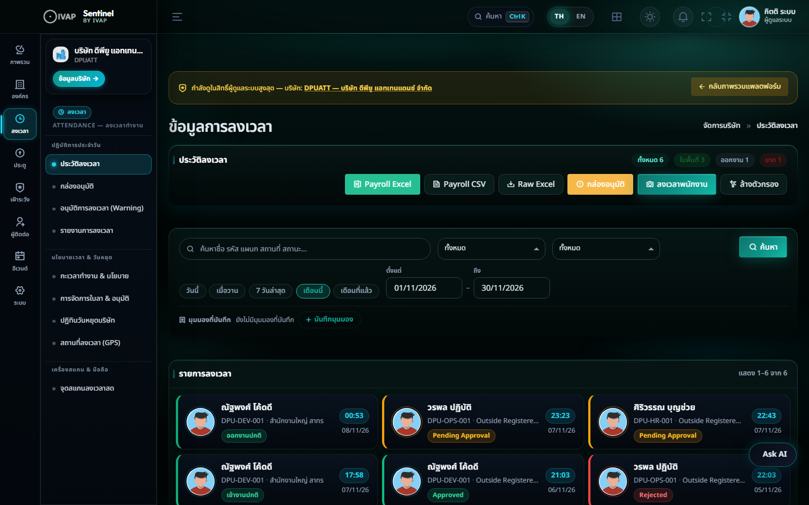

### 5.2 คิวอนุมัติลงเวลานอกพื้นที่ (`/#/company/warning-timestamp-log`)
- **หน้าที่:** คัดกรองรายการลงเวลาที่อยู่นอกรัศมี Geofence หรือมีสถานะ Warning เพื่อให้หัวหน้างาน/HR ตรวจสอบและอนุมัติหรือปฏิเสธ

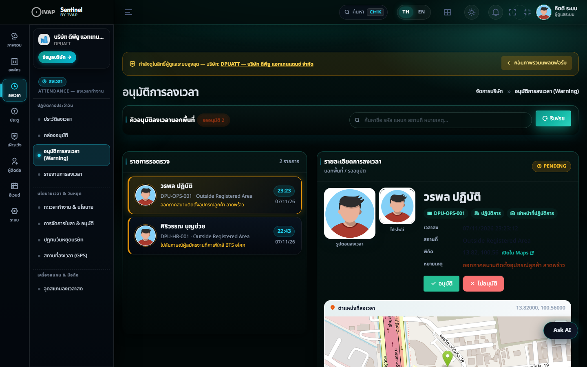

### 5.3 กล่องอนุมัติรวม (`/#/company/approval-inbox`)
- **หน้าที่:** ศูนย์รวมคำขอรออนุมัติทั้งหมด (คำขอแก้ไขเวลา, การลา, OT, สลับกะ) เพื่ออนุมัติได้ครบในหน้าจอเดียว

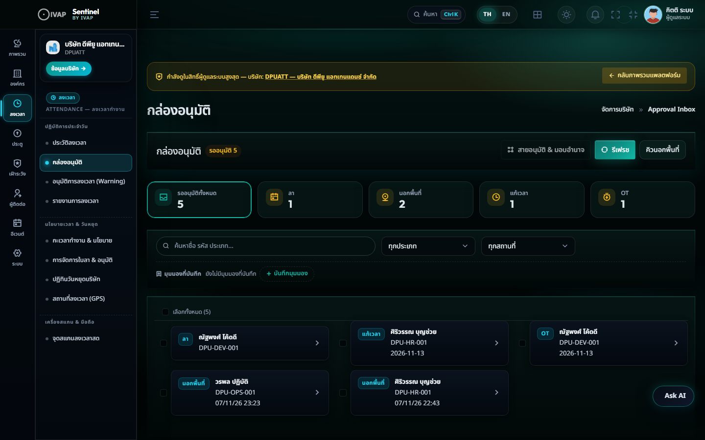

### 5.4 จัดการกะเวลาทำงานและปฏิทินเวร (`/#/company/hr-schedule/shifts`)
- **หน้าที่:** สร้างกะทำงาน (รองรับกะข้ามคืน Night Shift), ตั้งเวลาอนุโลมสาย/ปัดเวลา/พัก/เกณฑ์ OT, ผูกกะรายแผนก/รายบุคคล และสร้างตารางเวรหมุนเวียนรายเดือน (Monthly Roster)

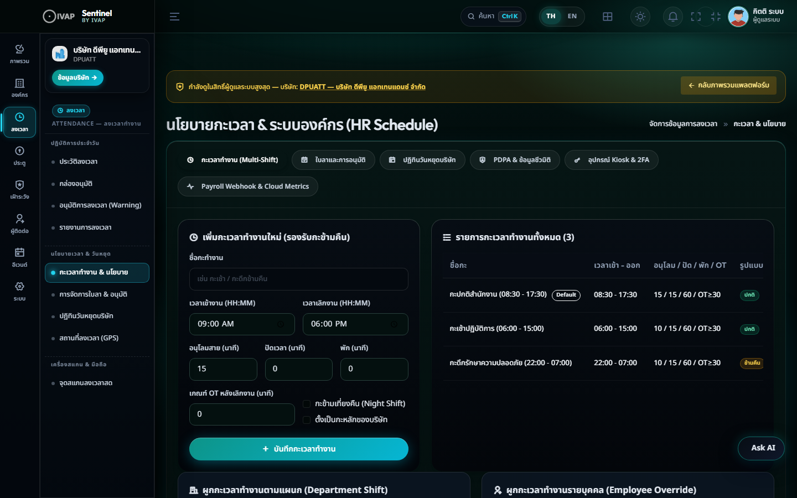

### 5.5 ระบบลางานและคำขอ OT (`/#/company/hr-schedule/leaves`)
- **หน้าที่:** บันทึกใบลา (ลาพักร้อน, ลาป่วย, ลากิจ, WFH), ตรวจสอบสถานะ และจัดการคำขออนุมัติ

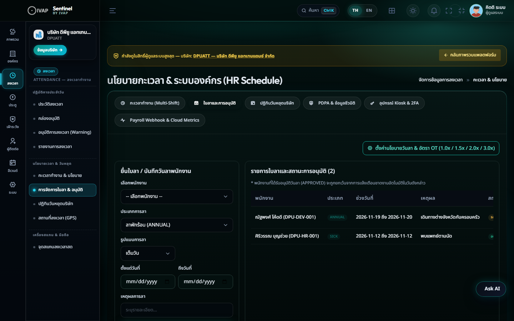

### 5.6 ปฏิทินวันหยุดประจำปี (`/#/company/hr-schedule/holidays`)
- **หน้าที่:** กำหนดวันหยุดนักขัตฤกษ์และวันหยุดบริษัทเพื่อใช้คำนวณเวลาทำงานและ OT อัตโนมัติ

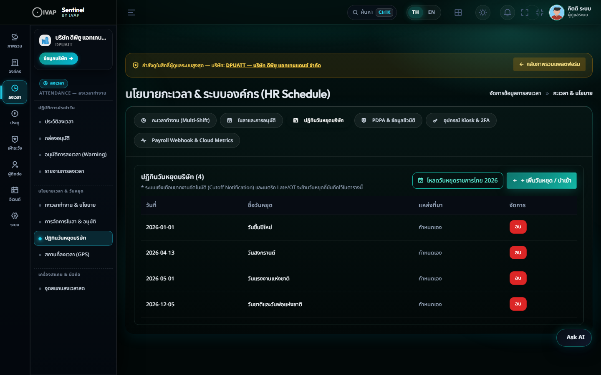

### 5.7 นโยบาย PDPA และสิทธิ์ข้อมูลชีวมิติ (`/#/company/hr-schedule/pdpa`)
- **หน้าที่:** ตั้งค่าระยะเวลาเก็บรักษาข้อมูลใบหน้า, ส่งออกข้อมูลเจ้าของข้อมูล (DSAR), บันทึกความยินยอม หรือสั่งลบข้อมูลชีวมิติ (Right to Erasure) รายบุคคล

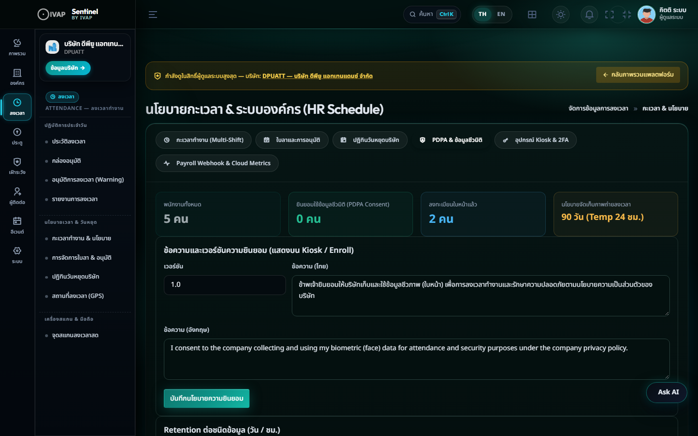

### 5.8 รายงานสรุปการลงเวลาและส่งออก Payroll (`/#/company/reports`)
- **หน้าที่:** เลือกช่วงวันที่ พนักงาน และโหมดรายงาน (Raw Punches หรือ Payroll Summary คำนวณกะ/สาย/OT), ดูตัวอย่างข้อมูลก่อนส่งออกเป็น `.xlsx` / `.csv` หรือเชื่อมต่อ HRIS

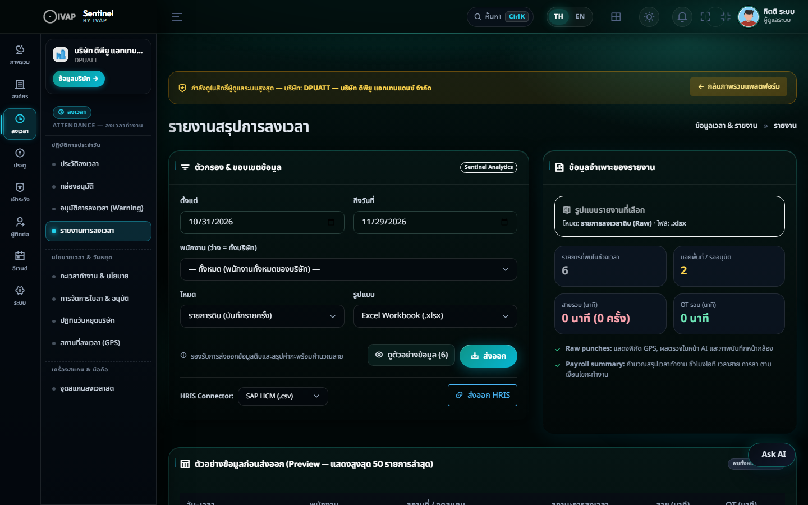

### 5.9 ลงเวลาผ่านมือถือ (`/#/company/mobile-checkin`)
- **หน้าที่:** ช่องทางลงเวลาผ่านเว็บเบราว์เซอร์บนมือถือ/โน้ตบุ๊กพร้อมถ่ายรูปใบหน้าและจับพิกัด GPS อัตโนมัติ

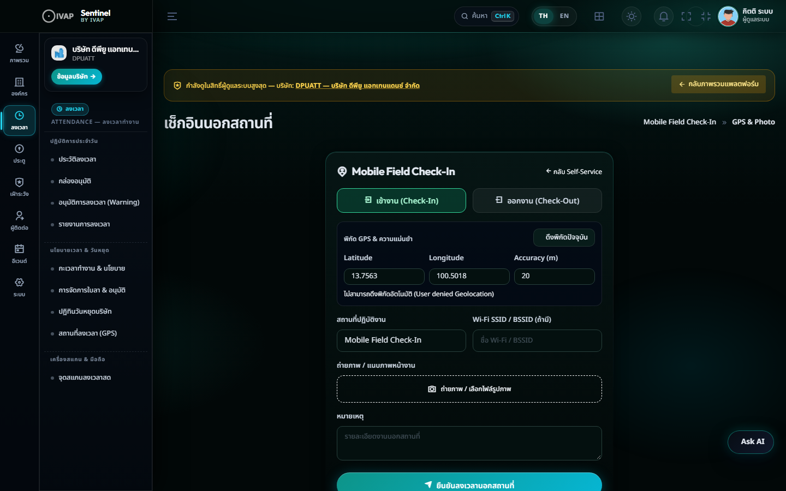

### 5.10 บริการตนเองสำหรับพนักงาน (`/#/company/self-service`)
- **หน้าที่:** พนักงานตรวจสอบประวัติลงเวลาของตนเอง ยื่นคำขอลา ขอแก้ไขเวลา ขอ OT และขอสลับกะได้ด้วยตนเอง

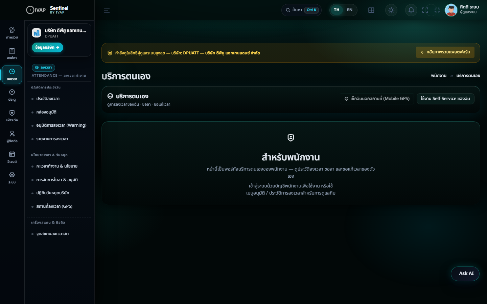

---

## Flow 6 — ศูนย์ควบคุมโหมดสแกนและตู้สแกนใบหน้าชีวมิติ (Scan Hub & Kiosk)

### 6.1 Scan & Action Hub (`/#/company/scan-hub`)
- **หน้าที่:** เปิด/ปิดโมดูลของบริษัท เลือก Station Mode เริ่มต้น กำหนดโซนประตู/กิจกรรมเริ่มต้น การจัดการใบหน้าไม่รู้จัก ข้อความต้อนรับ VIP และเสียง TTS พร้อมคัดลอก URL หรือเปิดเทอร์มินัลสแกนทันที

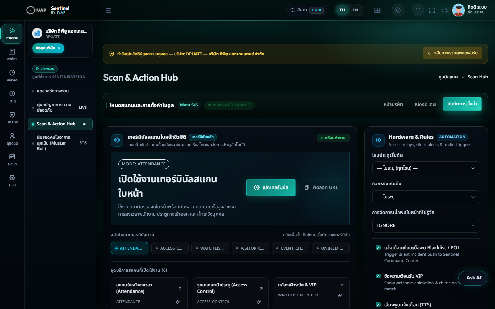

### 6.2 ตู้สแกนใบหน้าสด (`/#/company/scan/attendance`)
- **หน้าที่:** โหมดเต็มหน้าจอสำหรับการสแกนใบหน้าเดินผ่านพร้อมกันหลายคน (Multi-Person Walk-by via WebSocket) เริ่มต้นด้วยหน้าต่างยืนยันความยินยอม PDPA ก่อนเปิดกล้อง รองรับ 6 Station Modes, โหมด Offline Queue, ตัวอักษรใหญ่ (Large Text), สั่งการด้วยท่ามือ และ PIN Fallback

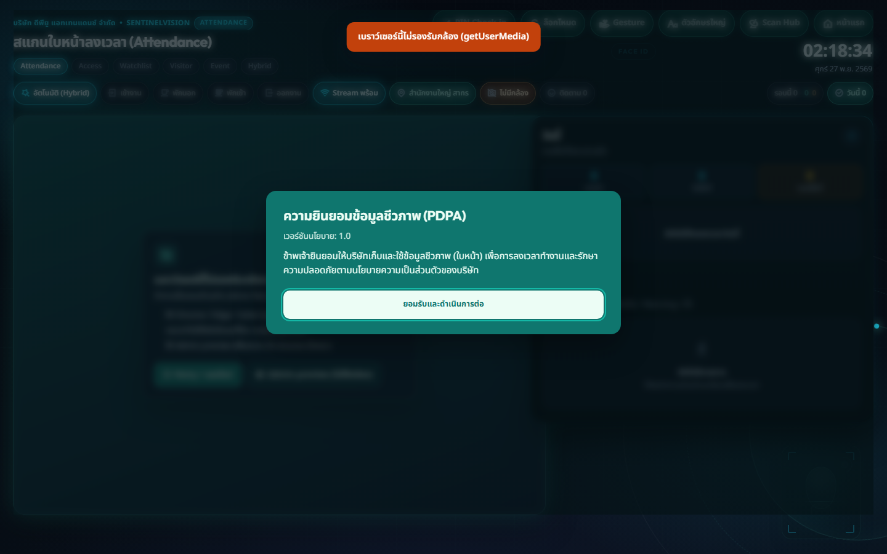

---

## Flow 7 — ควบคุมการเข้าออก ลานจอดรถอัจฉริยะ LPR และบัตร RFID

### 7.1 จัดการโซนประตูและสั่งปลดล็อก (`/#/company/access-control/zones`)
- **หน้าที่:** สร้างโซนประตู กำหนดสิทธิ์กลุ่มบุคคล (พนักงาน/VIP/ผู้มาติดต่อ), ตั้งค่า Anti-Passback, บังคับ 2FA/PIN, เชื่อมต่อ IoT Relay / Wiegand / OSDP และสั่งปลดล็อกประตูฉุกเฉิน

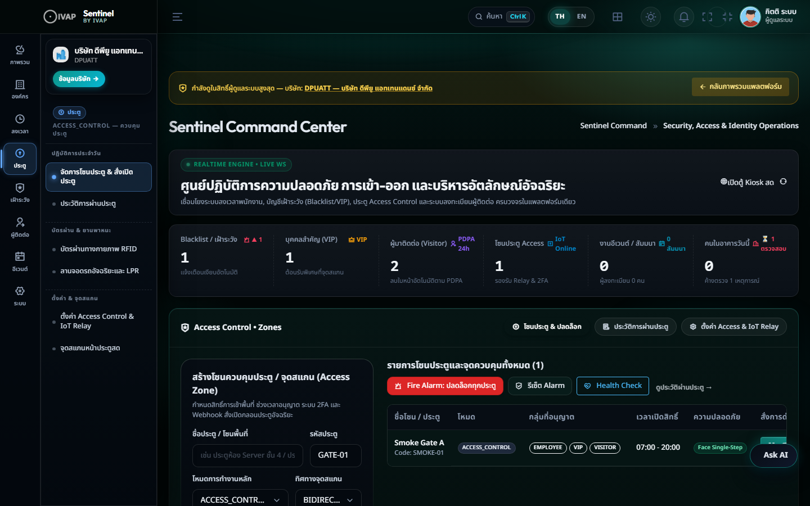

### 7.2 ประวัติการผ่านประตู (`/#/company/access-control/logs`)
- **หน้าที่:** ตรวจสอบเหตุการณ์การเปิดประตู การปฏิเสธสิทธิ์ และหลักฐานใบหน้าย้อนหลังแยกตามโซน

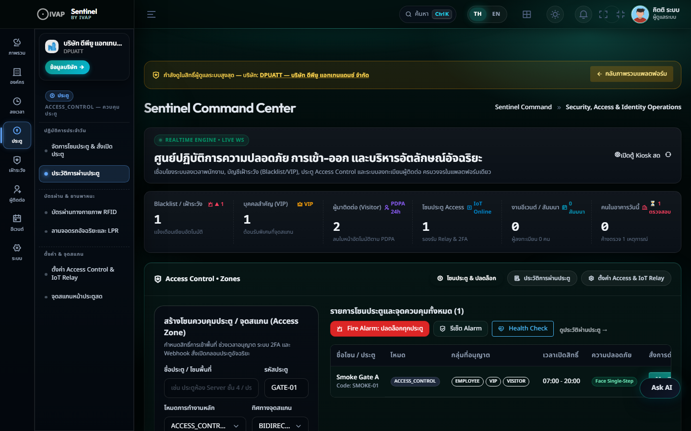

### 7.3 ศูนย์บริหารลานจอดรถอัจฉริยะและ LPR (`/#/company/parking`)
- **หน้าที่:** ติดตามความจุช่องจอดแบบเรียลไทม์, จัดการแผนผังช่องจอด (VIP / EV / Standard / Handicap), ทะเบียนยานพาหนะ/แบล็กลิสต์, ประวัติเข้า-ออกไม้กั้น และเครื่องมือจำลองสแกนป้ายทะเบียน LPR (ENTRY/EXIT)

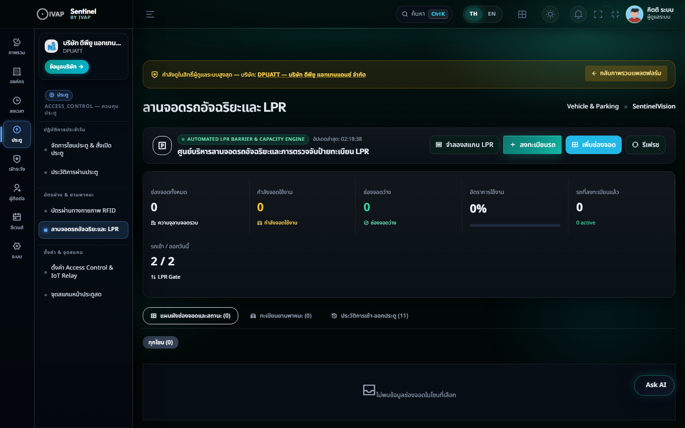

### 7.4 ศูนย์บริหารบัตรผ่านทางกายภาพ RFID (`/#/company/rfid-cards`)
- **หน้าที่:** ออกบัตร RFID (MIFARE 13.56 MHz / LF), ผูกตัวตนพนักงานหรือผู้มาติดต่อ, ระงับหรือแจ้งบัตรสูญหายทันที และทดสอบสิทธิ์ด้วย Swipe Simulator

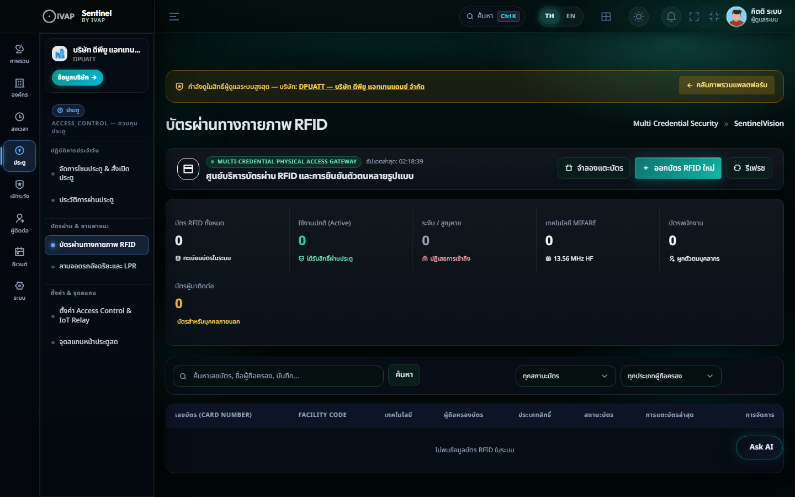

---

## Flow 8 — เฝ้าระวังบุคคล ผู้มาติดต่อ อีเวนต์ และการนับยอดฉุกเฉิน

### 8.1 เฝ้าระวัง Watchlist / Blacklist & VIP (`/#/company/watchlist/identities`)
- **หน้าที่:** ลงทะเบียนบุคคลเฝ้าระวัง (Blacklist / POI) และบุคคลสำคัญ (VIP) พร้อมระดับความรุนแรงและรูปใบหน้า เพื่อแจ้งเตือนศูนย์ รปภ. หรือขึ้นข้อความต้อนรับอัตโนมัติ

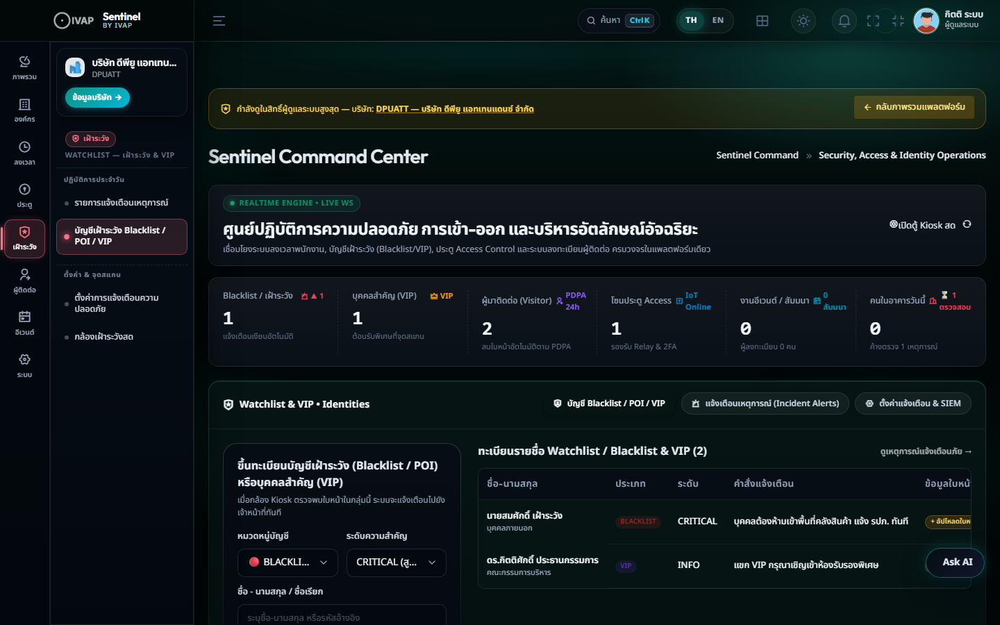

### 8.2 บัตรผู้มาติดต่อชั่วคราวตาม PDPA (`/#/company/visitors/passes`)
- **หน้าที่:** ออกบัตรผ่านใบหน้าชั่วคราว (Visitor Face Pass), สแกนบัตรด้วย OCR พร้อมปิดบังเลขบัตร (PII Masking), สร้างลิงก์ลงทะเบียนล่วงหน้า และกำหนดวันเวลาหมดอายุพร้อมลบข้อมูลใบหน้าอัตโนมัติ

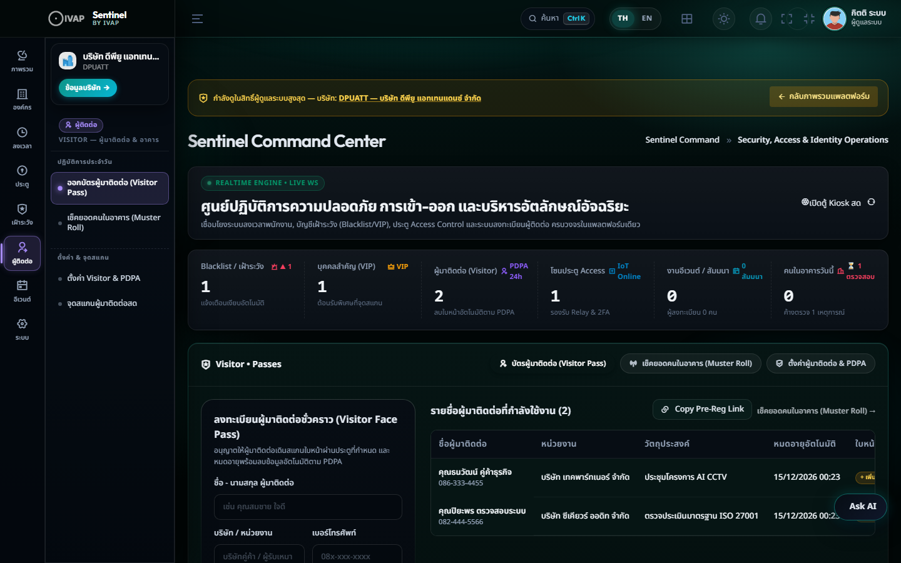

### 8.3 รายงานนับยอดคนในอาคารฉุกเฉิน (`/#/company/visitors/muster-roll`)
- **หน้าที่:** แสดงรายชื่อพนักงานและผู้มาติดต่อที่ยังอยู่ในอาคารแบบเรียลไทม์ แยกตามโซน/ชั้น เพื่อใช้ตรวจสอบความปลอดภัยและส่งออกให้ทีมกู้ภัยยามเกิดเหตุฉุกเฉิน

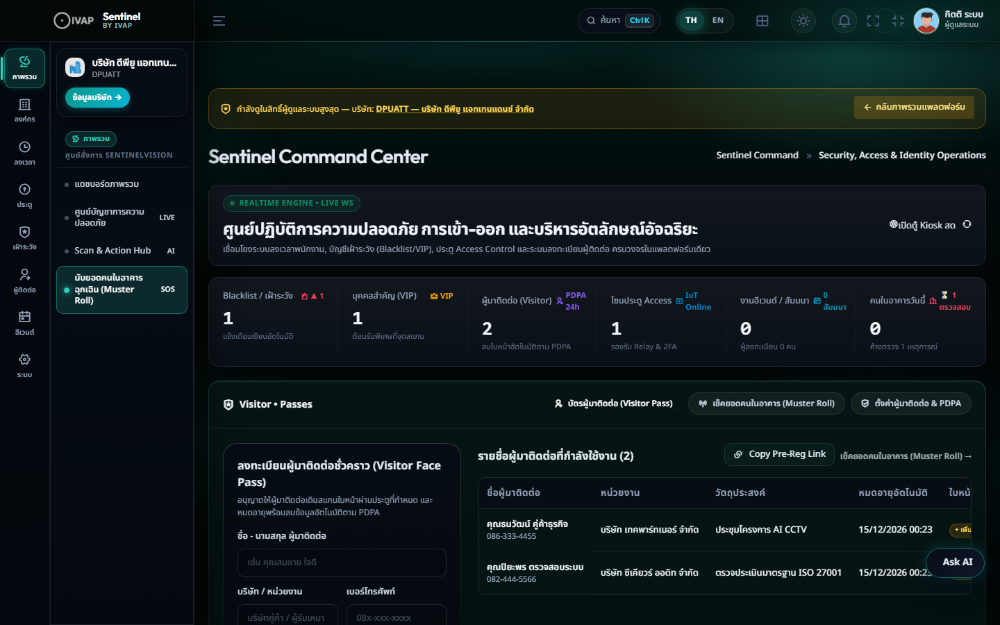

### 8.4 จัดการแคมเปญงานอีเวนต์และสัมมนา (`/#/company/events/campaigns`)
- **หน้าที่:** สร้างแคมเปญงานอีเวนต์ ลงทะเบียนผู้เข้าร่วมพร้อมรูปใบหน้า กำหนดเลขที่นั่ง ข้อความต้อนรับ และติดตามอัตราการเช็กอินรวมถึงวิเคราะห์เวลาแวะบูธ (Booth Dwell Analytics)

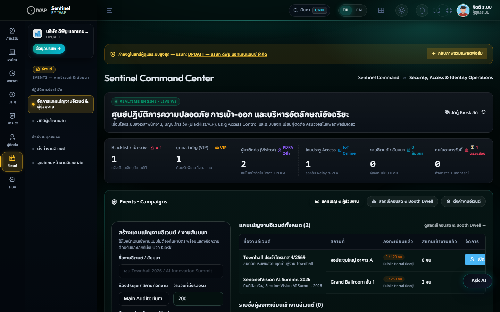

---

## Flow 9 — กล้องวงจรปิด CCTV, Live Wall, Playback, E-Map และ Spatial AI

### 9.1 ทะเบียนกล้องวงจรปิด CCTV (`/#/company/cameras`)
- **หน้าที่:** เพิ่มและจัดการกล้อง RTSP/ONVIF เชื่อมต่อ MediaMTX เปิด-ปิด AI วิเคราะห์บุคคล ตรวจสถานะออนไลน์ และควบคุมทิศทางกล้อง PTZ

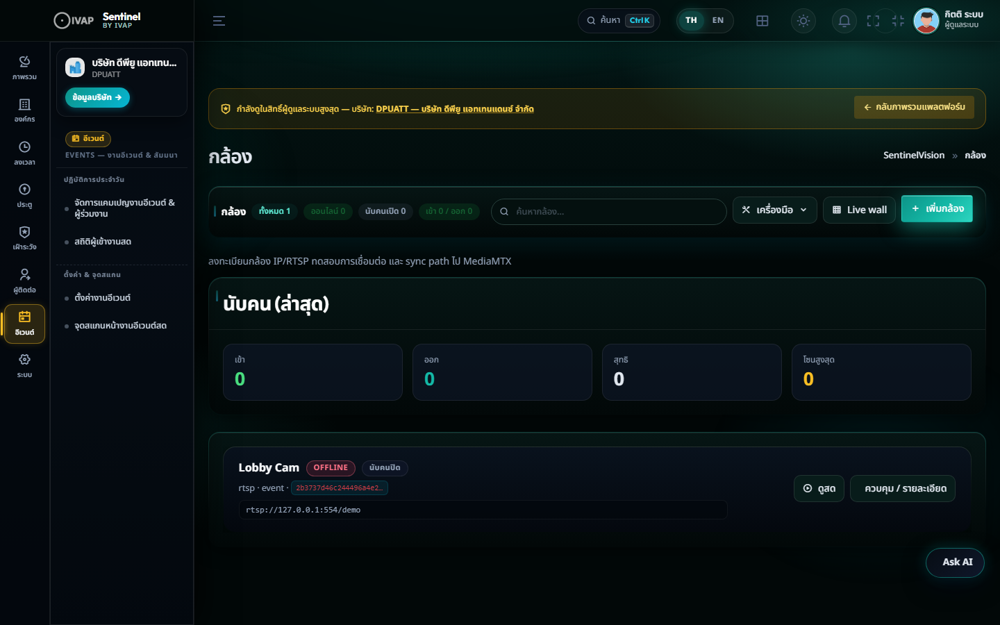

### 9.2 ผนังภาพสด Live Wall (`/#/company/live-wall`)
- **หน้าที่:** รับชมสตรีมภาพสด WebRTC (WHEP) จากกล้องหลายตัวพร้อมกันในหน้าจอเดียว

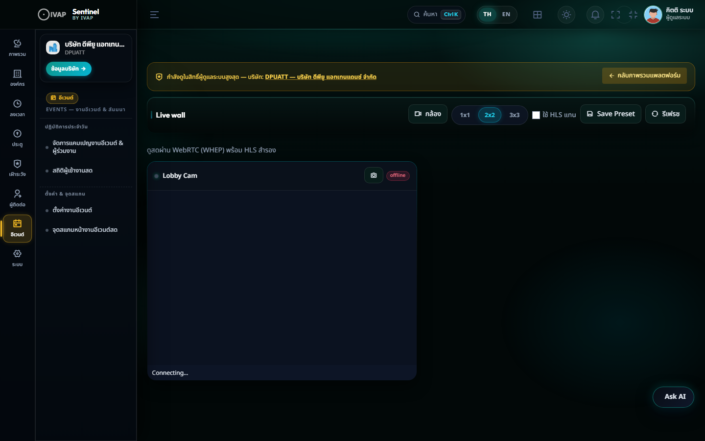

### 9.3 ดูวิดีโอย้อนหลังและคลิปเหตุการณ์ (`/#/company/playback`)
- **หน้าที่:** ค้นหาและเล่นซ้ำคลิปเหตุการณ์ความปลอดภัยพร้อม Event Markers ตามช่วงเวลา

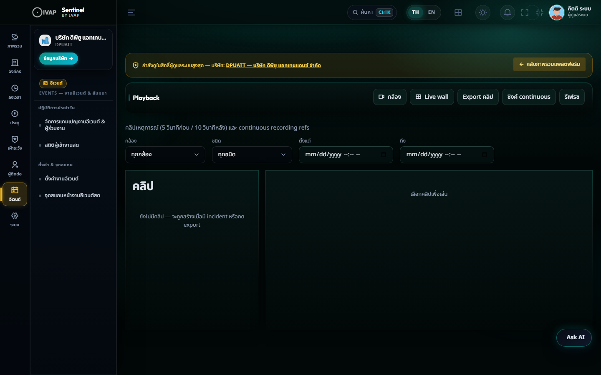

### 9.4 วิเคราะห์ใบหน้าจากกล้อง (`/#/company/face-monitor`)
- **หน้าที่:** ติดตามผลการตรวจจับและระบุตัวตนจากกล้องวงจรปิดแบบต่อเนื่องพร้อมความแม่นยำและเวลาที่พบ

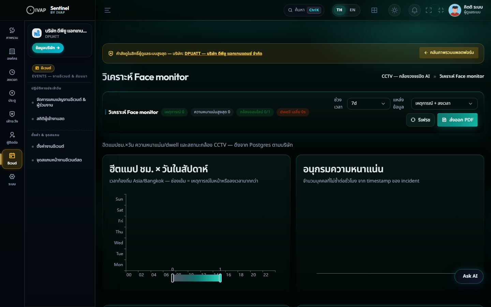

### 9.5 แผนที่ชั้นและตำแหน่งกล้อง/ประตู (`/#/company/e-map`)
- **หน้าที่:** อัปโหลดผังอาคารแต่ละชั้น ปักหมุดตำแหน่งกล้องและจุดควบคุมประตู เพื่อดูตำแหน่งเกิดเหตุบนแผนที่ได้ทันที

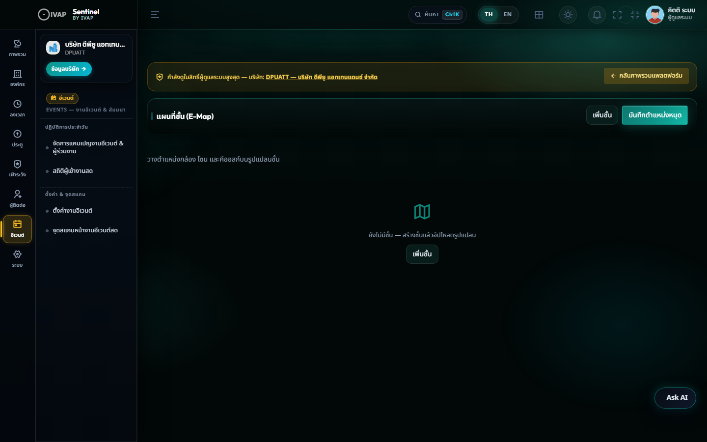

### 9.6 ค้นหาพนักงานจากกล้องและหลักฐาน OT (`/#/company/presence`)
- **หน้าที่:** ค้นหาตำแหน่งล่าสุดของพนักงาน วิเคราะห์ความหนาแน่นรายชั่วโมง และเปรียบเทียบหลักฐานการอยู่ในพื้นที่จริงกับเวลา OT

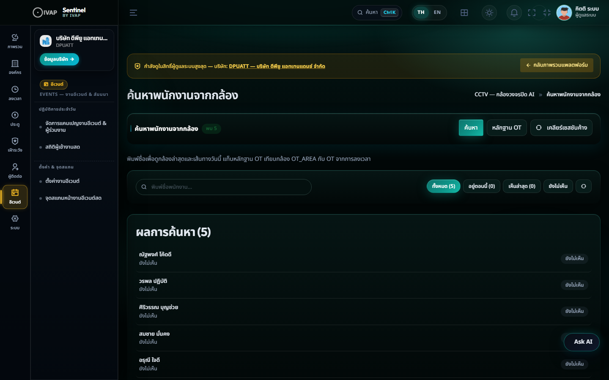

---

## Flow 10 — กำกับดูแล สุขภาพอุปกรณ์ การแจ้งเตือน และตั้งค่าสิทธิ์

### 10.1 ศูนย์ตรวจวัดสุขภาพอุปกรณ์และ Edge Telemetry (`/#/company/fleet-health`)
- **หน้าที่:** แสดงดัชนีความพร้อมรวม (Readiness Index), จำนวน Kiosk ออนไลน์/ออฟไลน์, กล้อง CCTV, โซนประตู, สถานะระบบ AI และสัญญาณ Heartbeat ล่าสุดของทุกอุปกรณ์

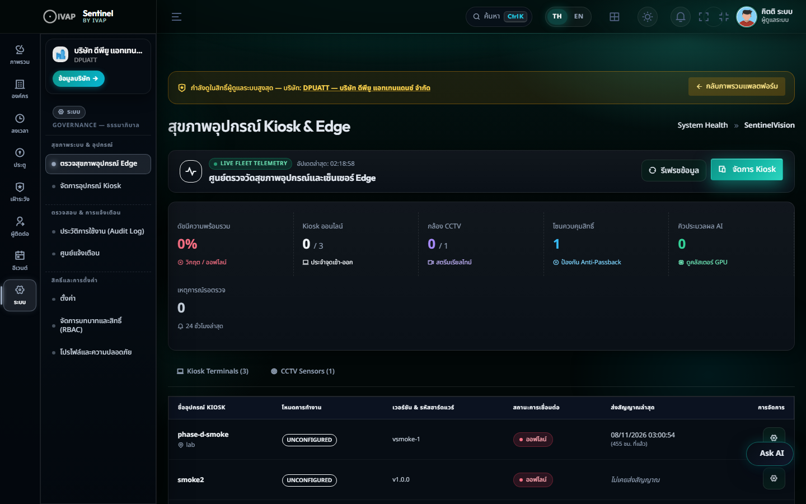

### 10.2 จัดการอุปกรณ์ Kiosk และออกรหัสจับคู่ (`/#/company/devices`)
- **หน้าที่:** ลงทะเบียนอุปกรณ์ Kiosk, กดสร้าง **One-Time Pairing Code** 6 หลัก, กำหนด Station Mode และเพิกถอนอุปกรณ์ที่เลิกใช้งาน

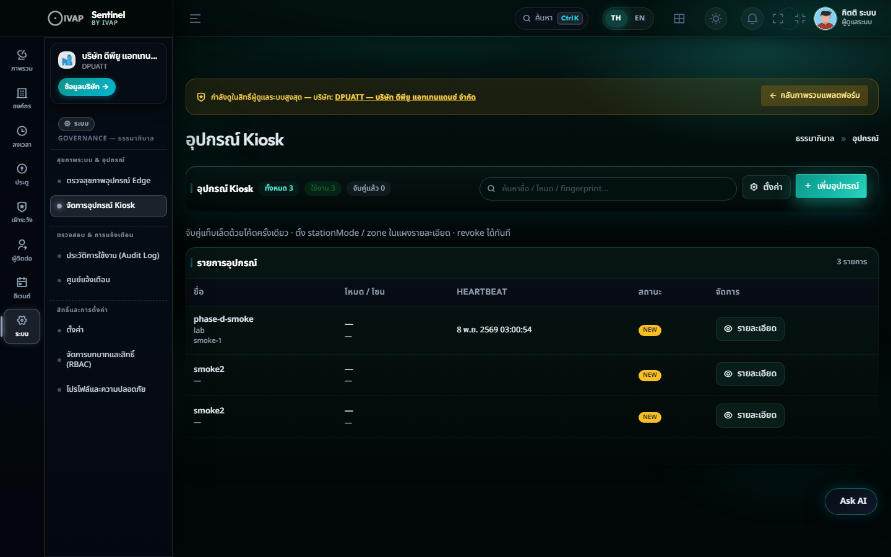

### 10.3 บันทึกการตรวจสอบย้อนหลัง (`/#/company/audit-log`)
- **หน้าที่:** ตรวจสอบ Audit Trail ทุกการเปลี่ยนแปลงในระบบ (ผู้ดำเนินการ, เวลา, เหตุการณ์, รายละเอียด) พร้อมค้นหาและส่งออกเพื่อการตรวจสอบมาตรฐานองค์กร

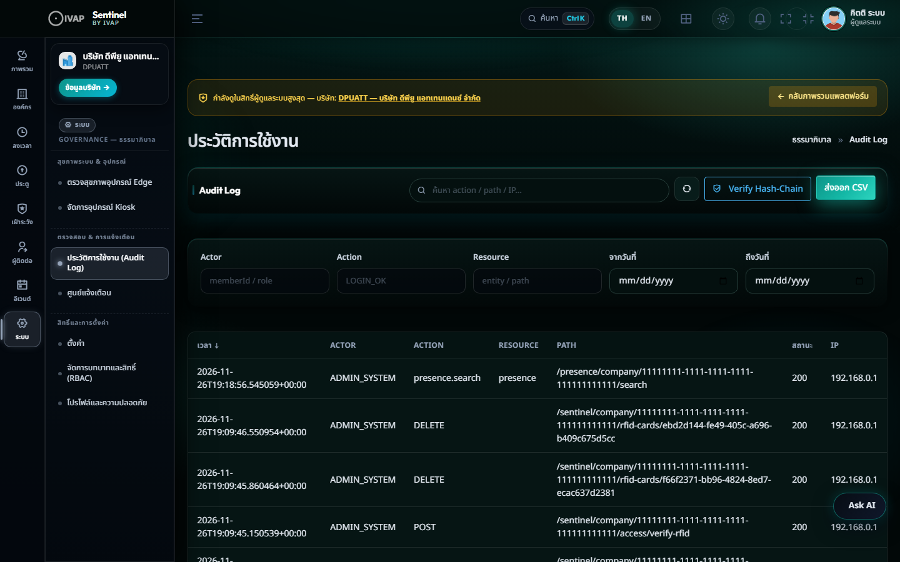

### 10.4 ศูนย์แจ้งเตือนและเทมเพลตข้อความ (`/#/company/notification-center`)
- **หน้าที่:** ตรวจดู Inbox ในแอป, คิวส่งไม่สำเร็จ (Dead-letter), ประวัติการนำส่ง, ตั้งค่าช่องทางส่วนตัว และแก้ไข/พรีวิว Notification Templates (LINE, Webhook, Email, In-app)

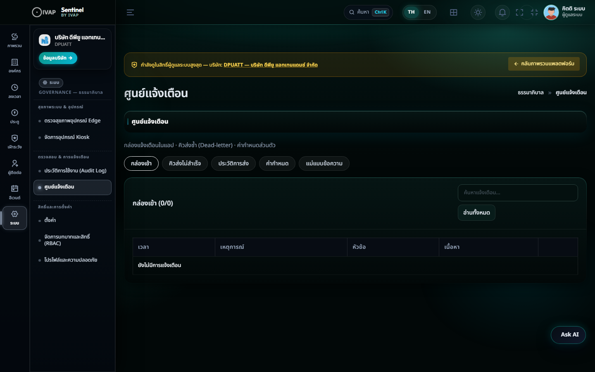

### 10.5 ศูนย์ตั้งค่าและสิทธิ์ RBAC ของบริษัท (`/#/company/settings/rbac`)
- **หน้าที่:** บริหารบทบาทและสิทธิ์ระดับบริษัท (Company Tenant RBAC แยกขาดจาก System Admin), ตั้งค่า Webhook/LINE, โควตา, API Keys และ SCIM/SSO

### 10.6 โปรไฟล์และความปลอดภัยบัญชี (`/#/company/profile-security`)
- **หน้าที่:** เปลี่ยนรหัสผ่าน, เปิดใช้งาน **2FA TOTP (Authenticator App)** พร้อมรหัสสำรอง, และตรวจสอบหรือเพิกถอน Session ที่ล็อกอินค้างอยู่

